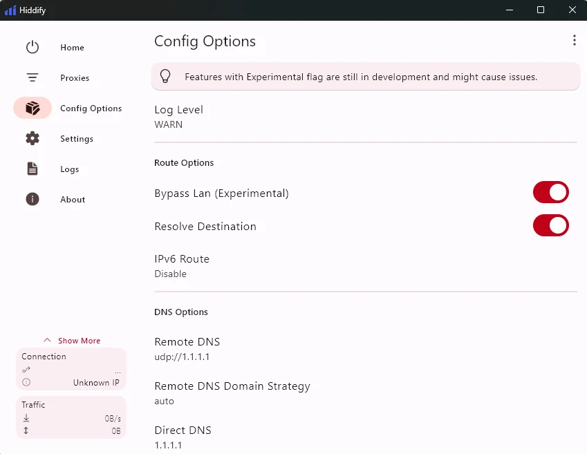

# Hiddify Next 0.12–0.13: TLS Tricks, Android TV and LAN sharing

<!-- made by .cache/blog/history_gen.py -->

!!! abstract "In 30 seconds"
    Hiddify Next **0.12** came out on 20 December 2023 with **TLS Tricks**: it cuts and mixes the start of the TLS
    connection so that even a filtered domain may get through. It also works with an **Android TV** remote.
    **0.13** (January 2024) added **LAN sharing**.

<!-- more -->

## What was new

- **TLS Tricks** (experimental): TLS fragment and mixed-case SNI.
- **Android TV:** move around with the remote's D-pad.
- **A notification** with the profile name and speed on Android.
- **BeePass** support.
- **Bypass LAN** and **sharing the VPN on your network** (0.13).
- **Ctrl+V** adds a profile from the clipboard on desktop, update all subscriptions at once (0.13).
- **Afghanistan region** (0.12.3).

## Today

The Hiddify app is at version 5 now, with free profiles, Chain and connection sharing. Download the latest version.

<a class="hi-cta" href="/app/How-to-install-Hiddify-app/">Download the Hiddify app</a>

??? note "For experts"
    - 0.13.6 (7 January 2024) was the first stable 0.13; it also added a DNS routing option and basic auth for subscription URLs.
    - Sources: [0.12.0 release](https://github.com/hiddify/hiddify-app/releases/tag/v0.12.0), [CHANGELOG](https://github.com/hiddify/hiddify-app/blob/main/CHANGELOG.md)

## Related articles

- [Hiddify Next 0.11: VPN, system proxy or proxy only](Hiddify-Next-v0-11-is-released.md)
- [Hiddify Next 0.14–0.16: iOS beta, WARP and the Microsoft Store](Hiddify-Next-iOS-beta-and-WARP.md)
- [DNS and TLS tricks in the Hiddify app](/app/DNS-and-TLS-tricks-in-Hiddify-app/)
- [Hiddify app 5 is out](Hiddify-app-v5-is-released.md)
