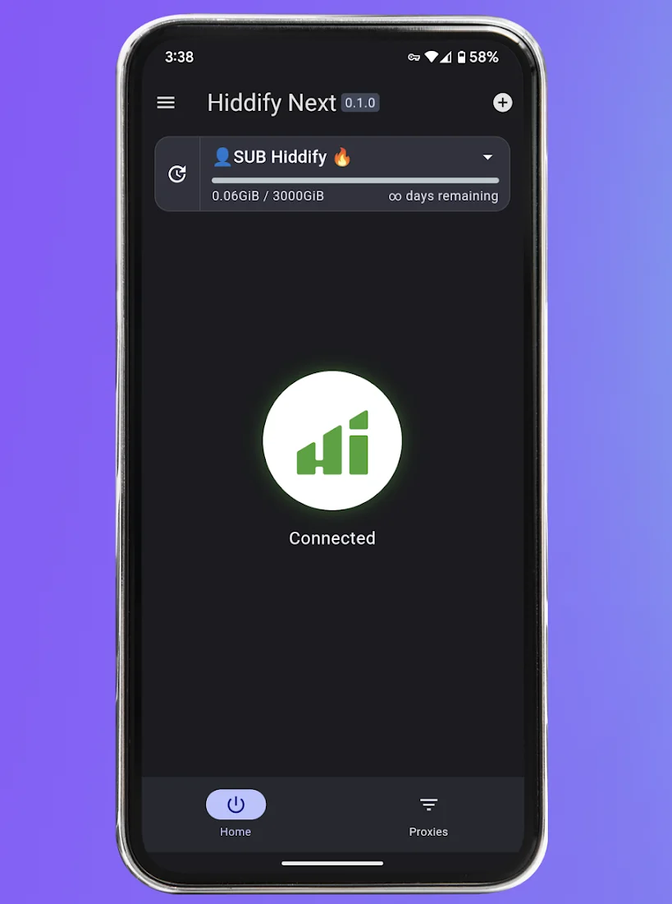

# Hiddify Next 0.8–0.10: Hysteria2, SSH, ECH and Google Play

<!-- made by .cache/blog/history_gen.py -->

!!! abstract "In 30 seconds"
    Hiddify Next **0.8** came out on 5 October 2023 with **Hysteria2** and **SSH** links and **ECH**. A few days
    later the app was on **Google Play**, and **0.10** (27 October) added routing rules for your **region**, so
    local sites skip the proxy.

<!-- more -->

## What was new

- **Hysteria2** and **SSH** links, and more Trojan configs.
- **ECH** for proxies behind Cloudflare (`&ech=1` at the end of a link).
- **Google Play:** install and update the app from the store.
- **Region rules** (0.10): sites of Iran, China or Russia go direct, everything else through the proxy.
- **A redesigned logs page** with pause and clear, and colours for the delay of each proxy (0.10).
- **Memory limit option** for low-memory phones (0.10).
- **More languages:** Russian, Chinese and French.

## Today

The Hiddify app is at version 5 now, with free profiles, Chain and connection sharing. Download the latest version.

<a class="hi-cta" href="/app/How-to-install-Hiddify-app/">Download the Hiddify app</a>

??? note "For experts"
    - 0.9 (13 October) updated the core and fixed Android 14; 0.10 included the first iOS code (PR #98).
    - Sources: [0.8.0 release](https://github.com/hiddify/hiddify-app/releases/tag/v0.8.0), [0.10.0 release](https://github.com/hiddify/hiddify-app/releases/tag/v0.10.0), [Google Play](https://github.com/hiddify/hiddify-app/commit/dcdcf1f1)

## Related articles

- [Hiddify Next 0.1: the first version of the Hiddify app](Hiddify-Next-v0-1-is-released.md)
- [Hiddify Next 0.11: VPN, system proxy or proxy only](Hiddify-Next-v0-11-is-released.md)
- [Hiddify app 5 is out](Hiddify-app-v5-is-released.md)
