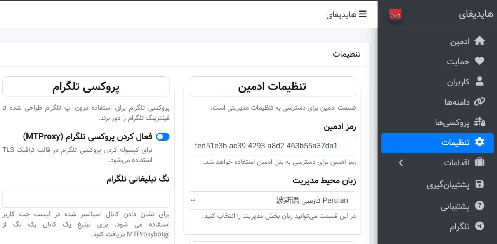
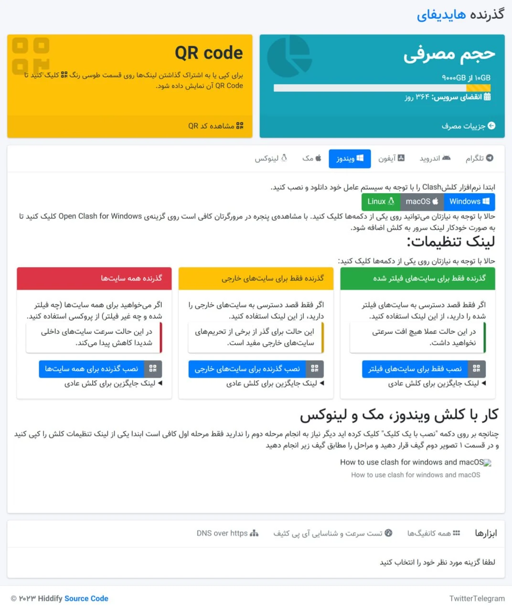

# هیدیفای‌منیجر ۱: چند کاربر، چند دامنه

<!-- made by .cache/blog/history_gen.py -->

!!! abstract "در ۳۰ ثانیه"
    اولین نسخهٔ پایدار، **هیدیفای‌منیجر ۱.۰**، در ۹ اسفند ۱۴۰۱ همراه اولین بستهٔ شماره‌دار سرور (Hiddify Config ۷.۰) منتشر شد. یک
    سرور حالا می‌توانست **چند کاربر روی چند دامنه** را سرویس بدهد، با **TUIC** و **ShadowTLS**، یک **ربات تلگرام**
    برای ادمین‌ها، و **مصرف و روزهای باقی‌ماندهٔ** هر کاربر در لینک اشتراکش.

<!-- more -->

## چه چیزهایی تازه بود

- **چند کاربر و چند دامنه** روی یک سرور، با دامنهٔ پیش‌فرض والد و پنجرهٔ راه‌اندازی سریع دامنه.
- **TUIC** («سریع‌ترین پروتکل با کمترین تأخیر») و **ShadowTLS** (۱.۱).
- **انتخاب پروکسی برای هر دامنه**، و نام (alias) و توضیح برای هر دامنه (۱.۱).
- **پروفایل Clash برای هر دامنه:** کاربر پروکسی‌های یک دامنه، یا گروه پشت‌سرهم، توزیع بار یا خودکار را انتخاب می‌کند (۱.۱).
- **ربات تلگرام** برای ادمین‌ها، و بعد فرمانی برای ساختن چند حساب با هم (۱.۱ تا ۱.۶).
- **مصرف و روزهای باقی‌مانده** در لینک اشتراک (۱.۲) و صفحهٔ کاربر (۱.۴)؛ روزهای کاربر از اولین اتصال شروع می‌شود.
- **غیرفعال کردن کاربر**، بازنشانی بستهٔ کاربر (۱.۳) و حذف چند کاربر با هم (۱.۵).
- **مسیرهای تصادفی پروکسی** که می‌شود عوضشان کرد، برای امنیت بیشتر (۱.۵)؛ لینک v2rayNG برای اندروید (۱.۲).

## امروز

هیدیفای‌منیجر حالا در نسخهٔ ۱۴ است. آخرین نسخه را نصب کنید، یا نسخهٔ خودتان را از پنل به‌روزرسانی کنید (اول یک [پشتیبان](/fa/manager/configuration-and-advanced-settings/How-to-backup-and-restore-panel-on-Hiddify/) بگیرید).

<a class="hi-cta" href="/fa/manager/installation-and-setup/guide/">نصب هیدیفای‌منیجر</a>

??? note "برای کاربران حرفه‌ای"
    - تا اسفند ۱۴۰۲ پنل شمارهٔ نسخهٔ خودش را داشت و بستهٔ سرور (که آن موقع Hiddify Config نام داشت) شمارهٔ دیگری: هیدیفای‌منیجر ۱ همراه بستهٔ ۷.۰ آمد. از ۱۰.۱۰ هر دو یک شماره دارند.
    - بستهٔ سرور ۷.x این‌ها را آورد: منوی متنی روی سرور، Let's Encrypt به‌طور پیش‌فرض (و ZeroSSL اگر نشد)، HAProxy در جلو، و پشتیبان خودکار پنل هر ۶ ساعت.
    - منبع‌ها: [panel HISTORY 1.x](https://github.com/hiddify/hiddifypanel/blob/main/HISTORY.md)، [package 7.0.0](https://github.com/hiddify/Hiddify-Manager/releases/tag/v7.0.0)

## مقاله‌های مرتبط

- [هیدیفای‌منیجر چطور شروع شد: Hiddify Config و اولین پنل](Hiddify-Config-the-first-panel.md)
- [هیدیفای‌منیجر ۲: اپ روی گوشی، کلودفلر و AutoCDN](Hiddify-Panel-v2.md)
- [هیدیفای‌منیجر ۱۴ منتشر شد](Hiddify-Manager-v14-is-released.md)
