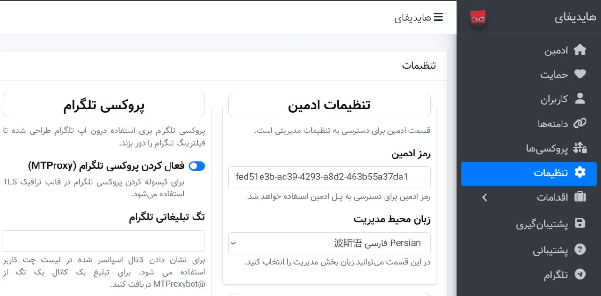
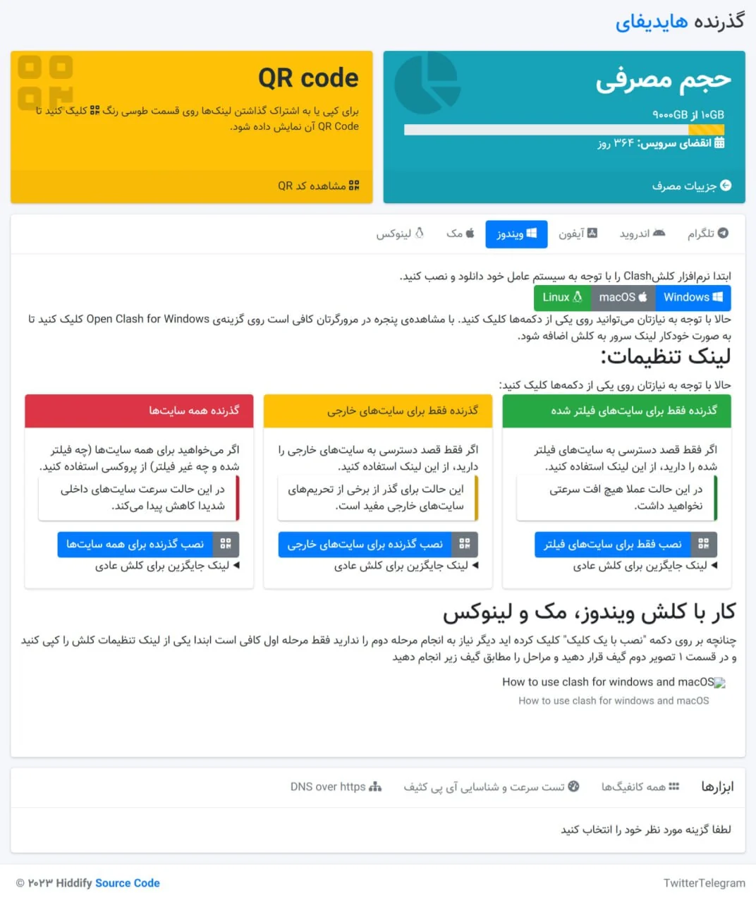

# Hiddify panel 1: many users, many domains

<!-- made by .cache/blog/history_gen.py -->

!!! abstract "In 30 seconds"
    The first stable **Hiddify panel 1.0** came out on 28 February 2023, together with the first numbered server
    package (7.0). One server could now serve **many users on many domains**, with **TUIC** and **ShadowTLS**, a
    **Telegram bot** for admins, and each user's **usage and days left** in their subscription link.

<!-- more -->

## What was new

- **Many users and many domains** on one server, with a default parent domain and a quick-setup window for domains.
- **TUIC** ("the fastest protocol with the lowest latency") and **ShadowTLS** (1.1).
- **Choose proxies per domain**, and give each domain a name (alias) and a description (1.1).
- **Clash profile per domain:** users pick one domain's proxies, or a sequential, load-balance or automatic group (1.1).
- **Telegram bot** for admins, then a command to create many accounts (1.1–1.6).
- **Usage and days left** in the subscription link (1.2) and on the user page (1.4); a user's days start at the first connection.
- **Turn users off**, reset a user's package (1.3), and delete many users at once (1.5).
- **Random proxy paths**, which you can change, for more security (1.5); v2rayNG links for Android (1.2).

## Today

Hiddify Manager is at version 14 now. Install the latest version, or update yours from the panel (take a [backup](/manager/configuration-and-advanced-settings/How-to-backup-and-restore-panel-on-Hiddify/) first).

<a class="hi-cta" href="/manager/installation-and-setup/guide/">Install Hiddify Manager</a>

??? note "For experts"
    - Until March 2024 the panel had its own version numbers, and the server package (then called Hiddify Config) had others: panel 1 shipped with package 7.0. Since 10.10 both share one number.
    - Server package 7.x added: a text menu on the server, Let's Encrypt by default (ZeroSSL as fallback), HAProxy in front, and automatic panel backups every 6 hours.
    - Sources: [panel HISTORY 1.x](https://github.com/hiddify/hiddifypanel/blob/main/HISTORY.md), [package 7.0.0](https://github.com/hiddify/Hiddify-Manager/releases/tag/v7.0.0)

## Related articles

- [How Hiddify Manager began: Hiddify Config and its first panel](Hiddify-Config-the-first-panel.md)
- [Hiddify panel 2: an app on your phone, Cloudflare and AutoCDN](Hiddify-Panel-v2.md)
- [Hiddify Manager 14 is out](Hiddify-Manager-v14-is-released.md)
