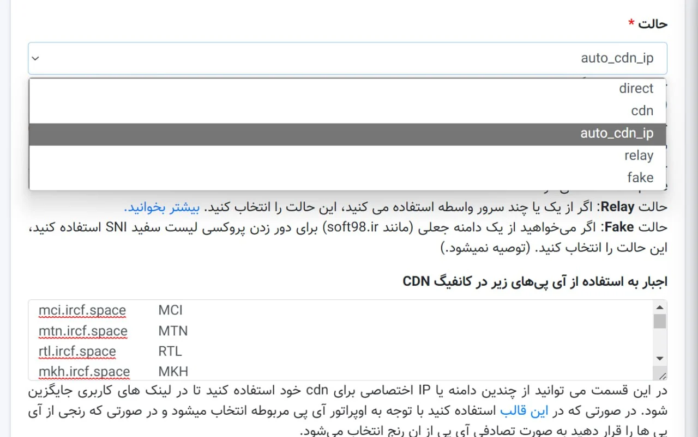

# هیدیفای‌منیجر ۲: اپ روی گوشی، کلودفلر و AutoCDN

<!-- made by .cache/blog/history_gen.py -->

!!! abstract "در ۳۰ ثانیه"
    **هیدیفای‌منیجر ۲** (منتشرشده به نام ۲.۹ در ۱۰ فروردین ۱۴۰۲) **مثل یک اپ** روی گوشی نصب می‌شود، دامنه‌های شما را
    خودش در **کلودفلر** می‌سازد، و به هر کاربر **IP تمیز CDN مناسب اپراتور او** را می‌دهد. **HTTP/2** و **چند
    پورت** را هم آورد.

<!-- more -->

## چه چیزهایی تازه بود

- **پنل به شکل اپ (PWA):** آن را روی گوشی نصب کنید، با صفحهٔ آغاز.
- **API کلودفلر:** کلید کلودفلر را وارد کنید تا پنل دامنه‌ها را بسازد یا به‌روز کند.
- **IP تمیز بر اساس اپراتور:** لینک اشتراک IPهای CDN مناسب اپراتور کاربر را انتخاب می‌کند (مثلاً آسیاتک).
- پروتکل‌های **HTTP/2 (h2)** و رمزگذاری VMess برای پنهان کردن بهتر ترافیک.
- **چند پورت** برای هر کانفیگ؛ حالا می‌شود پورت ۸۰ و ۴۴۳ را برداشت.
- **تغییر نام پروکسی‌ها** و انتخاب fingerprint برای TLS (iOS، Edge، تصادفی و…).
- **راه‌اندازی دوباره از پنل**، زمان‌سنج هنگام اعمال تنظیمات، و خبر دادن وقتی پنل قدیمی است.
- **پنهان از موتورهای جستجو و ربات‌ها.**

## امروز

هیدیفای‌منیجر حالا در نسخهٔ ۱۴ است. آخرین نسخه را نصب کنید، یا نسخهٔ خودتان را از پنل به‌روزرسانی کنید (اول یک [پشتیبان](/fa/manager/configuration-and-advanced-settings/How-to-backup-and-restore-panel-on-Hiddify/) بگیرید).

<a class="hi-cta" href="/fa/manager/installation-and-setup/guide/">نصب هیدیفای‌منیجر</a>

??? note "برای کاربران حرفه‌ای"
    - تا اسفند ۱۴۰۲ پنل شمارهٔ نسخهٔ خودش را داشت و بستهٔ سرور (که آن موقع Hiddify Config نام داشت) شمارهٔ دیگری: هیدیفای‌منیجر ۲ همراه بستهٔ ۸.۰–۸.۳ آمد. از ۱۰.۱۰ هر دو یک شماره دارند.
    - تاریخچهٔ پنل همهٔ نسخه‌های ۲.x را زیر یک عنوان آورده (۲.۹.۰، ۱۰ فروردین ۱۴۰۲)؛ کار پیش از نوروز شروع شده بود.
    - در همین روزها توسعه‌دهندگان Xray پنل را به فهرست وب‌پنل‌های خود اضافه کردند.
    - منبع‌ها: [panel HISTORY 2.9.0](https://github.com/hiddify/hiddifypanel/blob/main/HISTORY.md)، [package 8.0.0](https://github.com/hiddify/Hiddify-Manager/releases/tag/v8.0.0)

## مقاله‌های مرتبط

- [هیدیفای‌منیجر ۱: چند کاربر، چند دامنه](Hiddify-Panel-v1.md)
- [هیدیفای‌منیجر ۳: ظاهر تازه و حالت تیره](Hiddify-Panel-v3.md)
- [هیدیفای‌منیجر ۱۴ منتشر شد](Hiddify-Manager-v14-is-released.md)
