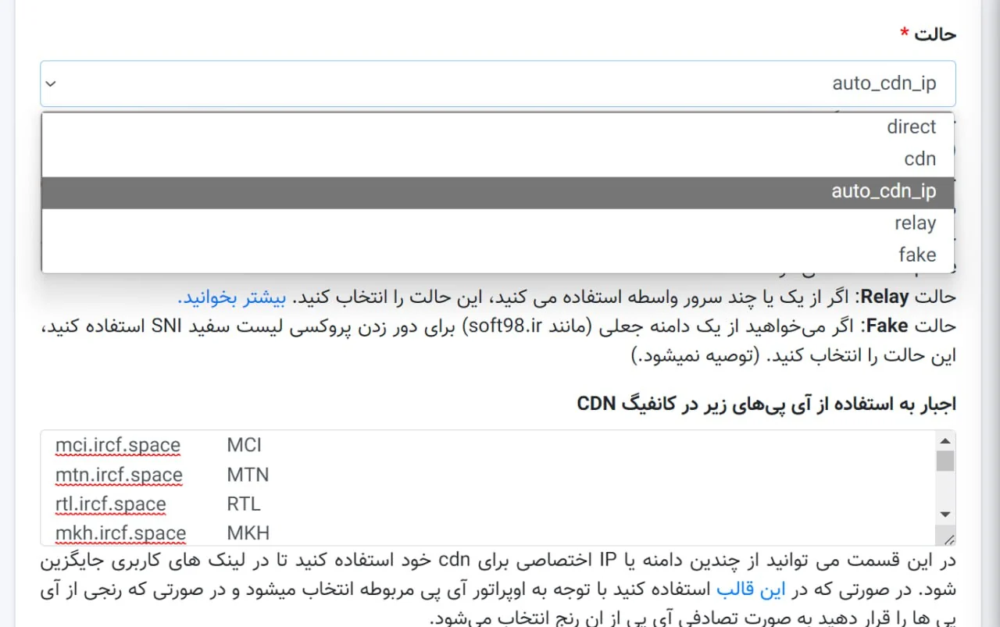

# Hiddify Manager 2: an app on your phone, Cloudflare and AutoCDN

<!-- made by .cache/blog/history_gen.py -->

!!! abstract "In 30 seconds"
    **Hiddify Manager 2** (published as 2.9 on 30 March 2023) can be **installed like an app** on your phone,
    creates your domains in **Cloudflare** by itself, and gives each user **clean CDN IPs for their mobile
    operator**. It also added **HTTP/2** and **many ports**.

<!-- more -->

## What was new

- **The panel as an app (PWA):** install it on your phone, with a splash screen.
- **Cloudflare API:** add your Cloudflare key and the panel creates or updates your domains.
- **Clean IPs by operator:** the subscription link picks CDN IPs that work on the user's operator (for example Asiatech).
- **HTTP/2 (h2)** protocols, and VMess encryption to hide traffic better.
- **Many ports** for every config; ports 80 and 443 can now be removed.
- **Rename proxies** and choose the TLS fingerprint (iOS, Edge, random…).
- **Restart from the panel**, a timer while settings apply, and a notice when the panel is out of date.
- **Hidden from search engines and bots.**

## Today

Hiddify Manager is at version 14 now. Install the latest version, or update yours from the panel (take a [backup](/manager/configuration-and-advanced-settings/How-to-backup-and-restore-panel-on-Hiddify/) first).

<a class="hi-cta" href="/manager/installation-and-setup/guide/">Install Hiddify Manager</a>

??? note "For experts"
    - Until March 2024 the panel had its own version numbers, and the server package (then called Hiddify Config) had others: Hiddify Manager 2 shipped with package 8.0–8.3. Since 10.10 both share one number.
    - Panel HISTORY keeps the whole 2.x line under one heading (2.9.0, 30 March 2023); work started before Nowruz.
    - In the same days the Xray developers added the panel to their list of web panels.
    - Sources: [panel HISTORY 2.9.0](https://github.com/hiddify/hiddifypanel/blob/main/HISTORY.md), [package 8.0.0](https://github.com/hiddify/Hiddify-Manager/releases/tag/v8.0.0)

## Related articles

- [Hiddify Manager 1: many users, many domains](Hiddify-Panel-v1.md)
- [Hiddify Manager 3: a new look and dark mode](Hiddify-Panel-v3.md)
- [Hiddify Manager 14 is out](Hiddify-Manager-v14-is-released.md)
