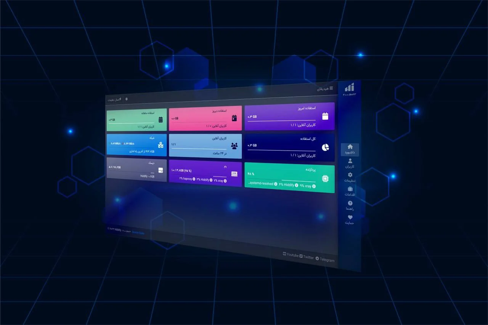

# پنل هیدیفای ۳: ظاهر تازه و حالت تیره

<!-- made by .cache/blog/history_gen.py -->

!!! abstract "در ۳۰ ثانیه"
    **پنل هیدیفای ۳** در ۲۰ فروردین ۱۴۰۲ با تمرکز بر پایداری، سادگی و زیبایی منتشر شد. همهٔ صفحه‌ها از نو طراحی
    شدند، با **حالت تیره**، **داشبورد تازه** و **جستجو در تنظیمات**.

<!-- more -->

## چه چیزهایی تازه بود

- **حالت تیره**، که از روی دستگاه شما هم خودکار انتخاب می‌شود.
- **نوار کناری تازه**، روی صفحه‌های کوچک هم.
- **داشبورد تازه:** پروسه‌ها، سرعت شبکه، مصرف روزانه، هفتگی و ماهانه، آخرین استفاده و روزهای باقی‌مانده.
- **جستجو در تنظیمات**، حتی با کلمه‌های انگلیسی در پنل فارسی.
- **دامنه‌های wildcard (*)**.
- **تاریخچهٔ مصرف داخلی** به جای Netdata، و کاشی‌هایی که خودشان به‌روز می‌شوند.
- **IP تمیز از IRCF** (۳.۱)، و اپراتورهای بیشتر مثل شاتل.
- **تأیید پیش از انجام کارها** (۳.۱.۱۰).

## امروز

هیدیفای‌منیجر حالا در نسخهٔ ۱۴ است. آخرین نسخه را نصب کنید، یا نسخهٔ خودتان را از پنل به‌روزرسانی کنید (اول یک [پشتیبان](/fa/manager/configuration-and-advanced-settings/How-to-backup-and-restore-panel-on-Hiddify/) بگیرید).

<a class="hi-cta" href="/fa/manager/installation-and-setup/guide/">نصب هیدیفای‌منیجر</a>

??? note "برای کاربران حرفه‌ای"
    - تا اسفند ۱۴۰۲ پنل شمارهٔ نسخهٔ خودش را داشت و بستهٔ سرور (که آن موقع Hiddify Config نام داشت) شمارهٔ دیگری: پنل ۳ همراه بستهٔ ۸.۵–۸.۶ آمد. از ۱۰.۱۰ هر دو یک شماره دارند.
    - وقتی بستهٔ کاربر تمام شود، لینک اشتراکش خودبه‌خود از کار می‌افتد.
    - منبع‌ها: [panel HISTORY 3.0.0](https://github.com/hiddify/hiddifypanel/blob/main/HISTORY.md)

## مقاله‌های مرتبط

- [پنل هیدیفای ۲: اپ روی گوشی، کلودفلر و AutoCDN](Hiddify-Panel-v2.md)
- [پنل هیدیفای ۴: ریالتی و ادمین‌های چندسطحی](Hiddify-Panel-v4.md)
- [هیدیفای‌منیجر ۱۴ منتشر شد](Hiddify-Manager-v14-is-released.md)
