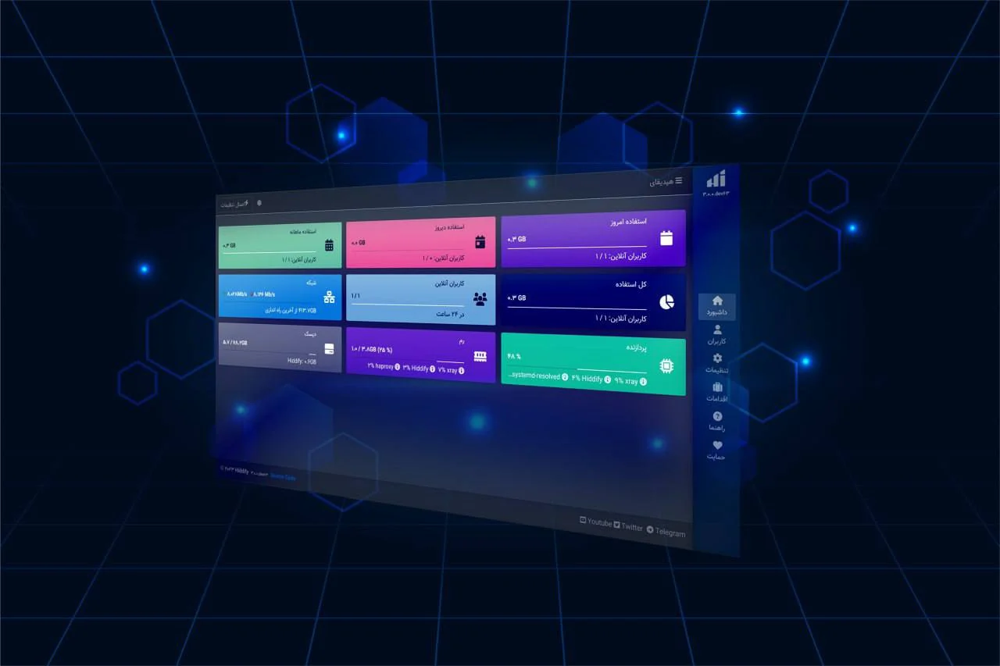

# Hiddify Manager 3: a new look and dark mode

<!-- made by .cache/blog/history_gen.py -->

!!! abstract "In 30 seconds"
    **Hiddify Manager 3** came out on 9 April 2023, focused on stability, simplicity and beauty. Every page was
    redesigned, with **dark mode**, a **new dashboard** and **search in the settings**.

<!-- more -->

## What was new

- **Dark mode**, also chosen automatically from your device.
- **A new sidebar**, also on small screens.
- **A new dashboard:** processes, network speed, daily, weekly and monthly usage, last use and days left.
- **Search in the settings**, even with English words in the Persian panel.
- **Wildcard (*) domains.**
- **Built-in usage history** instead of Netdata, and tiles that update themselves.
- **Clean IPs from IRCF** (3.1), and more operators such as Shatel.
- **Confirm before actions** (3.1.10).

## Today

Hiddify Manager is at version 14 now. Install the latest version, or update yours from the panel (take a [backup](/manager/configuration-and-advanced-settings/How-to-backup-and-restore-panel-on-Hiddify/) first).

<a class="hi-cta" href="/manager/installation-and-setup/guide/">Install Hiddify Manager</a>

??? note "For experts"
    - Until March 2024 the panel had its own version numbers, and the server package (then called Hiddify Config) had others: Hiddify Manager 3 shipped with package 8.5–8.6. Since 10.10 both share one number.
    - Sub links stop working by themselves when a user's package ends.
    - Sources: [panel HISTORY 3.0.0](https://github.com/hiddify/hiddifypanel/blob/main/HISTORY.md)

## Related articles

- [Hiddify Manager 2: an app on your phone, Cloudflare and AutoCDN](Hiddify-Panel-v2.md)
- [Hiddify Manager 4: Reality and admins with levels](Hiddify-Panel-v4.md)
- [Hiddify Manager 14 is out](Hiddify-Manager-v14-is-released.md)
