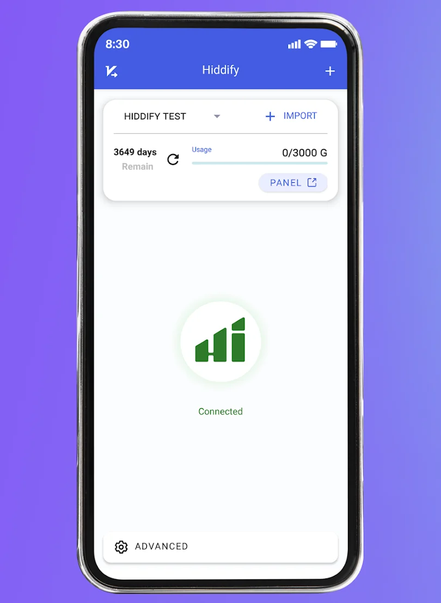

# هیدیفای‌منیجر ۶: فرگمنت، WARP+ و HiddifyNG

<!-- made by .cache/blog/history_gen.py -->

!!! abstract "در ۳۰ ثانیه"
    **هیدیفای‌منیجر ۶** در ۱۱ اردیبهشت ۱۴۰۲ منتشر شد. **فرگمنت** بسته‌ها را تکه‌تکه می‌کند تا راحت‌تر از فیلتر رد
    شوند، و **وارپ** و **WARP+** سایت‌های انتخابی را از راه کلودفلر از سرور بیرون می‌فرستند تا IP سرور به آن‌ها
    نشان داده نشود. لینک‌های **HiddifyNG**، اپ اندروید ما، را هم آورد.

<!-- more -->

## چه چیزهایی تازه بود

- **فرگمنت TLS** در لینک‌ها (۶.۰)، که لینک HiddifyNG آن را می‌برد (۶.۱).
- **وارپ کلودفلر**، با **کلید WARP+** (۶.۴)، حالت‌های وارپ (۶.۵) و DNS.
- **لینک‌های HiddifyNG**، و لینک HiddifyNG در گوگل‌پلی (۶.۱).
- **دامنه‌های CDN و relay** می‌توانند تنها دامنه‌های پنل باشند.
- **راه‌اندازی سریع** وقتی پنل هنوز تنظیم نشده، خودش باز می‌شود (۶.۲).
- **اعلان‌ها** در پنل.

## امروز

هیدیفای‌منیجر حالا در نسخهٔ ۱۴ است. آخرین نسخه را نصب کنید، یا نسخهٔ خودتان را از پنل به‌روزرسانی کنید (اول یک [پشتیبان](/fa/manager/configuration-and-advanced-settings/How-to-backup-and-restore-panel-on-Hiddify/) بگیرید).

<a class="hi-cta" href="/fa/manager/installation-and-setup/guide/">نصب هیدیفای‌منیجر</a>

??? note "برای کاربران حرفه‌ای"
    - تا اسفند ۱۴۰۲ پنل شمارهٔ نسخهٔ خودش را داشت و بستهٔ سرور (که آن موقع Hiddify Config نام داشت) شمارهٔ دیگری: هیدیفای‌منیجر ۶ همراه بستهٔ ۹.۱–۹.۴ آمد. از ۱۰.۱۰ هر دو یک شماره دارند.
    - هستهٔ sing-box بعداً، با هیدیفای‌منیجر ۷ (خرداد ۱۴۰۲)، آمد.
    - منبع‌ها: [panel HISTORY 6.x](https://github.com/hiddify/hiddifypanel/blob/main/HISTORY.md)، [WARP commit](https://github.com/hiddify/Hiddify-Manager/commit/3e7057b3)

## مقاله‌های مرتبط

- [هیدیفای‌منیجر ۵: نوع دامنه و مصرف در لینک](Hiddify-Panel-v5.md)
- [هیدیفای‌منیجر ۷: دو هسته، Xray و sing-box](Hiddify-Panel-v7.md)
- [هیدیفای‌منیجر ۱۴ منتشر شد](Hiddify-Manager-v14-is-released.md)
