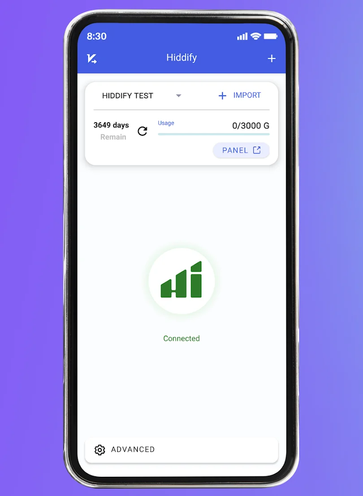

# Hiddify Manager 6: fragment, WARP+ and HiddifyNG

<!-- made by .cache/blog/history_gen.py -->

!!! abstract "In 30 seconds"
    **Hiddify Manager 6** came out on 1 May 2023. **Fragment** cuts packets into pieces so they pass the filter more
    easily, and **WARP** and **WARP+** let chosen sites leave the server through Cloudflare, so the server's IP is
    not shown to them. It also brought links for **HiddifyNG**, our Android app.

<!-- more -->

## What was new

- **TLS fragment** in the links (6.0), carried by the HiddifyNG link (6.1).
- **Cloudflare WARP**, with a **WARP+ key** (6.4), WARP modes (6.5) and DNS.
- **HiddifyNG links**, and a link to HiddifyNG on Google Play (6.1).
- **CDN and relay domains** can be the only panel domains.
- **Quick setup** opens by itself when the panel is not set up yet (6.2).
- **Notifications** in the panel.

## Today

Hiddify Manager is at version 14 now. Install the latest version, or update yours from the panel (take a [backup](/manager/configuration-and-advanced-settings/How-to-backup-and-restore-panel-on-Hiddify/) first).

<a class="hi-cta" href="/manager/installation-and-setup/guide/">Install Hiddify Manager</a>

??? note "For experts"
    - Until March 2024 the panel had its own version numbers, and the server package (then called Hiddify Config) had others: Hiddify Manager 6 shipped with package 9.1–9.4. Since 10.10 both share one number.
    - The sing-box core came later, with Hiddify Manager 7 (May 2023).
    - Sources: [panel HISTORY 6.x](https://github.com/hiddify/hiddifypanel/blob/main/HISTORY.md), [WARP commit](https://github.com/hiddify/Hiddify-Manager/commit/3e7057b3)

## Related articles

- [Hiddify Manager 5: domain types and usage in the link](Hiddify-Panel-v5.md)
- [Hiddify Manager 7: two cores, Xray and sing-box](Hiddify-Panel-v7.md)
- [Hiddify Manager 14 is out](Hiddify-Manager-v14-is-released.md)
