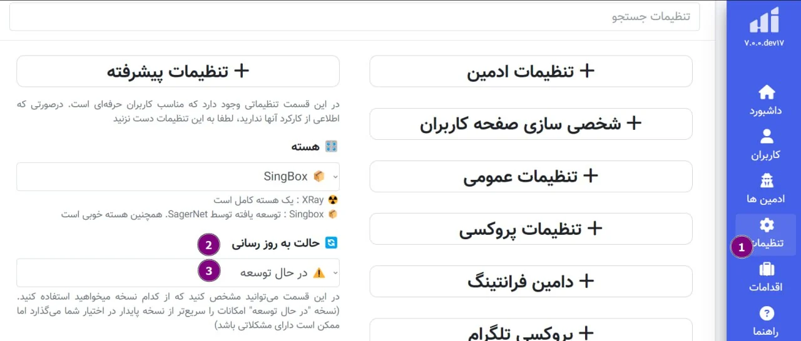

# پنل هیدیفای ۷: دو هسته، Xray و sing-box

<!-- made by .cache/blog/history_gen.py -->

!!! abstract "در ۳۰ ثانیه"
    **پنل هیدیفای ۷** در ۸ خرداد ۱۴۰۲ همراه بستهٔ سرور ۱۰.۰ منتشر شد. هستهٔ دوم، **sing-box**، را کنار Xray آورد،
    با شمارش مصرف روی هر دو؛ تنها پنلی که این کار را می‌کرد. **ریالتی** حالا روی **چند دامنه** و **روی gRPC** کار
    می‌کند، و دامنه‌های **ورکر کلودفلر** آمدند.

<!-- more -->

## چه چیزهایی تازه بود

- **sing-box کنار Xray**، با انتخاب هسته و شمارش مصرف روی هر دو.
- **ریالتی روی چند دامنه**، و **ریالتی روی gRPC**.
- **دامنه‌های ورکر کلودفلر**، و domain fronting (۷.۰.۷).
- **برگشت به نسخهٔ قبل** از منوی به‌روزرسانی.
- **REST API** برای پنل.
- **ویدیوهای راهنما** از یوتیوب، با نسخهٔ محلی وقتی یوتیوب بسته است.
- **زبان پرتغالی**، و حذف سایت‌های دولتی از سایت‌های فریب (decoy).
- **متن‌باز** (۷.۱.۶، مرداد ۱۴۰۲): کد پنل با مجوز متن‌باز منتشر شد.

## امروز

هیدیفای‌منیجر حالا در نسخهٔ ۱۴ است. آخرین نسخه را نصب کنید، یا نسخهٔ خودتان را از پنل به‌روزرسانی کنید (اول یک [پشتیبان](/fa/manager/configuration-and-advanced-settings/How-to-backup-and-restore-panel-on-Hiddify/) بگیرید).

<a class="hi-cta" href="/fa/manager/installation-and-setup/guide/">نصب هیدیفای‌منیجر</a>

??? note "برای کاربران حرفه‌ای"
    - تا اسفند ۱۴۰۲ پنل شمارهٔ نسخهٔ خودش را داشت و بستهٔ سرور (که آن موقع Hiddify Config نام داشت) شمارهٔ دیگری: پنل ۷ همراه بستهٔ ۱۰.۰ آمد. از ۱۰.۱۰ هر دو یک شماره دارند.
    - بستهٔ سرور ۱۰.۰ وارپ را هم به sing-box برد و پنل را با کاربر جداگانه اجرا کرد؛ ۱۰.۱ (خرداد) قفل نصب و وارپ برای یوتیوب را آورد.
    - منبع‌ها: [panel HISTORY 7.0.0](https://github.com/hiddify/hiddifypanel/blob/main/HISTORY.md)، [package 10.0.0](https://github.com/hiddify/Hiddify-Manager/releases/tag/v10.0.0)، [open source](https://github.com/hiddify/hiddifypanel/commit/7c11e7c2)

## مقاله‌های مرتبط

- [پنل هیدیفای ۶: فرگمنت، WARP+ و HiddifyNG](Hiddify-Panel-v6.md)
- [پنل هیدیفای ۸: پروکسی SSH و یک لینک هوشمند](Hiddify-Panel-v8.md)
- [هیدیفای‌منیجر ۱۴ منتشر شد](Hiddify-Manager-v14-is-released.md)
