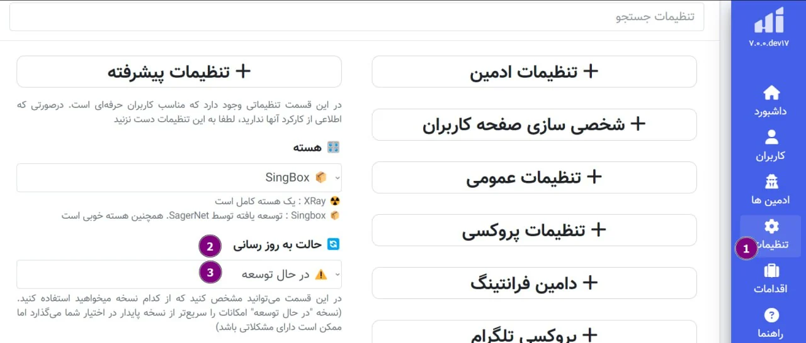

# Hiddify panel 7: two cores, Xray and sing-box

<!-- made by .cache/blog/history_gen.py -->

!!! abstract "In 30 seconds"
    **Hiddify panel 7** came out on 29 May 2023, with server package 10.0. It added a second core, **sing-box**,
    next to Xray, with usage counted on both: the only panel that could do this. **Reality** now works on **many
    domains** and **over gRPC**, and **Cloudflare Worker** domains arrived.

<!-- more -->

## What was new

- **sing-box next to Xray**, with a core selector and usage on both cores.
- **Reality on many domains**, and **Reality over gRPC**.
- **Cloudflare Worker domains**, and domain fronting (7.0.7).
- **Downgrade:** go back to an earlier version from the update menu.
- **REST API** for the panel.
- **Help videos** from YouTube, with a local copy when YouTube is blocked.
- **Portuguese**, and government sites removed from the decoy sites.
- **Open source** (7.1.6, July 2023): the panel's code was published under an open-source license.

## Today

Hiddify Manager is at version 14 now. Install the latest version, or update yours from the panel (take a [backup](/manager/configuration-and-advanced-settings/How-to-backup-and-restore-panel-on-Hiddify/) first).

<a class="hi-cta" href="/manager/installation-and-setup/guide/">Install Hiddify Manager</a>

??? note "For experts"
    - Until March 2024 the panel had its own version numbers, and the server package (then called Hiddify Config) had others: panel 7 shipped with package 10.0. Since 10.10 both share one number.
    - Server package 10.0 also moved WARP to sing-box and runs the panel as its own user; 10.1 (June) added an install lock and WARP for YouTube.
    - Sources: [panel HISTORY 7.0.0](https://github.com/hiddify/hiddifypanel/blob/main/HISTORY.md), [package 10.0.0](https://github.com/hiddify/Hiddify-Manager/releases/tag/v10.0.0), [open source](https://github.com/hiddify/hiddifypanel/commit/7c11e7c2)

## Related articles

- [Hiddify panel 6: fragment, WARP+ and HiddifyNG](Hiddify-Panel-v6.md)
- [Hiddify panel 8: SSH proxy and one smart link](Hiddify-Panel-v8.md)
- [Hiddify Manager 14 is out](Hiddify-Manager-v14-is-released.md)
