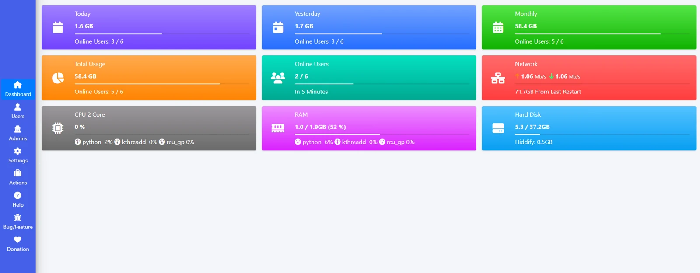

# پنل هیدیفای ۸: پروکسی SSH و یک لینک هوشمند

<!-- made by .cache/blog/history_gen.py -->

!!! abstract "در ۳۰ ثانیه"
    **پنل هیدیفای ۸** در ۷ شهریور ۱۴۰۲ همراه بستهٔ سرور ۱۰.۲ منتشر شد. با کمک یک دوست **پروکسی امن SSH** را اضافه
    کردیم. یک **لینک اشتراک هوشمند** حالا به هر اپ کانفیگی را می‌دهد که می‌فهمد، **لینک کوتاه** تایپ روی دستگاه
    دیگر را آسان می‌کند، و پنل خیلی سریع‌تر شد.

<!-- more -->

## چه چیزهایی تازه بود

- **پروکسی SSH** («liberty bridge»)، با UDP روی SSH.
- **یک لینک اشتراک هوشمند** (صفحه و دکمهٔ «auto»): پنل به هر اپ کانفیگ مناسب خودش را می‌دهد.
- **لینک کوتاه** که مدت کوتاهی کار می‌کند، به سبک کارآگاه گجت.
- **کانفیگ کامل sing-box** در اشتراک؛ پشتیبانی از sing-box 1.7 و 1.8 بعداً (۸.۸).
- **پنل سریع‌تر** با Redis، و دیتابیس MySQL روی سرور.
- **تغییر کلیدهای ریالتی**، و باز کردن پنل با IP روی HTTPS.
- **کد QR با یک کلیک** (۸.۱)، و لینک برای Streisand و Hiddify Next.
- **کانال بتا** (۸.۶)، و راه‌اندازی اول امن‌تر (۸.۸.۹۶).

## امروز

هیدیفای‌منیجر حالا در نسخهٔ ۱۴ است. آخرین نسخه را نصب کنید، یا نسخهٔ خودتان را از پنل به‌روزرسانی کنید (اول یک [پشتیبان](/fa/manager/configuration-and-advanced-settings/How-to-backup-and-restore-panel-on-Hiddify/) بگیرید).

<a class="hi-cta" href="/fa/manager/installation-and-setup/guide/">نصب هیدیفای‌منیجر</a>

??? note "برای کاربران حرفه‌ای"
    - تا اسفند ۱۴۰۲ پنل شمارهٔ نسخهٔ خودش را داشت و بستهٔ سرور (که آن موقع Hiddify Config نام داشت) شمارهٔ دیگری: پنل ۸ همراه بستهٔ ۱۰.۲–۱۰.۵ آمد. از ۱۰.۱۰ هر دو یک شماره دارند.
    - نسخه‌های ۸.x تا ۸.۸.۹۹ (۱۲ اسفند ۱۴۰۲) ادامه داشتند. Hysteria2 و TUIC از شهریور ۱۴۰۲ در بتا بودند و با ۱۰.۱۰ منتشر شدند.
    - پنل ۹ هیچ‌وقت نداشتیم: بعد از ۸.۸.۹۹ پنل به ۱۰.۱۰ رفت تا با شمارهٔ سرور یکی شود.
    - منبع‌ها: [panel HISTORY 8.0.0](https://github.com/hiddify/hiddifypanel/blob/main/HISTORY.md)، [SSH proxy](https://github.com/hiddify/Hiddify-Manager/commit/e1a5d9a9)

## مقاله‌های مرتبط

- [پنل هیدیفای ۷: دو هسته، Xray و sing-box](Hiddify-Panel-v7.md)
- [هیدیفای‌منیجر ۱۰.۱۰: شدوساکس ۲۰۲۲، HTTPUpgrade و وایرگارد](Hiddify-Manager-v10-10-is-released.md)
- [پروکسی SSH در پنل هیدیفای](/fa/manager/configuration-and-advanced-settings/SSH-proxy-setting-on-Hiddify-panel/)
- [هیدیفای‌منیجر ۱۴ منتشر شد](Hiddify-Manager-v14-is-released.md)
