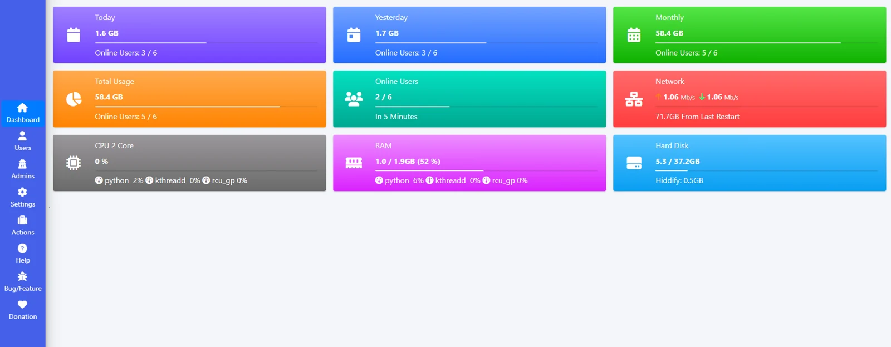

# Hiddify panel 8: SSH proxy and one smart link

<!-- made by .cache/blog/history_gen.py -->

!!! abstract "In 30 seconds"
    **Hiddify panel 8** came out on 29 August 2023, with server package 10.2. A friend helped us add the secure
    **SSH proxy**. One **smart subscription link** now gives every app the configs it understands, **short links**
    are easy to type on another device, and the panel became much faster.

<!-- more -->

## What was new

- **SSH proxy** ("liberty bridge"), with UDP over SSH.
- **One smart subscription link** (the "auto" page and button): the panel gives each app the right configs.
- **Short links** that work for a short time, in the style of Inspector Gadget.
- **Full sing-box configs** in the subscription; sing-box 1.7 and 1.8 supported later (8.8).
- **Faster panel** with Redis, and a MySQL database on the server.
- **Change the Reality keys**, and open the panel by IP over HTTPS.
- **One-click QR codes** (8.1), and links for Streisand and Hiddify Next.
- **Beta channel** (8.6), and a safer first setup (8.8.96).

## Today

Hiddify Manager is at version 14 now. Install the latest version, or update yours from the panel (take a [backup](/manager/configuration-and-advanced-settings/How-to-backup-and-restore-panel-on-Hiddify/) first).

<a class="hi-cta" href="/manager/installation-and-setup/guide/">Install Hiddify Manager</a>

??? note "For experts"
    - Until March 2024 the panel had its own version numbers, and the server package (then called Hiddify Config) had others: panel 8 shipped with package 10.2–10.5. Since 10.10 both share one number.
    - 8.x lasted until 8.8.99 (2 March 2024). Hysteria2 and TUIC were in the beta from September 2023 and came out with 10.10.
    - There was never a panel 9: after 8.8.99 the panel jumped to 10.10 to share the server's number.
    - Sources: [panel HISTORY 8.0.0](https://github.com/hiddify/hiddifypanel/blob/main/HISTORY.md), [SSH proxy](https://github.com/hiddify/Hiddify-Manager/commit/e1a5d9a9)

## Related articles

- [Hiddify panel 7: two cores, Xray and sing-box](Hiddify-Panel-v7.md)
- [Hiddify Manager 10.10: Shadowsocks 2022, HTTPUpgrade and WireGuard](Hiddify-Manager-v10-10-is-released.md)
- [SSH proxy on the Hiddify panel](/manager/configuration-and-advanced-settings/SSH-proxy-setting-on-Hiddify-panel/)
- [Hiddify Manager 14 is out](Hiddify-Manager-v14-is-released.md)
