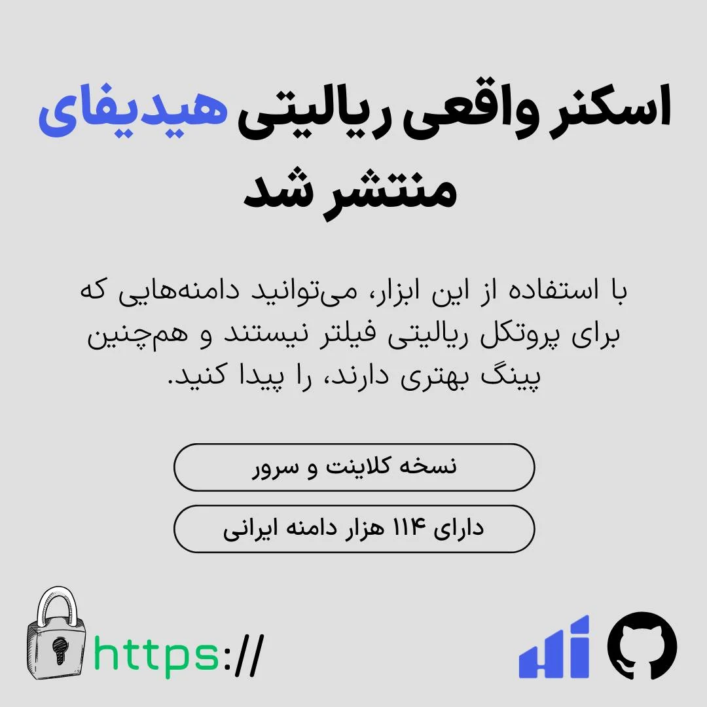

# اسکنر ریالتی هیدیفای: بهترین SNI برای ریالتی

<!-- made by .cache/blog/history_gen.py -->

!!! abstract "در ۳۰ ثانیه"
    وقتی محدودیت‌های تازه روی ریالتی آمد، در ۱ آذر ۱۴۰۲ **اسکنر ریالتی هیدیفای** را منتشر کردیم. فهرستی از سایت‌ها
    را روی **شبکهٔ خود شما** بررسی می‌کند و SNIهایی را پیدا می‌کند که برای دامنهٔ ریالتی بهترین‌اند. در هفتهٔ اول
    هفت نسخه از آن آمد.

<!-- more -->

## چه چیزهایی تازه بود

- **SNIهای مناسب ریالتی** را روی همان شبکه‌ای که هستید پیدا می‌کند.
- **بخش سرور و بخش کلاینت.**
- **گزینهٔ محدودیت**، و راهنمای فارسی.
- **۱۳ نسخه در یک هفته** (۱.۰ تا ۱.۸).
- **۲۵۱ ستاره** در گیت‌هاب.

## امروز

امروز این ابزارها داخل اپ هیدیفای و هیدیفای‌منیجر هستند. با اپ شروع کنید، یا سرور خودتان را راه بیندازید.

<a class="hi-cta" href="/fa/app/How-to-install-Hiddify-app/">دانلود اپ هیدیفای</a>

??? note "برای کاربران حرفه‌ای"
    - آخرین نسخه ۱.۸.۰ در ۸ آذر ۱۴۰۲.
    - منبع‌ها: [Hiddify-Reality-Scanner](https://github.com/hiddify/Hiddify-Reality-Scanner/releases)

## مقاله‌های مرتبط

- [هستهٔ هیدیفای: یک موتور برای همهٔ سیستم‌ها](Hiddify-core.md)
- [HiddifyCli و داکر: هیدیفای بدون صفحه](HiddifyCli-and-Docker.md)
- [استفاده از ریالتی در هیدیفای](/fa/manager/configuration-and-advanced-settings/How-to-use-Reality-on-Hiddify/)
- [هیدیفای چهار ساله شد](4th-anniversary.md)
