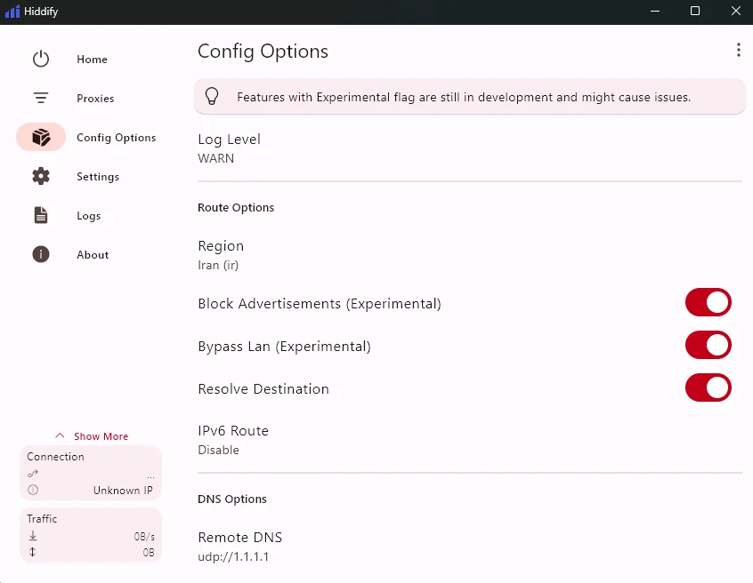

# Hiddify app 1.4–1.9: routing that updates itself, and more WARP

<!-- made by .cache/blog/history_gen.py -->

!!! abstract "In 30 seconds"
    The **Hiddify app 1.5** came out on 9 July 2024. Its routing now uses **rule sets that update themselves**,
    and it can **block ads** on websites. Around it, 1.4 to 1.9 brought **more WARP modes**, WireGuard with both
    IPv4 and IPv6, and the **Xray** config type.

<!-- more -->

## What was new

- **Routing with rule sets** that update automatically (1.5); the old geo files are gone.
- **Block ads** on websites (1.5).
- **Reserve WARP** and sync the WARP key with the app (1.4).
- **Better fragment** (1.4).
- **More WARP modes**, and WireGuard with IPv4 and IPv6 (1.7).
- **Reconnects by itself** after you change the service mode (1.6).
- **Xray config type**, with IPv6 and resolve-destination on by default (1.9.1); Indonesia region (1.9).

## Today

The Hiddify app is at version 5 now, with free profiles, Chain and connection sharing. Download the latest version.

<a class="hi-cta" href="/app/How-to-install-Hiddify-app/">Download the Hiddify app</a>

??? note "For experts"
    - Around this time the Hiddify app passed half a million active installs on Google Play.
    - Sources: [1.5.0 release](https://github.com/hiddify/hiddify-app/releases/tag/v1.5.0), [rule sets](https://github.com/hiddify/hiddify-app/commit/c6d34e74)

## Related articles

- [Hiddify app 1.0: the name is Hiddify](Hiddify-app-v1-is-released.md)
- [Hiddify app 2: config editor and two cores](Hiddify-app-v2-is-released.md)
- [Routing in the Hiddify app](/app/Routing-in-Hiddify-app/)
- [Hiddify app 5 is out](Hiddify-app-v5-is-released.md)
