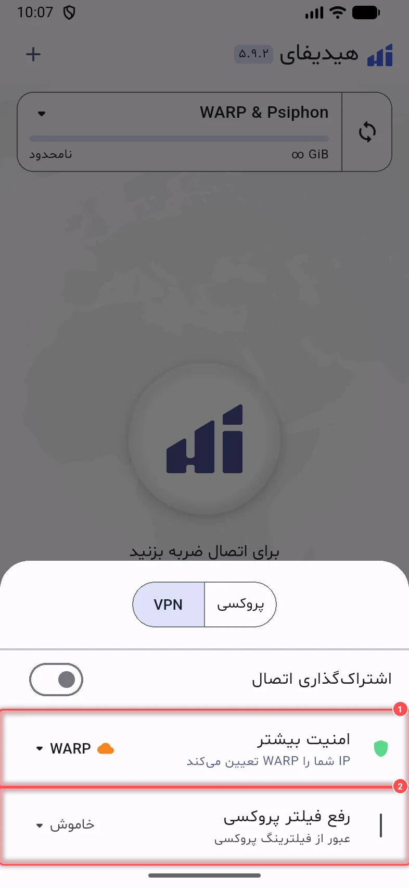
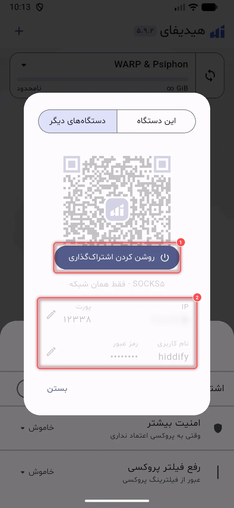
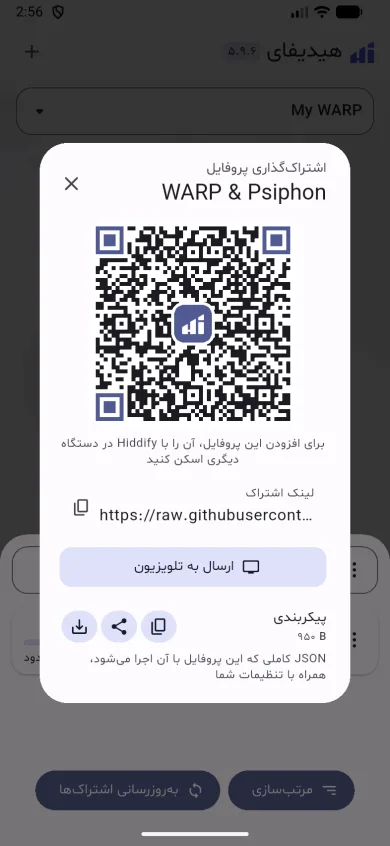

# اپ هیدیفای ۵ منتشر شد

!!! abstract "در ۳۰ ثانیه"
    اپ هیدیفای **۵.۵.۵** در ۱۳ آبان ۱۴۰۵ منتشر شد (نسخه‌های آزمایشی ۵ چند روز پیش‌تر آمده بودند). مهم‌ترین
    تازه‌اش **زنجیره** است: وارپ یا سایفون را با یک انتخاب جلو یا پشت پروکسی خودتان بگذارید. همچنین
    می‌توانید **اتصالتان را با دستگاه‌های دیگر شریک شوید**، **پروفایل را به تلویزیون بفرستید**، و بگذارید
    اپ **خودش انتخاب کند کدام اپ‌ها از پروکسی بروند**.

<!-- more -->

## چه چیزی برای شما عوض می‌شود

- **زنجیره: امنیت بیشتر و رفع فیلتر پروکسی.** دو انتخاب ساده در تنظیمات سریع. *امنیت بیشتر* وارپ را بعد
  از پروکسی شما می‌گذارد تا سایت‌ها IP کلودفلر را ببینند. *رفع فیلتر پروکسی* از راه وارپ یا سایفون به
  پروکسی فیلترشده می‌رسد.
- **وارپی که می‌شود تنظیمش کرد**: تونل را انتخاب کنید (WireGuard، AmneziaWG یا MASQUE)، حالت نویز را از
  روی نامش برگزینید، و بگذارید اسکنر آدرسی پیدا کند که روی شبکهٔ شما کار می‌کند.
- **اشتراک اتصال.** بگذارید کامپیوتر، تلویزیون یا گوشی دیگر از اتصال این دستگاه استفاده کند، با یک کد QR
  برای راه‌اندازی.
- **فرستادن پروفایل به اندروید تی‌وی** از گوشی روی همان وای‌فای، به جای تایپ یک لینک بلند با کنترل.
- **مسیریابی بر اساس اپ، انتخاب‌شده برای شما.** اپ خودش اپ‌هایی را که باید از پروکسی بروند انتخاب می‌کند و
  شما می‌توانید فهرست را تغییر دهید. قانون‌های آماده (مثلاً سرویس‌های اپل) با یک کلید روشن می‌شوند.
- **صفحهٔ اصلی تازه**: دکمهٔ اتصال ترافیک را دور خودش نشان می‌دهد و کارت پروکسی هر مرحلهٔ اتصال را.
- **وارد کردن و فرستادن آسان‌تر**: وارد کردن از فایل یا zip؛ فرستادن پروفایل به‌صورت لینک، کد QR یا فایل.
- **به‌روزرسانی بیرون از فروشگاه‌ها**: اپ می‌تواند نسخهٔ تازهٔ خودش را دانلود و نصب کند.
- **VPN همیشه روشن** در اندروید؛ در ویندوز و لینوکس حالت VPN بی‌دردسر کار می‌کند، و در مک VPN به‌صورت
  افزونهٔ سیستمی اجرا می‌شود.

زنجیره در تنظیمات سریع، اشتراک با دستگاه‌های دیگر، و فرستادن پروفایل به تلویزیون:

## باید به‌روزرسانی کنم؟

بله. از گوگل‌پلی یا اپ‌استور به‌روزرسانی کنید، یا نسخهٔ ۵ را از
[راهنمای نصب اپ هیدیفای](/fa/app/How-to-install-Hiddify-app/) دانلود کنید. پروفایل‌هایتان سر جایشان می‌مانند.

به‌زودی، در نسخه‌های آزمایشی ۵.۹: **گزارش مشکل** از داخل اپ همراه با لاگ‌ها، **حالت روتر** در لینوکس که
VPN را با کل شبکه شریک می‌شود، پروفایل‌های OpenVPN، و ۱۹ زبان تازه.

<a class="hi-cta" href="/fa/app/How-to-install-Hiddify-app/">دانلود اپ هیدیفای</a>

??? note "برای کاربران حرفه‌ای: تغییرات بیشتر نسخهٔ ۵"
    - هدرهای `enable-warp` و `enable-psiphon` پروفایل در `extra-security` یکی شدند؛ هدر `fragment` به
      لینک اشتراک اجازه می‌دهد فرگمنت را تنظیم کند.
    - اشتراک در شبکهٔ محلی: یک پروکسی محلی بدون رمز روی پورت جدای خودش.
    - رابط TUN هسته روی ویندوز و لینوکس؛ packet tunnel system extension در مک.
    - mTLS برای gRPC هسته؛ `ipinfo-url` دلخواه؛ قالب خروجی masterdns در ویرایشگر JSON.
    - تغییرات: [۴.۱.۲ تا ۵.۵.۵](https://github.com/hiddify/hiddify-app/compare/v4.1.2...v5.5.5).

## مقاله‌های مرتبط

- [زنجیره: امنیت بیشتر و رفع فیلتر پروکسی](/fa/app/Chain-Extra-security-and-Proxy-unblocker/)
- [اشتراک اتصال](/fa/app/Share-your-connection/)
- [هیدیفای روی اندروید تی‌وی](/fa/app/Hiddify-on-Android-TV/)
- [مسیریابی در اپ هیدیفای](/fa/app/Routing-in-Hiddify-app/)
