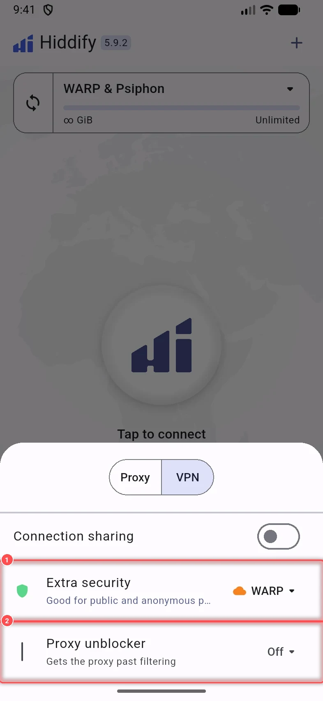
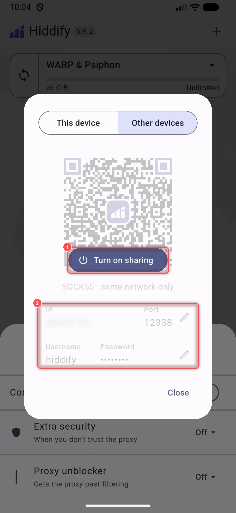
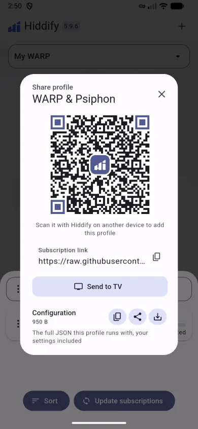

# Hiddify app 5 is out

!!! abstract "In 30 seconds"
    Hiddify app **5.5.5** came out on 4 November 2026 (the first 5.x test versions came a few days
    before). The big new thing is **Chain**: put WARP or Psiphon in front of or behind your proxy with one
    choice. You can also **share your connection** with other devices, **send a profile to your TV**, and
    let the app **pick which apps go through the proxy**.

<!-- more -->

## What changes for you

- **Chain: Extra security and Proxy unblocker.** Two simple choices in quick settings. *Extra security*
  adds WARP after your proxy, so sites see a Cloudflare IP. *Proxy unblocker* reaches a blocked proxy
  through WARP or Psiphon.
- **WARP you can tune**: choose the tunnel (WireGuard, AmneziaWG or MASQUE), pick a noise mode by name,
  and let the scanner find an address that works on your network.
- **Share your connection.** Let your computer, TV or another phone use the connection of this device,
  with a QR code to set it up.
- **Send a profile to Android TV** from your phone on the same Wi-Fi, instead of typing a long link with
  a remote.
- **Routing by app, chosen for you.** The app picks the apps that should go through the proxy, and you
  can change the list. Built-in rules (for example Apple services) are ready to turn on.
- **A new home page**: the connect button shows the traffic around it, and the proxy card shows each
  step of the connection.
- **Import and share more easily**: import from a file or a zip; share a profile as a link, a QR code or
  a file.
- **Updates outside the stores**: the app can download and install its own update.
- **Always-on VPN** on Android; on Windows and Linux the VPN mode works out of the box, and on macOS the
  VPN runs as a system extension.

Chain in quick settings, sharing with other devices, and sending a profile to a TV:

## Should I update?

Yes. Update from Google Play or the App Store, or download version 5 from
[How to install the Hiddify app](/app/How-to-install-Hiddify-app/). Your profiles stay as they are.

Coming next, in the 5.9 test versions: **report a problem** from the app with the logs attached, a
**router mode** that shares the VPN with your whole network on Linux, OpenVPN profiles, and 19 more
languages.

<a class="hi-cta" href="/app/How-to-install-Hiddify-app/">Download the Hiddify app</a>

??? note "For experts: more changes in 5"
    - `enable-warp` and `enable-psiphon` profile headers merged into `extra-security`; a `fragment` header
      lets a subscription tune fragmentation.
    - LAN sharing: a local proxy without a password on its own port.
    - Desktop TUN core interface on Windows and Linux; macOS packet tunnel system extension.
    - mTLS for the core's gRPC; custom `ipinfo-url`; masterdns outbound template in the JSON editor.
    - Changes: [4.1.2 → 5.5.5](https://github.com/hiddify/hiddify-app/compare/v4.1.2...v5.5.5).

## Related articles

- [Chain: Extra security and Proxy unblocker](/app/Chain-Extra-security-and-Proxy-unblocker/)
- [Share your connection](/app/Share-your-connection/)
- [Hiddify on Android TV](/app/Hiddify-on-Android-TV/)
- [Routing in the Hiddify app](/app/Routing-in-Hiddify-app/)
