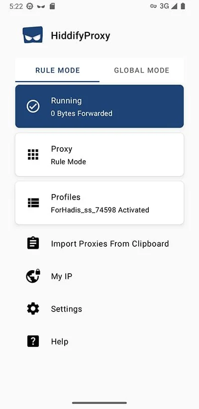

# HiddifyClash: یک کلاینت ساده‌تر برای پدر و مادرهایمان

<!-- made by .cache/blog/history_gen.py -->

!!! abstract "در ۳۰ ثانیه"
    اپ‌های کلاینت آن زمان ساده نبودند: پدر و مادرهایمان نمی‌توانستند با آن‌ها کار کنند. پس در ۱۴ دی ۱۴۰۱
    **HiddifyClash** را شروع کردیم؛ نسخه‌های سفارشی Clash Meta برای **کامپیوتر** و **اندروید**، با سایت‌های ایرانی
    مستقیم و وارد کردن لینک با یک لمس. روی هم بیش از **۲۱۰ هزار** بار از گیت‌هاب دانلود شدند.

<!-- more -->

## چه چیزهایی تازه بود

- **HiddifyClash Desktop** (اولین نسخه بهمن ۱۴۰۱): ‏VLESS، fingerprint مرورگر، وارد کردن با لینک، و انتخاب خودکار بهترین پروفایل.
- **HiddifyClash برای اندروید** (بهمن ۱۴۰۱): قانون‌های عبور مستقیم ایرانی و وارد کردن از کلیپ‌بورد.
- **سایت‌های ایرانی مستقیم**، بقیه از پروکسی، بدون تنظیم.
- **حدود ۱۰۸ هزار دانلود دسکتاپ و ۱۰۲ هزار دانلود اندروید** از گیت‌هاب.
- باگ‌های هستهٔ Clash Meta باعث شد در فروردین ۱۴۰۲ سراغ راه دیگری برویم: HiddifyNG و HiddifyN.

## امروز

امروز این ابزارها داخل اپ هیدیفای و هیدیفای‌منیجر هستند. با اپ شروع کنید، یا سرور خودتان را راه بیندازید.

<a class="hi-cta" href="/fa/app/How-to-install-Hiddify-app/">دانلود اپ هیدیفای</a>

??? note "برای کاربران حرفه‌ای"
    - نسخهٔ دسکتاپ با Tauri روی Clash Meta ساخته شده بود؛ آخرین نسخه‌ها در فروردین و اردیبهشت ۱۴۰۲ آمدند.
    - منبع‌ها: [HiddifyClashDesktop](https://github.com/hiddify/HiddifyClashDesktop)، [HiddifyClashAndroid](https://github.com/hiddify/HiddifyClashAndroid)

## مقاله‌های مرتبط

- [Awesome Freedom: یک فهرست از ابزارهای عبور از فیلتر](Awesome-Freedom.md)
- [HiddifyNG و HiddifyN: اپ‌های ما برای اندروید و ویندوز](HiddifyNG-and-HiddifyN.md)
- [هیدیفای چهار ساله شد](4th-anniversary.md)
