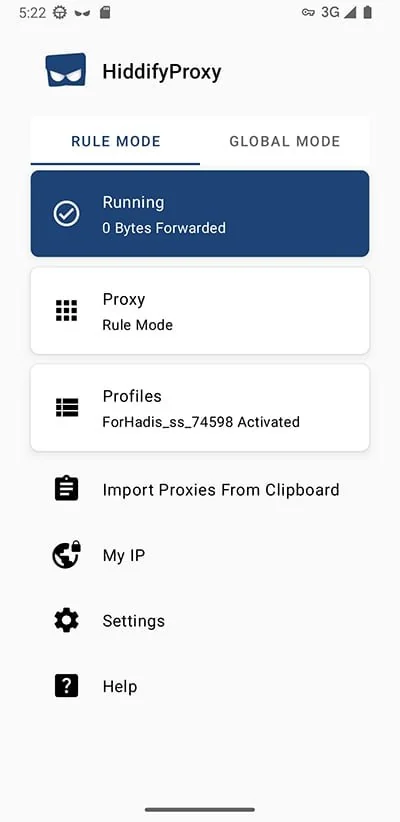

# HiddifyClash: a simpler client for our parents

<!-- made by .cache/blog/history_gen.py -->

!!! abstract "In 30 seconds"
    The client apps of the time were not simple: our parents could not use them. So on 4 January 2023 we started
    **HiddifyClash**, custom versions of Clash Meta for **desktop** and **Android**, with Iranian sites going
    direct and one-tap import of a link. Together they were downloaded more than **210,000** times from GitHub.

<!-- more -->

## What was new

- **HiddifyClash Desktop** (first release February 2023): VLESS, a browser fingerprint, import by link, choosing the best profile by itself.
- **HiddifyClash for Android** (February 2023): Iranian bypass rules and import from the clipboard.
- **Iranian sites go direct**, the rest through the proxy, without setup.
- **About 108,000 desktop and 102,000 Android downloads** from GitHub.
- Bugs in the Clash Meta core made us look for another way in April 2023: HiddifyNG and HiddifyN.

## Today

Today these tools live inside the Hiddify app and Hiddify Manager. Start with the app, or run your own server.

<a class="hi-cta" href="/app/How-to-install-Hiddify-app/">Download the Hiddify app</a>

??? note "For experts"
    - Desktop was built with Tauri on Clash Meta; the last versions came out in April 2023.
    - Sources: [HiddifyClashDesktop](https://github.com/hiddify/HiddifyClashDesktop), [HiddifyClashAndroid](https://github.com/hiddify/HiddifyClashAndroid)

## Related articles

- [Awesome Freedom: one list of tools to get past the filter](Awesome-Freedom.md)
- [HiddifyNG and HiddifyN: our apps for Android and Windows](HiddifyNG-and-HiddifyN.md)
- [Hiddify turns four](4th-anniversary.md)
