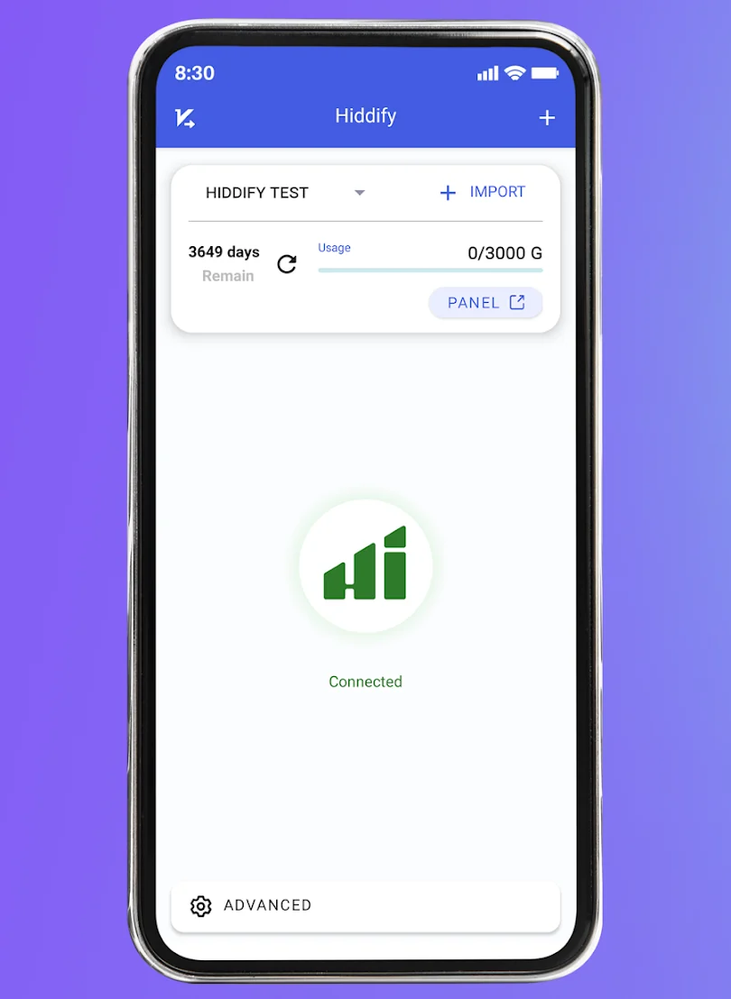
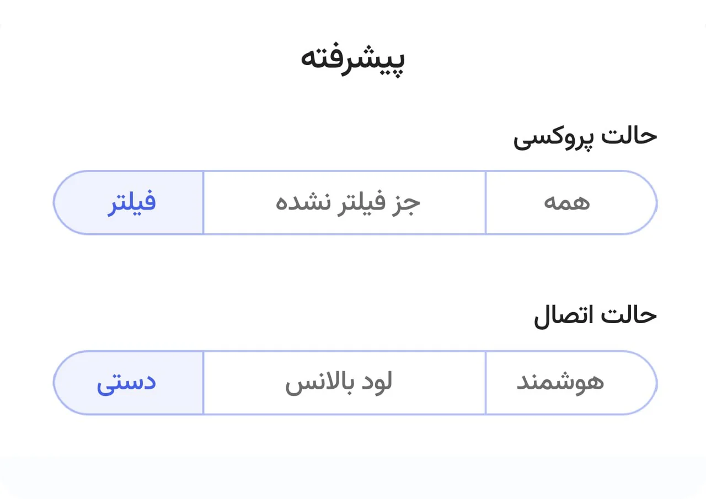

# HiddifyNG و HiddifyN: اپ‌های ما برای اندروید و ویندوز

<!-- made by .cache/blog/history_gen.py -->

!!! abstract "در ۳۰ ثانیه"
    در ۱۰ اردیبهشت ۱۴۰۲ **HiddifyNG** برای اندروید و **HiddifyN** برای ویندوز را منتشر کردیم: همان v2rayNG و
    v2rayN معروف، ساده‌تر با تنظیمات هیدیفای. HiddifyNG در **کمتر از پنج ماه بیش از ۱۰۰ هزار بار در گوگل‌پلی**
    دانلود شد، با **امتیاز ۴.۸ از ۵**.

<!-- more -->

## چه چیزهایی تازه بود

- **HiddifyNG** (اندروید) و **HiddifyN** (ویندوز)، ساخته‌شده روی v2rayNG و v2rayN.
- **وارد کردن اشتراک با یک لمس**، و تنظیمات پیش‌فرض مناسب ایران.
- **مسیریابی و توزیع بار** (نسخهٔ ۷ هر دو اپ).
- لینک‌های **فرگمنت TLS** از پنل (هیدیفای‌منیجر ۶).
- **به‌روزرسانی سریع:** ۳۰ نسخهٔ HiddifyNG در ماه اول.
- **در گوگل‌پلی** با شناسهٔ `ang.hiddify.com`؛ و حدود ۵۱۹ هزار + ۱۷۴ هزار دانلود دیگر از گیت‌هاب.

## امروز

امروز این ابزارها داخل اپ هیدیفای و هیدیفای‌منیجر هستند. با اپ شروع کنید، یا سرور خودتان را راه بیندازید.

<a class="hi-cta" href="/fa/app/How-to-install-Hiddify-app/">دانلود اپ هیدیفای</a>

??? note "برای کاربران حرفه‌ای"
    - هر دو در بهمن ۱۴۰۴ بازنشسته شدند؛ صفحه‌هایشان حالا به اپ هیدیفای اشاره می‌کند.
    - منبع‌ها: [HiddifyNG](https://github.com/hiddify/HiddifyNG/releases/tag/v1)، [HiddifyN](https://github.com/hiddify/HiddifyN/releases/tag/v1)

## مقاله‌های مرتبط

- [HiddifyClash: یک کلاینت ساده‌تر برای پدر و مادرهایمان](HiddifyClash.md)
- [هستهٔ هیدیفای: یک موتور برای همهٔ سیستم‌ها](Hiddify-core.md)
- [آموزش اپ HiddifyNG](/fa/manager/client-software-on-android/Tutorial-for-HiddifyNG-app/)
- [هیدیفای چهار ساله شد](4th-anniversary.md)
