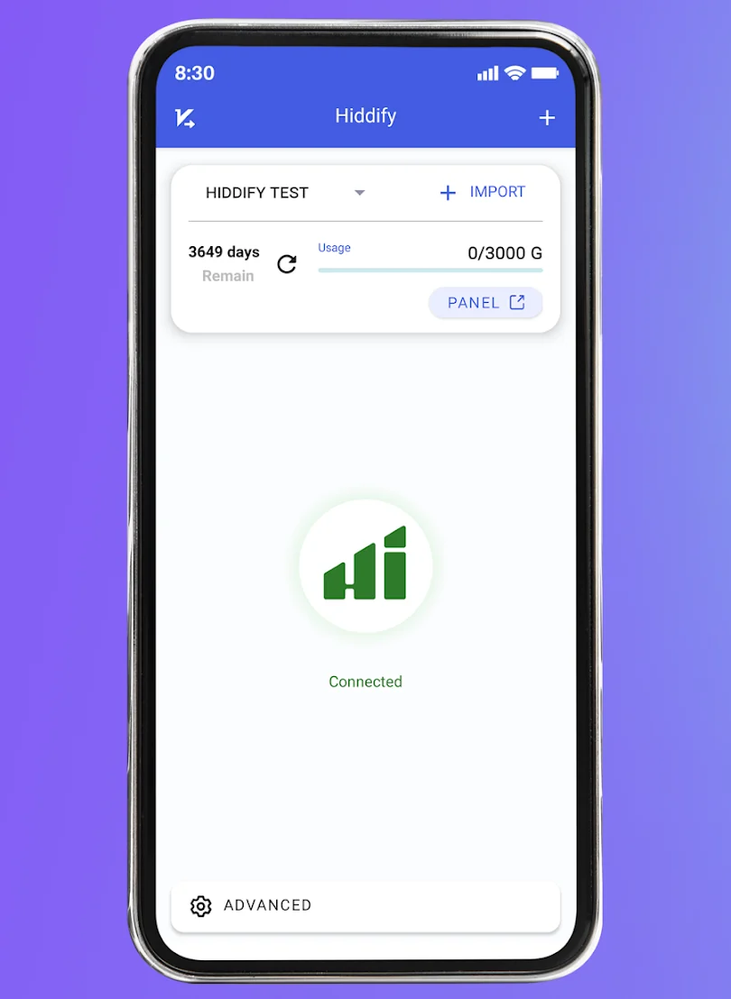
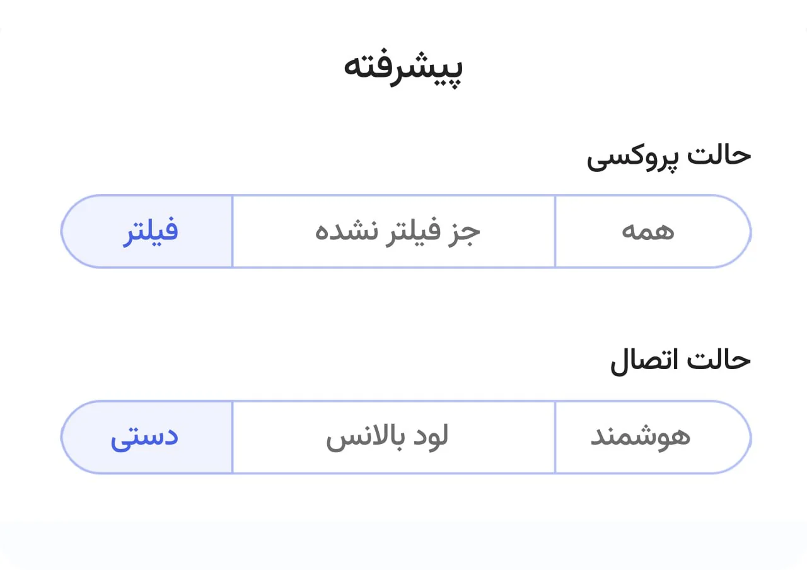

# HiddifyNG and HiddifyN: our apps for Android and Windows

<!-- made by .cache/blog/history_gen.py -->

!!! abstract "In 30 seconds"
    On 30 April 2023 we released **HiddifyNG** for Android and **HiddifyN** for Windows: the well-known v2rayNG
    and v2rayN, made simpler with Hiddify defaults. HiddifyNG passed **100,000 downloads on Google Play in less
    than five months**, with a rating of **4.8 out of 5**.

<!-- more -->

## What was new

- **HiddifyNG** (Android) and **HiddifyN** (Windows), built on v2rayNG and v2rayN.
- **Import a subscription with one tap**, and defaults that suit Iran.
- **Routing and load balancing** (version 7 of both apps).
- **TLS fragment** links from the panel (panel 6).
- **Fast updates:** 30 HiddifyNG releases in the first month.
- **On Google Play** as `ang.hiddify.com`; about 519,000 + 174,000 more downloads from GitHub.

## Today

Today these tools live inside the Hiddify app and Hiddify Manager. Start with the app, or run your own server.

<a class="hi-cta" href="/app/How-to-install-Hiddify-app/">Download the Hiddify app</a>

??? note "For experts"
    - Both were retired in February 2026; their pages now point to the Hiddify app.
    - Sources: [HiddifyNG](https://github.com/hiddify/HiddifyNG/releases/tag/v1), [HiddifyN](https://github.com/hiddify/HiddifyN/releases/tag/v1)

## Related articles

- [HiddifyClash: a simpler client for our parents](HiddifyClash.md)
- [Hiddify core: one engine for every platform](Hiddify-core.md)
- [Tutorial for the HiddifyNG app](/manager/client-software-on-android/Tutorial-for-HiddifyNG-app/)
- [Hiddify turns four](4th-anniversary.md)
