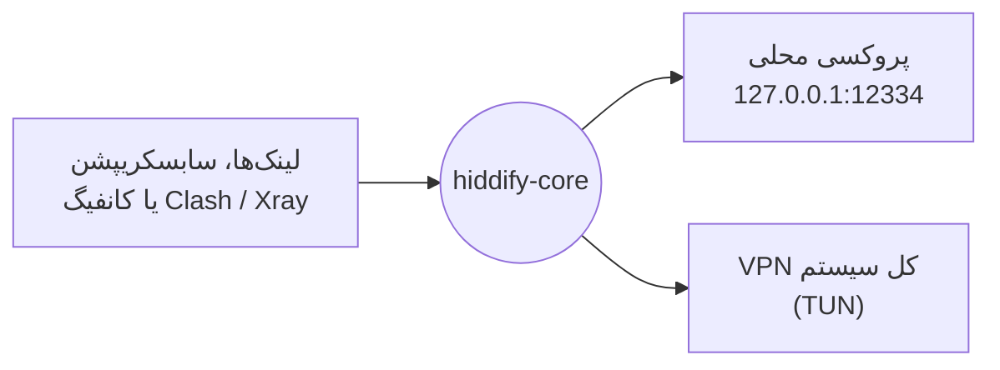

# هسته هیدیفای

**موتور اپ هیدیفای، حالا جدا و در خط فرمان.**

هسته هیدیفای (`hiddify-core`) همان بخشی از اپ هیدیفای است که اتصال را برقرار می‌کند. همین موتور را می‌توانید بدون اپ، با یک دستور، روی سرور، روتر یا کامپیوتری بدون صفحه‌نمایش اجرا کنید.

[:material-download: دانلود](https://github.com/hiddify/hiddify-core/releases){ .md-button .md-button--primary }
[:material-console: دستورها](cli.md){ .md-button }
[:material-star-four-points: قابلیت‌ها](features/index.md){ .md-button }

## کجا به کار می‌آید؟

<div class="grid cards" markdown>

-   :material-cellphone:{ .lg .middle } __داخل اپ هیدیفای__

    ---

    در اندروید، iOS، ویندوز، مک و لینوکس، همین هسته پشت دکمه اتصال کار می‌کند.

-   :material-server:{ .lg .middle } __روی سرور__

    ---

    یک کلاینت یا سرور پروکسی بدون محیط گرافیکی، به‌صورت یک سرویس همیشه روشن.

-   :material-router-wireless:{ .lg .middle } __روی روتر__

    ---

    روی OpenWrt نصب کنید تا همه دستگاه‌های خانه از آن رد شوند.
    [آموزش OpenWrt](../app/How-to-use-HiddifyCli-on-OpenWrt.md)

-   :material-laptop:{ .lg .middle } __روی کامپیوتر__

    ---

    در لینوکس و ویندوز، به‌عنوان پروکسی محلی یا VPN برای کل سیستم (در مک از اپ هیدیفای استفاده کنید).

</div>

## چطور کار می‌کند؟

به هسته فقط پروکسی‌ها را بدهید؛ بقیه را خودش می‌سازد.



هسته بر پایه **hiddify-sing-box** ساخته شده است، نسخه هیدیفای از [sing-box](https://sing-box.sagernet.org/). یعنی هر کانفیگ sing-box در آن کار می‌کند و ده‌ها پروتکل و ترفند ضدسانسور هم دارد که sing-box اصلی ندارد.

## نصب {#install}

=== ":material-linux: لینوکس و OpenWrt"

    این دستور سیستم و پردازنده را خودش تشخیص می‌دهد، هسته را نصب می‌کند و آن را به‌صورت سرویس راه می‌اندازد:

    ```bash
    bash <(curl -fsSL https://raw.githubusercontent.com/hiddify/hiddify-core/main/installer.sh)
    ```

    کانفیگ در `/etc/hiddify-core/config.json` است. بعد از ویرایش آن، سرویس را دوباره اجرا کنید:

    ```bash
    systemctl restart hiddify-core
    ```

    در OpenWrt: `/etc/init.d/hiddify-core restart`

=== ":material-download: دانلود دستی"

    فایل سیستم خود را از [صفحه نسخه‌ها](https://github.com/hiddify/hiddify-core/releases) بگیرید و باز کنید.

    - **لینوکس:** فایل `hiddify-core-linux-<پردازنده>.tar.gz` را بگیرید (مثلاً `amd64` یا `arm64`). فایل `libcronet.so` را کنار `hiddify-core` نگه دارید و `./hiddify-core` را از ترمینال اجرا کنید.
    - **ویندوز:** فایل `hiddify-lib-windows-amd64.tar.gz` را بگیرید. برنامهٔ خط فرمان داخل آن `HiddifyCli.exe` است: آن را از ترمینال با همان دستورهای این صفحه اجرا کنید (`HiddifyCli.exe run -c links.txt`).
    - **مک:** نسخهٔ خط فرمان برای مک وجود ندارد. از [اپ هیدیفای](../app/How-to-install-Hiddify-app.md) یا ایمیج داکر پایین استفاده کنید.

=== ":material-docker: داکر"

    ```bash
    docker pull ghcr.io/hiddify/hiddify-core:latest
    ```

    یا در پوشه `docker` مخزن: `docker-compose up -d`

!!! note "HiddifyCli حالا hiddify-core است"
    نام قبلی برنامهٔ خط فرمان **HiddifyCli** بود. از نسخهٔ ۵.۹ نام آن `hiddify-core` است و نمونه‌های این صفحه همین نام را به کار می‌برند. فقط در نسخهٔ ویندوز نام فایل هنوز `HiddifyCli.exe` است؛ دستورها یکی است.

## اجرا: `run` یا `srun`؟ {#run-or-srun}

بسته به اینکه چه چیزی در دست دارید، یکی از این دو را انتخاب کنید:

<div class="grid cards" markdown>

-   :material-auto-fix:{ .lg .middle } __`run`: فقط پروکسی دارید__

    ---

    لینک‌های اشتراک‌گذاری، لینک سابسکریپشن، یا کانفیگ Clash یا Xray.

    هسته بقیه کانفیگ را خودش می‌سازد: پروکسی محلی یا VPN، DNS، مسیریابی و انتخاب خودکار سریع‌ترین سرور.

    ```bash
    hiddify-core run -c links.txt
    ```

-   :material-file-code:{ .lg .middle } __`srun`: کانفیگ کامل sing-box دارید__

    ---

    کانفیگی که باید دقیقا همان‌طور که نوشته شده اجرا شود، مثل کانفیگ یک **سرور**.

    هسته چیزی به آن اضافه نمی‌کند و مثل خود sing-box اجرایش می‌کند، با همه قابلیت‌های هیدیفای.

    ```bash
    hiddify-core srun -c config.json
    ```

</div>

### نمونه‌های `run`

=== "پروکسی محلی"

    فایلی از لینک‌ها، هر خط یک لینک:

    ```bash
    hiddify-core run -c links.txt
    ```

    یا مستقیم لینک سابسکریپشن، که خودکار به‌روز می‌شود:

    ```bash
    hiddify-core run -c https://example.com/sub/abc
    ```

    یک پروکسی HTTP و SOCKS5 روی `127.0.0.1:12334` باز می‌شود. مرورگر یا برنامه‌ها را به آن وصل کنید.

=== "VPN کل سیستم"

    ```bash
    sudo hiddify-core run -c links.txt --tun
    ```

    همه برنامه‌ها از VPN رد می‌شوند. دسترسی root یا administrator لازم است.

=== "پروکسی سیستم"

    ```bash
    hiddify-core run -c links.txt --system-proxy
    ```

    پروکسی سیستم در دسکتاپ خودکار تنظیم می‌شود.

=== "با تنظیمات اپ شما"

    ```bash
    hiddify-core run -c links.txt -d hiddify-settings.json
    ```

    فایل تنظیمات را در اپ از **تنظیمات ← ⋮ ← خروجی گرفتن ← خروجی تمام تنظیمات به فایل** بگیرید.

??? info "`run` چه ورودی‌هایی را می‌خواند؟"
    - لینک‌های همه پروتکل‌هایی که اپ پشتیبانی می‌کند، هر خط یک لینک، ساده یا base64
    - لینک سابسکریپشن، حتی داخل یک فایل کنار لینک‌های دیگر
    - کانفیگ JSON sing-box (فقط `outbounds` و `endpoints` آن برداشته می‌شود)
    - کانفیگ YAML کلش یا mihomo (بخش `proxies`)
    - کانفیگ JSON ایکس‌ری (Xray)
    - فایل `.conf` وایرگارد

    با `--full-config`، inboundها، DNS و قوانین کانفیگ sing-box هم نگه داشته می‌شوند.

??? info "نکته‌های `srun`"
    | چه می‌خواهید | دستور |
    |---|---|
    | چند فایل که با هم ادغام شوند | `hiddify-core srun -c base.json -c outbounds.json` |
    | همه فایل‌های `.json` یک پوشه | `hiddify-core srun -C /etc/hiddify-core/conf.d` |
    | خواندن از ورودی استاندارد | `cat config.json \| hiddify-core srun -c stdin` |

    - **بارگذاری دوباره بدون قطعی:** `SIGHUP` بفرستید؛ کانفیگ جدید اول بررسی می‌شود.
    - **توقف:** `SIGINT` یا `SIGTERM`.

!!! tip "از پروکسی تا کانفیگ کامل، برای ویرایش دستی"
    1. لینک‌ها را به outboundهای sing-box تبدیل کنید: `hiddify-core parse links.txt -o outbounds.json`
    2. کانفیگ کامل کلاینت را بسازید: `hiddify-core build -c outbounds.json -o config.json`
    3. `config.json` را ویرایش و اجرا کنید: `hiddify-core srun -c config.json`

## چه چیزهایی بیشتر از sing-box دارد؟ {#differences}

<div class="grid cards" markdown>

-   :material-transit-connection-variant:{ .lg .middle } __ترنسپورت‌های Xray__

    ---

    [XHTTP](features/transports/xhttp.md)، [mKCP](features/transports/kcp.md)، [XDRIVE](features/transports/xdrive.md)، [finalmask](features/transports/finalmask.md)، [raw](features/transports/raw.md) و [رمزنگاری VLESS](features/protocols/vless-encryption.md)، داخل خود sing-box.

-   :material-shield-lock:{ .lg .middle } __پروتکل‌های بیشتر__

    ---

    [WARP](features/protocols/warp.md) رایگان، [AmneziaWG](features/protocols/amneziawg.md)، [سایفون](features/protocols/psiphon.md)، [Mieru](features/protocols/mieru.md)، [Sudoku](features/protocols/sudoku.md)، [TrustTunnel](features/protocols/trusttunnel.md)، [تونل معکوس](features/protocols/tunnel.md) و [بیشتر](features/protocols/index.md).

-   :material-dns:{ .lg .middle } __تونل از راه DNS__

    ---

    [DNSTT](features/protocols/dnstt.md)، [MasterDNS](features/protocols/masterdns.md) و [Soar](features/protocols/soar.md) که خودشان [ریزالورهای سالم](features/dns/smart-dns-pool.md) را پیدا می‌کنند.

-   :material-incognito:{ .lg .middle } __ترفندهای ضدسانسور__

    ---

    [تکه‌تکه کردن TLS](features/tls-fragment.md)، [ترفندهای TLS](features/tls-tricks.md) و [افزوده‌های ریالتی](features/reality-hiddify.md).

-   :material-scale-balance:{ .lg .middle } __گروه‌ها و پایش__

    ---

    [بالانسر](features/groups/balancer.md)، [fallback](features/groups/fallback.md)، [URL test بهتر](features/groups/urltest.md) و [پایش پس‌زمینه](features/groups/monitoring.md) تأخیر و IP خروجی.

-   :material-web:{ .lg .middle } __DNS هوشمند__

    ---

    [گروه DNS](features/dns/dns-group.md)، [bypass_if_failed](features/dns/dns-bypass-if-failed.md)، [DNSCrypt](features/dns/sdns.md) و [IPv6 بر اساس outbound](features/dns/ipv6-by-outbound.md).

</div>

[:material-format-list-bulleted: فهرست کامل قابلیت‌ها](features/index.md){ .md-button } [:material-bug-check: رفع باگ‌ها](bugfix/v5.md){ .md-button }

### مقایسه سریع

| | هسته هیدیفای | sing-box | Xray | mihomo |
|---|:-:|:-:|:-:|:-:|
| کانفیگ sing-box | :material-check: | :material-check: | :material-close: | :material-close: |
| خواندن لینک، سابسکریپشن، Clash و Xray | :material-check: | :material-close: | فقط Xray | فقط Clash |
| ساخت خودکار کانفیگ کلاینت از پروکسی‌ها | :material-check: | :material-close: | :material-close: | :material-close: |
| ترنسپورت‌های XHTTP و mKCP | :material-check: | :material-close: | :material-check: | :material-close: |
| WARP، AmneziaWG، سایفون، تونل DNS | :material-check: | :material-close: | :material-close: | تا حدی |
| API کنترل | gRPC و Clash API | Clash API | gRPC | Clash API |

- **کاربر Xray هستید؟** لینک‌ها و کانفیگ‌های JSON ایکس‌ری (حتی فیلد `extra` در XHTTP) همان‌طور که هستند کار می‌کنند، و می‌توانید آن‌ها را کنار Hysteria2، WARP و تونل‌های DNS در یک کانفیگ داشته باشید.
- **کاربر mihomo هستید؟** سابسکریپشن Clash بدون تغییر با `run` کار می‌کند و گروه‌های آشنا (انتخاب، URL test، fallback، بالانسر) را دارد.

## قدم بعدی

<div class="grid cards" markdown>

-   :material-console-line:{ .lg .middle } [__راهنمای خط فرمان__](cli.md)

    ---

    همه دستورها و گزینه‌های `hiddify-core`.

-   :material-star-four-points:{ .lg .middle } [__قابلیت‌ها__](features/index.md)

    ---

    یک صفحه برای هر پروتکل، ترنسپورت و قابلیت DNS.

-   :material-router:{ .lg .middle } [__هسته روی OpenWrt__](../app/How-to-use-HiddifyCli-on-OpenWrt.md)

    ---

    نصب روی روتر، قدم‌به‌قدم.

-   :material-code-braces:{ .lg .middle } [__برای توسعه‌دهندگان__](app_considerations.md)

    ---

    آنچه اپ و هسته درباره نسخه ۵ باید بدانند. کد: [hiddify-core](https://github.com/hiddify/hiddify-core) و [hiddify-sing-box](https://github.com/hiddify/hiddify-sing-box).

</div>
