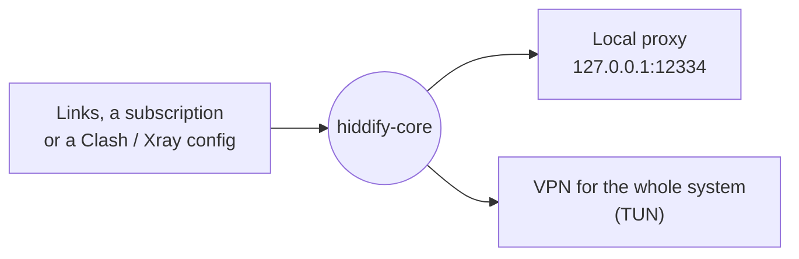

# Hiddify Core

**The engine of the Hiddify app, on its own, on the command line.**

Hiddify Core (`hiddify-core`) is the part of the Hiddify app that makes the connection. You can run the same engine without the app, with one command, on a server, a router or a computer without a screen.

[:material-download: Download](https://github.com/hiddify/hiddify-core/releases){ .md-button .md-button--primary }
[:material-console: Commands](cli.md){ .md-button }
[:material-star-four-points: Features](features/index.md){ .md-button }

## Where can I use it?

<div class="grid cards" markdown>

-   :material-cellphone:{ .lg .middle } __Inside the Hiddify app__

    ---

    On Android, iOS, Windows, macOS and Linux, this core works behind the connect button.

-   :material-server:{ .lg .middle } __On a server__

    ---

    A proxy client or server with no desktop, running as an always-on service.

-   :material-router-wireless:{ .lg .middle } __On a router__

    ---

    Install it on OpenWrt so every device at home goes through it.
    [OpenWrt guide](../app/How-to-use-HiddifyCli-on-OpenWrt.md)

-   :material-laptop:{ .lg .middle } __On a computer__

    ---

    On Linux, Windows and macOS, as a local proxy or a VPN for the whole system.

</div>

## How does it work?

Give the core only your proxies; it builds the rest.



The core is built on **hiddify-sing-box**, Hiddify's version of [sing-box](https://sing-box.sagernet.org/). So every sing-box config works in it, and it adds dozens of protocols and anti-censorship tricks that upstream sing-box does not have.

## Install

=== ":material-linux: Linux and OpenWrt"

    This command detects your system and processor, installs the core and sets it up as a service:

    ```bash
    bash <(curl https://i.hiddify.com/core)
    ```

    The config is `/etc/hiddify-core/config.json`. After editing it, restart the service:

    ```bash
    systemctl restart hiddify-core
    ```

    On OpenWrt: `/etc/init.d/hiddify-core restart`

=== ":material-download: Manual download"

    Get the file for your system from the [releases page](https://github.com/hiddify/hiddify-core/releases) and unpack it.

    - **Linux:** keep the `lib` folder next to `HiddifyCli`.
    - **Windows:** run `HiddifyCli.exe` from a terminal.

=== ":material-docker: Docker"

    ```bash
    docker pull ghcr.io/hiddify/hiddify-core:latest
    ```

    Or, in the `docker` folder of the repository: `docker-compose up -d`

!!! note "Two names, one program"
    The examples on this page call the program `HiddifyCli`. After the Linux installer, it is called `hiddify-core`.

## Run: `run` or `srun`? {#run-or-srun}

Pick one, depending on what you have:

<div class="grid cards" markdown>

-   :material-auto-fix:{ .lg .middle } __`run`: you only have proxies__

    ---

    Share links, a subscription link, or a Clash or Xray config.

    The core builds the rest of the config by itself: a local proxy or a VPN, DNS, routing and automatic choice of the fastest server.

    ```bash
    HiddifyCli run -c links.txt
    ```

-   :material-file-code:{ .lg .middle } __`srun`: you have a full sing-box config__

    ---

    A config that must run exactly as written, such as a **server** config.

    The core adds nothing to it and runs it like sing-box itself, with every Hiddify feature.

    ```bash
    HiddifyCli srun -c config.json
    ```

</div>

### `run` examples

=== "Local proxy"

    A file of links, one link per line:

    ```bash
    HiddifyCli run -c links.txt
    ```

    Or a subscription link directly, which updates by itself:

    ```bash
    HiddifyCli run -c https://example.com/sub/abc
    ```

    An HTTP and SOCKS5 proxy opens on `127.0.0.1:12334`. Point your browser or apps to it.

=== "VPN for the whole system"

    ```bash
    sudo HiddifyCli run -c links.txt --tun
    ```

    Every app goes through the VPN. Needs root or administrator rights.

=== "System proxy"

    ```bash
    HiddifyCli run -c links.txt --system-proxy
    ```

    Sets the desktop's system proxy by itself.

=== "With your app settings"

    ```bash
    HiddifyCli run -c links.txt -d hiddify-settings.json
    ```

    Get the settings file in the app from **Settings → ⋮ → Export → Export all settings to a file**.

??? info "What can `run` read?"
    - Links of every protocol the app supports, one per line, plain or base64
    - Subscription links, even inside a file next to other links
    - A sing-box JSON config (only its `outbounds` and `endpoints` are taken)
    - A Clash or mihomo YAML config (its `proxies` section)
    - An Xray JSON config
    - A WireGuard `.conf` file

    With `--full-config`, the inbounds, DNS and rules of a sing-box config are kept too.

??? info "`srun` tips"
    | You want | Command |
    |---|---|
    | Several files, merged together | `HiddifyCli srun -c base.json -c outbounds.json` |
    | Every `.json` file in a folder | `HiddifyCli srun -C /etc/hiddify-core/conf.d` |
    | Read from standard input | `cat config.json \| HiddifyCli srun -c stdin` |

    - **Reload without downtime:** send `SIGHUP`; the new config is checked first.
    - **Stop:** `SIGINT` or `SIGTERM`.

!!! tip "From proxies to a full config you can edit by hand"
    1. Turn links into sing-box outbounds: `HiddifyCli parse links.txt -o outbounds.json`
    2. Build the full client config: `HiddifyCli build -c outbounds.json -o config.json`
    3. Edit `config.json` and run it: `HiddifyCli srun -c config.json`

## What does it add to sing-box? {#differences}

<div class="grid cards" markdown>

-   :material-transit-connection-variant:{ .lg .middle } __Xray transports__

    ---

    [XHTTP](features/transports/xhttp.md), [mKCP](features/transports/kcp.md), [XDRIVE](features/transports/xdrive.md), [finalmask](features/transports/finalmask.md), [raw](features/transports/raw.md) and [VLESS encryption](features/protocols/vless-encryption.md), inside sing-box itself.

-   :material-shield-lock:{ .lg .middle } __More protocols__

    ---

    Free [WARP](features/protocols/warp.md), [AmneziaWG](features/protocols/amneziawg.md), [Psiphon](features/protocols/psiphon.md), [Mieru](features/protocols/mieru.md), [Sudoku](features/protocols/sudoku.md), [TrustTunnel](features/protocols/trusttunnel.md), [reverse tunnel](features/protocols/tunnel.md) and [more](features/protocols/index.md).

-   :material-dns:{ .lg .middle } __Tunnels over DNS__

    ---

    [DNSTT](features/protocols/dnstt.md), [MasterDNS](features/protocols/masterdns.md) and [Soar](features/protocols/soar.md), which find [working resolvers](features/dns/smart-dns-pool.md) by themselves.

-   :material-incognito:{ .lg .middle } __Anti-censorship tricks__

    ---

    [TLS fragment](features/tls-fragment.md), [TLS tricks](features/tls-tricks.md) and [Reality additions](features/reality-hiddify.md).

-   :material-scale-balance:{ .lg .middle } __Groups and monitoring__

    ---

    [Balancer](features/groups/balancer.md), [fallback](features/groups/fallback.md), [better URL test](features/groups/urltest.md) and [background monitoring](features/groups/monitoring.md) of delay and exit IP.

-   :material-web:{ .lg .middle } __Smart DNS__

    ---

    [DNS group](features/dns/dns-group.md), [bypass_if_failed](features/dns/dns-bypass-if-failed.md), [DNSCrypt](features/dns/sdns.md) and [IPv6 by outbound](features/dns/ipv6-by-outbound.md).

</div>

[:material-format-list-bulleted: Full feature list](features/index.md){ .md-button } [:material-bug-check: Bug fixes](bugfix/v5.md){ .md-button }

### Quick comparison

| | Hiddify Core | sing-box | Xray | mihomo |
|---|:-:|:-:|:-:|:-:|
| sing-box configs | :material-check: | :material-check: | :material-close: | :material-close: |
| Reads links, subscriptions, Clash and Xray | :material-check: | :material-close: | Xray only | Clash only |
| Builds a client config from proxies by itself | :material-check: | :material-close: | :material-close: | :material-close: |
| XHTTP and mKCP transports | :material-check: | :material-close: | :material-check: | :material-close: |
| WARP, AmneziaWG, Psiphon, DNS tunnels | :material-check: | :material-close: | :material-close: | partly |
| Control API | gRPC and Clash API | Clash API | gRPC | Clash API |

- **Coming from Xray?** Xray links and JSON configs (even the `extra` field of XHTTP) work as they are, and you can use them next to Hysteria2, WARP and DNS tunnels in one config.
- **Coming from mihomo?** A Clash subscription works with `run` without changes, with the groups you know (select, URL test, fallback, balancer).

## Next steps

<div class="grid cards" markdown>

-   :material-console-line:{ .lg .middle } [__Command-line reference__](cli.md)

    ---

    Every command and flag of `HiddifyCli`.

-   :material-star-four-points:{ .lg .middle } [__Features__](features/index.md)

    ---

    A page for every protocol, transport and DNS feature.

-   :material-router:{ .lg .middle } [__The core on OpenWrt__](../app/How-to-use-HiddifyCli-on-OpenWrt.md)

    ---

    Install it on a router, step by step.

-   :material-code-braces:{ .lg .middle } [__For developers__](app_considerations.md)

    ---

    What the app and the core need to know about version 5. Code: [hiddify-core](https://github.com/hiddify/hiddify-core) and [hiddify-sing-box](https://github.com/hiddify/hiddify-sing-box).

</div>
