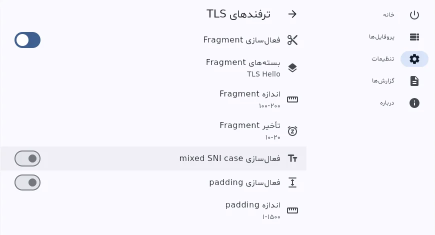
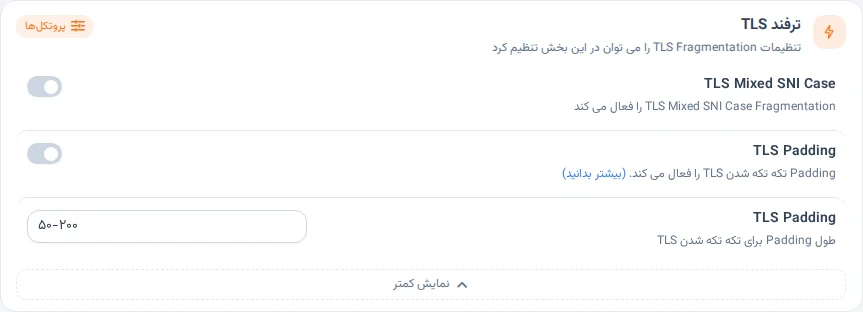

# یک روش مناسب برای پیدا کردن مقادیر ترفند TLS، و جای تنظیم آن‌ها

!!! info "نوشته‌شده برای هیدیفای‌منیجر نسخهٔ ۱۴.۵ و اپ هیدیفای ۵.۹"
    مقادیر Fragment در **اپ هیدیفای** تنظیم می‌شوند. پنل فقط کلیدهای **TLS Mixed SNI Case** و **TLS Padding** را دارد. [ترفندهای TLS را کجا تنظیم کنیم](/fa/manager/basic-concepts-and-troubleshooting/How-the-TLS-Trick-works-and-its-usage/#where-to-set) را ببینید.

در ماه‌های اخیر استفاده از TLS Trick یا فرگمنت به کابوسی برای سیستم‌های فیلترینگ و فایروال‌ها در کشورها تبدیل شده است. متاسفانه، طیف وسیعی از این روش‌ها محدود شده‌اند و در حال حاضر تنها روی برخی ISPها (اپراتورها) کارساز هستند. با این حال، می‌توان با استفاده از یک اسکنر، مقادیر سازگار با هر اپراتور را از طریق سرور مجازی (VPS) پیدا کرد.

---

## روش پیدا کردن مقادیر فرگمنت

برای پیدا کردن مقادیر مناسب فرگمنت، مراحل زیر را دنبال کنید:

1. **وارد سرور مجازی خود شوید، یا در اندروید Termux را باز کنید،** و دستور زیر را اجرا کنید:
   ```bash
   bash <(curl -fsSL https://raw.githubusercontent.com/Ptechgithub/FragmentScanner/main/install.sh)
   ```

2. پس از نصب اسکریپت، سه گزینه به شما نمایش داده می‌شود:
   1. `config to fragment`
   2. `fragment scanner`
   3. `exit`

3. ابتدا گزینه **1** را انتخاب کنید که از شما درخواست می‌کند کانفیگ مورد نظر خود برای تست را ارسال کنید.

    !!! note "نکتهٔ مهم"
        اسکریپت فقط از پروکسی‌های `tls`، `grpc` و `vless`/`vmess`/`trojan` پشتیبانی می‌کند.

4. پس از ارسال کانفیگ، اسکریپت فرمت فرگمنت کانفیگ را به شما نمایش داده و آن را داخل فایل `config.json` ذخیره می‌کند که برای اسکن در مرحله بعدی از آن استفاده کند.

5. سپس گزینه **2** را انتخاب کرده و به چهار سوال پاسخ دهید تا اسکن آغاز شود:

   - **سوال اول:** تعداد دفعات امتحان مقادیر تصادفی فرگمنت (پیش‌فرض: ۱۰)
   - **سوال دوم:** زمان تداوم تست هر مقدار بر حسب ثانیه [Time out] (پیشنهاد: ۴)
   - **سوال سوم:** اگر می‌خواهید پورت کانفیگ را تغییر دهید، پورت جدید را وارد کنید و برای استفاده از پورت کانفیگ وارد شده در مرحله ۱، Enter بزنید.
   - **سوال چهارم:** تعداد دفعات تست هر مقدار.

6. پس از پاسخ به این سوالات، اسکن آغاز شده و نتایج به شما نمایش داده می‌شود. مقادیر برتر در بالای لیست قرار دارند. مقادیر ارائه شده شامل نوع پکت، مقدار Interval و Length می‌باشد.

---

## تنظیم مقادیر در اپ هیدیفای

اسکنر برای هر نتیجهٔ خوب، **نوع پکت** (مثلاً `tlshello` یا `1-3`)، **طول** (Length) و **فاصلهٔ زمانی** (Interval) را نشان می‌دهد. بهترین نتیجه را در اپ بگذارید:

1. اپ هیدیفای را باز کنید و به **تنظیمات** › **ترفندهای TLS** بروید.
2. **فعال‌سازی Fragment** را روشن کنید.
3. در **بسته‌های Fragment** نوع پکت نتیجه را انتخاب کنید: **TLS Hello** برای `tlshello`، یا **1-1** تا **1-5**.
4. در **اندازه Fragment** طول (مثلاً `10-30`) و در **تأخیر Fragment** فاصلهٔ زمانی (مثلاً `2-8`) را وارد کنید.
5. دوباره وصل شوید و امتحان کنید.

همین صفحه **فعال‌سازی mixed SNI case** و **فعال‌سازی padding** را هم همراه با **اندازه padding** دارد.



## آنچه در پنل تنظیم می‌شود

در پنل، **تنظیمات** › **ترفند TLS** (کارتی پیشرفته است: **نمایش تنظیمات پیشرفته** را روشن کنید) فقط این‌ها را دارد:

- **TLS Mixed SNI Case:** نام دامنه را در دست‌دادن TLS با ترکیبی از حروف بزرگ و کوچک می‌نویسد. پیشنهاد می‌کنیم روشن باشد.
- **TLS Padding** (و طول آن): به دست‌دادن TLS پدینگ اضافه می‌کند. فقط اگر روی اپراتورهای شما کمک می‌کند روشنش کنید.



این‌ها در کانفیگ‌هایی که پنل به کاربران می‌دهد قرار می‌گیرند. توضیح دقیقشان: [همهٔ تنظیمات هیدیفای‌منیجر › ترفند TLS](/fa/manager/configuration-and-advanced-settings/Settings-reference/#tls_trick). خود Fragment دیگر تنظیم پنل نیست: هر کاربر آن را در اپ خودش تنظیم می‌کند، چون مقدار مناسبش به اپراتور همان کاربر بستگی دارد.

## مقاله‌های مرتبط

- [مفاهیم پایهٔ اینترنت و پروکسی](/fa/manager/basic-concepts-and-troubleshooting/Basic-Concepts/)
- [ترفند TLS چیست](/fa/manager/basic-concepts-and-troubleshooting/How-the-TLS-Trick-works-and-its-usage/)
- [MUX چیست](/fa/manager/basic-concepts-and-troubleshooting/How-MUX-works-and-its-usage/)
- [عیب‌یابی مشکلات اتصال](/fa/manager/basic-concepts-and-troubleshooting/Troubleshooting-connectivity-issues-with-HiddifyManager-and-proxies/)
