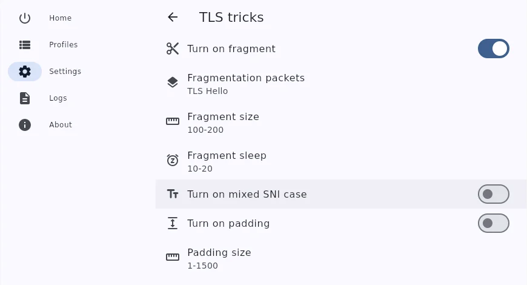
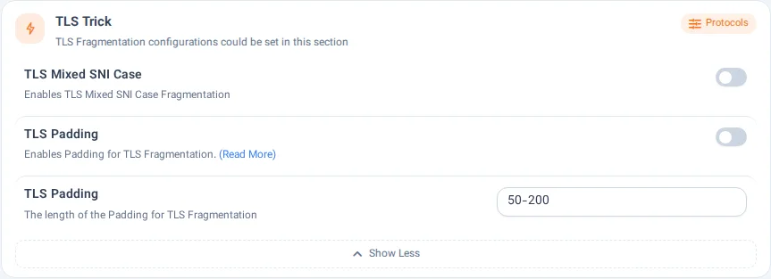

# A suitable method for finding TLS trick values, and where to set them

!!! info "Written for Hiddify Manager v14.5 and the Hiddify app 5.9"
    The fragment values are set in the **Hiddify app**. The panel only has the **TLS Mixed SNI Case** and **TLS Padding** switches. See [Where to set the TLS tricks](/manager/basic-concepts-and-troubleshooting/How-the-TLS-Trick-works-and-its-usage/#where-to-set).

In recent months, the use of TLS Trick or Fragment has become a nightmare for filtering systems and firewalls in various countries. Unfortunately, many methods have been restricted, and currently, they only work with some ISPs (Internet Service Providers). However, it is possible to find compatible values for each operator using a scanner through a virtual server (VPS).

---

## Finding fragment values

To find suitable fragment values, follow these steps:

1. **Connect to your virtual server, or open Termux on Android,** and run the following command:
   ```bash
   bash <(curl -fsSL https://raw.githubusercontent.com/Ptechgithub/FragmentScanner/main/install.sh)
   ```

2. After installing the script, three options will be displayed:
   1. `config to fragment`
   2. `fragment scanner`
   3. `exit`

3. Select **1** to upload your desired configuration for testing.

    !!! note "Important"
        The script supports only `tls`, `grpc` and `vless`/`vmess`/`trojan` proxies.

4. After submitting the configuration, the script will display and save the fragment format in `config.json` for use in the next scanning step.

5. Choose option **2** and answer four questions to start scanning:

   - **Question 1:** Number of random fragment values to test (default: 10).
   - **Question 2:** Duration of each test in seconds [Time out] (suggested: 4).
   - **Question 3:** If you want to change the config port, enter the new port or press Enter to use the previous port.
   - **Question 4:** Number of test iterations per value.

6. After responding to these questions, the scan will begin, and the results will be displayed. The top values will be listed first. The provided values include packet type, interval, and length.

---

## Set the values in the Hiddify app

The scanner shows, for each good result, the **packet type** (for example `tlshello` or `1-3`), the **length** and the **interval**. Put the best one in the app:

1. Open the Hiddify app and go to **Settings** › **TLS tricks**.
2. Turn on **Turn on fragment**.
3. In **Fragmentation packets**, choose the packet type of the result: **TLS Hello** for `tlshello`, or **1-1** … **1-5**.
4. In **Fragment size**, enter the length (for example `10-30`), and in **Fragment sleep** the interval (for example `2-8`).
5. Connect again and test.

The same page has **Turn on mixed SNI case** and **Turn on padding** with **Padding size**.



## What you can set in the panel

In the panel, **Settings** › **TLS Trick** (an advanced card: turn on **Show Advanced Settings**) has only:

- **TLS Mixed SNI Case:** writes the domain name in the TLS handshake with mixed upper and lower case letters. We recommend turning it on.
- **TLS Padding** (and its length): adds padding to the TLS handshake. Turn it on only if it helps on your operators.



These go into the configs the panel gives your users. Their exact meaning: [All Hiddify Manager settings › TLS Trick](/manager/configuration-and-advanced-settings/Settings-reference/#tls_trick). The fragment itself is not a panel setting any more: each user sets it in their app, because good values depend on the user's operator.

## Related articles

- [Internet and proxy basics](/manager/basic-concepts-and-troubleshooting/Basic-Concepts/)
- [How the TLS trick works](/manager/basic-concepts-and-troubleshooting/How-the-TLS-Trick-works-and-its-usage/)
- [How MUX works](/manager/basic-concepts-and-troubleshooting/How-MUX-works-and-its-usage/)
- [Connection problems](/manager/basic-concepts-and-troubleshooting/Troubleshooting-connectivity-issues-with-HiddifyManager-and-proxies/)
