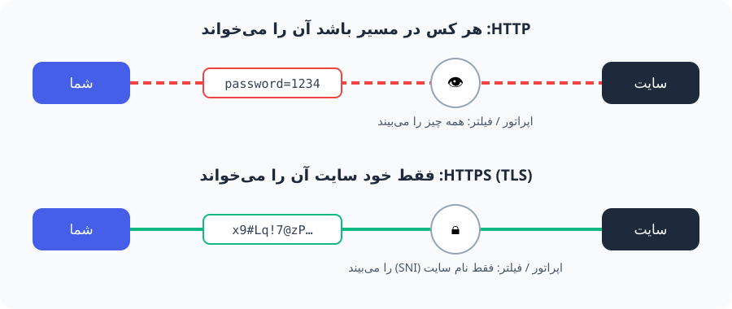
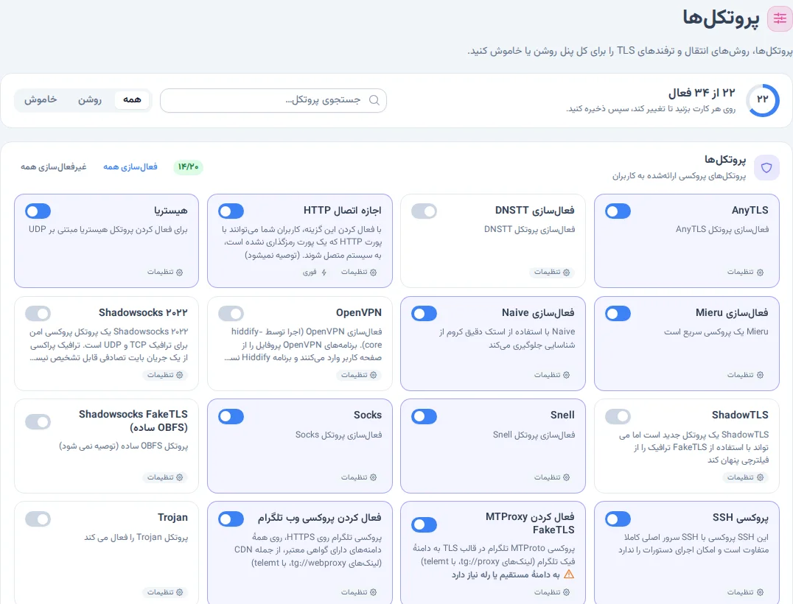

# مفاهیم پایه

از آنجا که ممکن است بعضی از مفاهیم استفاده شده در مطالب این ویکی و همینطور دنیای پروکسی‌ها برای افراد زیادی ناآشنا باشند؛ در این مطلب سعی می‌شود این موارد به زبان ساده توضیح داده شوند.

## آدرس IP
 آدرس IP آدرس منحصر‌به‌فردی است که یک دستگاه را در اینترنت یا شبکه محلی شناسایی می‌کند و از این طریق می‌توان به اینترنت یا شبکه محلی دسترسی داشت. به‌بیان بهتر، آدرس‌های IP شناسه‌هایی هستند که اجازه ارسال اطلاعات بین دستگاه‌های موجود در شبکه را صادر می‌کنند؛ زیرا آن‌ها حاوی اطلاعات مکان جغرافیایی دستگاه هستند؛ از‌این‌رو، دستگاه‌ها را برای برقراری ارتباط دردسترس یکدیگر قرار می‌دهند.

دو ورژن آی‌پی داریم. یکی آی‌پی ورژن ۴ و یکی آی‌پی ورژن ۶

### آی‌پی ورژن ۴ یا IPv4
آی‌پی ورژن ۴ شامل ۴ بخش است که هر بخش با `نقطه` از هم جدا می‌شوند. مثلا `w.x.y.z` که هر کدام از این‌ها می‌توانند بین ۰ تا ۲۵۵ باشند. در نهایت یک آی‌پی ورژن ۴ به این شکل است.

`54.78.11.14`

### آی‌پی ورژن ۶ یا IPv6
این آدرس آی‌پی ورژن جدید آی‌پی‌هاست که بر مبنای اعداد hex یا ۱۶ پایه‌گذاری شده است. شامل ۸ بخش (هر بخش حداکثر ۴ رقم hex) است که با `:` از هم جدا می‌شوند. یک آی‌پی ورژن ۶ به این شکل است.

`2001:0db8:85a3:0000:0000:8a2e:0370:7334`

این آی‌پی را کوتاه‌تر هم می‌شود نوشت: صفرهای ابتدای هر بخش حذف می‌شوند و یک دنبالهٔ پشت‌سرهم از بخش‌های تمام‌صفر را می‌شود با `::` جایگزین کرد. همان آی‌پی این‌طور نوشته می‌شود.

`2001:db8:85a3::8a2e:370:7334`

 
## HTTP
پروتکل پایه اینترنت است و شالودهٔ ارتباط اطلاعاتی برای وب است که در آن مستندات شامل لینک‌هاو متن‌ها به سایر منابع متصل می‌شوند که کاربر به راحتی می‌تواند به عنوان مثال با یک کلیک یا با تپ بر روی صفحه نمایش در یک مرورگر وب به آن‌ها دسترسی داشته باشد. این پروتکل از یک url یا نشانی وب برای آدرس‌دهی استفاده می‌کند و این آدرس‌ها را دامنه می‌گوییم که در ادامه تعریف می‌شوند. 

پروتکل HTTP از Handshaking به منظور ارسال و دریافت اطلاعات استفاده می‌کند. در این روش برای شروع و پایان عملیات تبادل اطلاعات بین سرور و کلاینت، چندین درخواست و پاسخ رد و بدل می‌شود. تصور کنید که کلاینت (مرورگر) فردی است که قصد دارد اطلاعات مربوط به یک سایت را دریافت کند. در ابتدا باید درخواستی با این هدف به سرور آن سایت ارسال کند. سپس باید صبر کند، تا از طرف سرور پاسخی برای درخواستش دریافت کند. در صورتی که اطلاعات خواسته شده در سرور موجود باشند، پاسخی مبنی بر موافقت ارسال اطلاعات برای شخص ارسال می‌شود.
سپس بار دیگر از طرف کلاینت پیامی مبنی بر درخواست داده‌های اطلاعاتی به سرور فرستاده می‌شود. در این مرحله سرور پیام را دریافت کرده و داده‌های درخواست شده را در بسته‌های اطلاعاتی کوچک‌تری تقسیم می‌کند. در نهایت این بسته‌ها توسط پروتکل Handshaking پشت سر هم و به ترتیب برای شخص ارسال می‌شوند. ارتباط بین کلاینت و سرور در این پروتکل معمولا از طریق پورت ۸۰ انجام می‌شود.

## HTTPS
این پروتکل در حقیقت نسخه امنیتی پروتکل HTTP است. به دلیل اینکه اطلاعات و داده‌ها در پروتکل HTTP رمزگذاری نمی‌شوند، به راحتی قابل هک و سوءاستفاده است. بر این اساس اگر کسی مانند سرویس دهنده اینترنت به مسیر تبادل اطلاعات دسترسی داشته باشد به راحتی می‌تواند اطلاعاتی که در حال رد و بدل شدن هستند را مشاهده کند. اما در HTTPS اطلاعات رد و بدل شده بین وبسایت و کاربر، به صورت رمزنگاری شده منتقل می‌شوند. یعنی حتی اگر کسانی بتوانند به اطلاعات رد و بدل شده در سایت دسترسی پیدا کنند، نمی‌توانند از محتوای آن سوءاستفاده کنند. زیرا این اطلاعات به صورت رمزنگاری شده هستند و فقط توسط کسی قابل مشاهده خواهند بود که کلید رمزگشایی آن‌ها را داشته باشد. از یکی از دو پروتکل SSL یا TLS برای رمزگذاری ارتباطات استفاده می‌کند که در ادامه توضیح داده خواهند شد. 

## HTTP Upgrade { #http-upgrade }
**HTTP Upgrade** روشی است برای تبدیل یک اتصال HTTP معمولی به نوع دیگری از اتصال. کلاینت یک درخواست HTTP با هدر `Upgrade` می‌فرستد، سرور قبول می‌کند و از آن به بعد همان اتصال داده‌های دیگری را جابه‌جا می‌کند؛ در اینجا ترافیک پروکسی شما را.

ترنسپورت `HTTPUpgrade` در Xray و sing-box فقط از همین درخواست و پاسخ اول استفاده می‌کند و بعد داده‌ها را مستقیم می‌فرستد. شبیه WebSocket است، ولی ساده‌تر و سبک‌تر. چون مثل یک درخواست HTTP معمولی شروع می‌شود، خیلی از CDNها و ریورس‌پروکسی‌ها آن را عبور می‌دهند و برای استفاده پشت CDN مناسب است. این روش به‌تنهایی رمزنگاری اضافه نمی‌کند؛ امنیت از TLS دور آن می‌آید.

## دامنه
به زبان خیلی ساده در تعریف دامنه چیست باید گفت همان آدرسی که در مرورگر خود برای ورود به هر سایتی وارد می‌کنید دامنه است. دامنه‌ها از طریق آی‌پی به میزبانی وبسایت شما متصل می‌شوند. هر سرور با یک آدرس آی‌پی در دنیای اینترنت شناخته می‌شود. آدرس آی‌پی‌ها از طریق سرویسی به نام DNS یا Domain Name System روی دامنه شما تعریف می‌شوند.

## SSL
این پروتکل اطلاعات را با استفاده از کلیدهای خصوصی و عمومی رمزنگاری (Encrypt) می‌کند. اطلاعات رمزگذاری شده توسط این پروتکل در سمت دیگر رمزگشایی (Decrypt) می‌شوند. امنیت در این پروتکل در مبدا و مقصد اطلاعات حفظ می‌شود، یعنی در هر دو طرف، فرایند رمزنگاری و رمزگشایی انجام می‌گیرد. وب‌سایت‌هایی که از این پروتکل جهت رمزگذاری داده‌ها استفاده می‌کنند، معمولا از طریق پروتکل HTTPS با کلاینت‌ها ارتباط برقرار می‌کنند. برای داشتن یک ارتباط امن در بستر پروتکل HTTPS برای سایت خود، نیاز به تهیه یک گواهی معتبر ssl دارید. در این پروتکل اطلاعات تبادل شده بین سرور و کلاینت رمزگذاری می‌شوند؛ بر این اساس این اطلاعات توسط شخص سوم قابل مشاهده نخواهند بود. البته همچنان دسترسی به این داده‌ها امکان‌پذیر است، اما با توجه به اینکه آن‌ها رمزگذاری شده‌اند، برای مشاهده داده‌های آن‌ها، نیازمند رمزگشایی هستند. رمزگشایی این داده بدون کلید مورد استفاده در نشست (session) ارتباطی امن امکان‌پذیر نیست. بنابراین، این پروتکل عملاً غیرقابل نفوذ است.

## TLS
یک پروتکل امنیتی است بر پایه پروتکل SSL ایجاد شده است. TLS نسخه بهبود یافته پروتکل SSL است که اگر چه تفاوت‌های خیلی کمی با SSL دارد، اما تقریبا بخش عمده آن یکسان مانده است. البته TLS از الگوریتم رمزنگاری قوی‌تری نسبت به پروتکل SSL استفاده می‌کند و در ایجاد کلید عمومی و احراز هویت کردن پیام‌ها، TLS امن‌تر و کارامدتر از SSL عمل می‌کند. به بیان دقیق‌تر، TLS پروتکلی است که برای رمزگذاری ارتباطات مبتنی بر وب، بین یک کلاینت و یک سرور، با استفاده از مجموعه‌ای از الگوریتم‌های رمزنگاری (uTLS, alpn, allowInsecure)، استفاده می‌شود. 
مهم: «شناسایی کاربر بر اساس فیلدهای پیام در طی TLS Handshaking است.»

با تجزیه و تحلیل ترافیک TLS، فیلترچی می‌تواند حدس بزند که کاربر به کدام وب‌سایت سر می‌زند و اطلاعات سرور(آی‌پی، لوکیشن و...)چیست.
مواردی که باید به‌دقت انجام بدهیم، تا به‌شکل صحیحی از الگوریتم‌های TLS استفاده کنیم و فیلترچی نتواند نام دامنه(SNI) را ببیند.

uTLS:
استفاده از فینگرپرینت اختصاصی مرورگر.
«برای جلوگیری از تکیه بر یک فینگرپرینت و بروز خطاهای احتمالی، استفاده از چندین اثر انگشت، Randomized، توصیه می‌شود.»

alpn: 
پروتکل گفت‌وگوی بین کلاینت و سرور را از پیش تعیین می‌کند، در نتیجه بارگذاری اطلاعات و رمزگذاری TLS را سرعت می‌بخشد. 

allowInsecure:
مانع استفاده از گواهی‌های جعلی می‌شود.

تنظیماتی که می‌بایست درباره کانکشن‌ها در نظر داشت:

`uTLS = Randomized, Chrome. Firefox, etc`

`alpn = H2,HTTP/1.1`

`allowInsecure = false`

نکته: تنظیمات این ٣ مورد می‌تونه با توجه به نوع کانفیگ و وضعیت اینترنت متفاوت باشه.

## Xray

Xray یکی از دو موتوری است که هیدیفای‌منیجر برای عبور از سیستم فیلترینگ از آن استفاده می‌کند؛ دیگری هستهٔ هیدیفای (بر پایهٔ sing-box) است که پروتکل‌هایی را ارائه می‌دهد که Xray ندارد، مثل Hysteria2، TUIC، WireGuard و Mieru. Xray که در سال ۲۰۲۰ معرفی شد، نسخهٔ اصلاح‌شده و بهتر V2ray معروف است: همهٔ پروتکل‌های V2ray به‌اضافهٔ پروتکل‌های جدیدتری مثل VLESS، ریالتی و XHTTP را دارد.

## VMess
یکی از اولین پروتکل‌های زیرمجموعه V2ray و Xray بود که بسته‌های اطلاعاتی را بر اساس زمان سیستم رمزگذاری و ارسال می‌کرد که البته این پروتکل به دلیل ضعف‌هایی که در الگوریتم آن وجود دارد، توسط سیستم فیلترینگ قابل شناسایی است و توصیه می‌شود تا جای ممکن استفاده نشود.

## VLESS
پروتکل VLESS نسخه اصلاح شده VMess می‌باشد! در VLESS تمامی معایب VMess رفع گردیده و با توجه به تفاوت در رمزنگاری در VLESS و سبک‌تر بودن این امکان را فراهم می‌نماید تا کاربران بیشتری نسبت به VMess روی یک سرور داشته باشید

## Trojan
این پروتکل یک راه ایمن دیگر جهت عبور از سیستم فیلترینگ میباشد Trojan که در سال 2017 معرفی گردید همیشه در کنار VLESS یک پروتکل قدرتمند جهت عبور از سیستم فیلترینگ مورد استفاده قرار گرفته است. 

## Reality
REALITY به جای TLS استفاده می‌شود و می‌تواند ویژگی‌های اثرانگشت TLS سرور را از بین ببرد، همچنان محرمانه‌ای رو به جلو داشته باشد، و غیره.
می‌توانید بدون نیاز به خرید نام دامنه یا پیکربندی سرور TLS به وب‌سایت‌های دیگر اشاره کنید، که راحت‌تر است و TLS واقعی کامل مشخص کردن SNI برای واسطه را درک می‌کند.

نکته: هیدیفای‌منیجر پروتکل‌های زیادی را پشتیبانی می‌کند (صفحهٔ **پروتکل‌ها** در پنل را ببینید) و تنظیمات پیش‌فرض آن پروتکل‌های مقاوم را روشن می‌کنند. به طور کلی (نسخهٔ ۱۴.۵):

- **اتصال مستقیم به سرور:** `VLESS + Reality` (بدون نیاز به دامنه)، یا `VLESS` / `Trojan` با TLS روی دامنهٔ خودتان.
- **پشت CDN:** `VLESS` یا `Trojan` روی `XHTTP`، `WebSocket`، `HTTPUpgrade` یا `gRPC`.
- **پروتکل‌های UDP برای شبکه‌های ناپایدار:** `Hysteria2` و `TUIC`.
- تا جای ممکن از `VMess` و HTTP بدون رمزنگاری استفاده نکنید.

در پنل، پروتکل‌ها در صفحهٔ **پروتکل‌ها** روشن و خاموش می‌شوند:

## مقاله‌های مرتبط

- [ترفند TLS چیست](/fa/manager/basic-concepts-and-troubleshooting/How-the-TLS-Trick-works-and-its-usage/)
- [پیدا کردن مقادیر ترفند TLS](/fa/manager/basic-concepts-and-troubleshooting/A-good-way-to-find-TLS-trick-values/)
- [MUX چیست](/fa/manager/basic-concepts-and-troubleshooting/How-MUX-works-and-its-usage/)
- [عیب‌یابی مشکلات اتصال](/fa/manager/basic-concepts-and-troubleshooting/Troubleshooting-connectivity-issues-with-HiddifyManager-and-proxies/)

