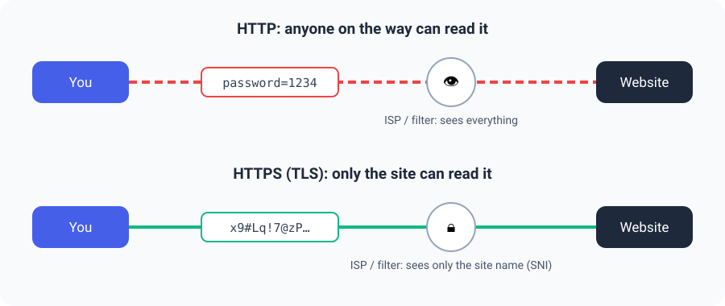
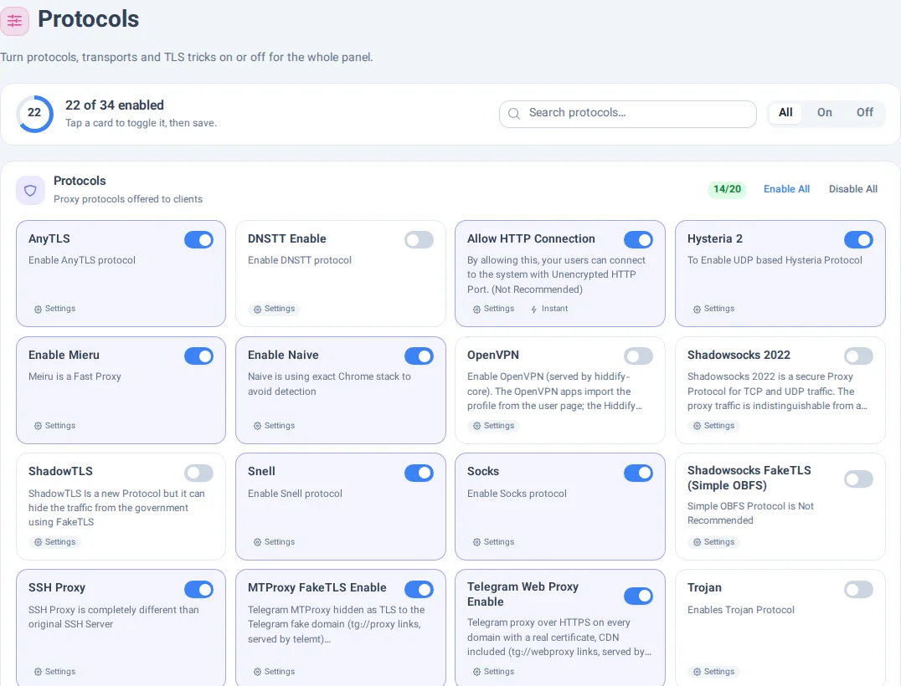

# Basic concepts
Because some of the concepts used in the contents of this wiki and also the world of proxies may be unfamiliar to many people; In this article, we try to explain these things in simple language.

## IP address

An IP address is a unique address that identifies a device on the Internet or local network, and through which the Internet or local network can be accessed. In other words, IP addresses are identifiers that allow sending information between devices in the network; because they contain the geographical location information of the device; Hence, they make devices available to each other to communicate.

We have two IP versions. One IP version 4 and one IP version 6

### IP version 4 or IPv4
IP version 4 consists of sections, each section is separated by a `dot`. For example, w.x.y.z, each of which can be between 0 and 255. Finally, an IP version 4 is like this. `54.78.11.14`

### IP version 6 or IPv6
This IP address is the new version of IPs, written in hexadecimal (base 16). It has 8 sections of up to 4 hex digits, separated by `:`. An IP version 6 is like this.

`2001:0db8:85a3:0000:0000:8a2e:0370:7334`

It can be written shorter: the zeros at the start of each section can be left out, and one run of sections that are all zero can be replaced by `::`. The same IP is then written like this. `2001:db8:85a3::8a2e:370:7334`

## HTTP
It is the basic protocol of the Internet and is the foundation of information communication for the web, where documents, including links and texts, are connected to other resources that the user can easily access, for example, with a click or a tap on the screen in a web browser. . This protocol uses a url or web address for addressing, and we call these addresses domains, which are defined below.

The HTTP protocol uses handshaking to send and receive information. In this method, several requests and responses are exchanged between the server and the client to start and end the information exchange operation. Imagine that the client (browser) is a person who intends to receive information about a site. At first, he must send a request to the server of that site. Then he has to wait to receive a response from the server to his request. If the requested information is available on the server, a response will be sent to the person agreeing to send the information. Then again, a message is sent from the client requesting information data to the server. At this stage, the server receives the message and divides the requested data into smaller data packets. Finally, these packets are sent to the person sequentially by the Handshaking protocol. Communication between client and server in this protocol is usually done through port 80.

## HTTPS

This protocol is actually the security version of the HTTP protocol. Because information and data are not encrypted in the HTTP protocol, it can be easily hacked and misused. Based on this, if someone like the internet service provider has access to the information exchange route, he can easily see the information that is being exchanged. But in HTTPS, the information exchanged between the website and the user is encrypted. That is, even if someone can access the information exchanged on the site, they cannot use the content on the other side. Because this information is encrypted and can only be seen by someone who has the key to decrypt it. It uses one of two SSL or TLS protocols to encrypt communications, which will be explained later.

## HTTP Upgrade { #http-upgrade }
**HTTP Upgrade** is a way to turn a normal HTTP connection into a different kind of connection. The client sends an HTTP request with an `Upgrade` header, the server agrees, and from then on the same connection carries other data, in this case your proxy traffic.

The `HTTPUpgrade` transport in Xray and sing-box uses only this first request and reply, and then sends the data directly. It is similar to WebSocket, but simpler and lighter. Because it starts as a normal HTTP request, many CDNs and reverse proxies can pass it on, so it is useful behind a CDN. It does not add encryption by itself; the security comes from TLS around it.

## Domain

In very simple language, in defining what is domain, it should be said that the same address that you enter in your browser to enter any site is the domain. Domains are connected to your website host via IP. Each server is identified by an IP address in the Internet world. IP addresses are defined on your domain through a service called DNS or Domain Name System.

## SSL

This protocol encrypts information using private and public keys. The information encrypted by this protocol is decrypted on the other side. Security in this protocol is maintained at the source and destination of the information, that is, the encryption and decryption process is performed on both sides. Websites that use this protocol to encrypt data usually communicate with clients through the HTTPS protocol. To have a secure HTTPS connection for your site, you need to obtain a valid ssl certificate. In this protocol, the information exchanged between the server and the client is encrypted; Accordingly, this information will not be visible to third parties. Of course, it is still possible to access these data, but due to the fact that they are encrypted, they need to be decrypted to view their data. Decrypting this data is not possible without the key used in the secure communication session. Therefore, this protocol is practically impenetrable.

## TLS

It is a security protocol based on the SSL protocol. TLS is an improved version of the SSL protocol, although it has very few differences with SSL, but most of it remains the same. Of course, TLS uses a stronger encryption algorithm than SSL protocol, and TLS is safer and more efficient than SSL in creating public keys and authenticating messages. More precisely, TLS is a protocol used to encrypt web-based communications between a client and a server, using a set of cryptographic algorithms (uTLS, alpn, allowInsecure). Important: "User identification is based on message fields during TLS handshaking."

By analyzing TLS traffic, the filter can guess which website the user is visiting and what the server information is (IP, location, etc.). The things we must do carefully, to use TLS algorithms correctly and the filter cannot see the domain name (SNI).

uTLS: Using the browser's own fingerprint. "To avoid relying on one fingerprint and possible errors, it is recommended to use multiple fingerprints, Randomized."

alpn: Predetermines the conversation protocol between the client and the server, thereby speeding up data loading and TLS encryption.

allowInsecure: prevents the use of fake certificates.

Settings to keep in mind about connections:

`uTLS = Randomized, Chrome. Firefox, etc`

`alpn = H2,HTTP/1.1`

`allowInsecure = false`

Note: The settings of these 3 items can be different according to the type of configuration and the state of the Internet.

## Xray

Xray is one of the two engines HiddifyManager uses to pass the filtering system; the other is Hiddify Core (based on sing-box), which serves protocols that Xray does not have, such as Hysteria2, TUIC, WireGuard and Mieru. Xray, introduced in 2020, is a modified and better version of the famous V2ray: it has all the V2ray protocols plus newer ones such as VLESS, Reality and XHTTP.

## VMess
It was one of the first protocols of the V2ray and Xray subcategory, which encodes and sends information packets based on system time, although this protocol can be detected by the filtering system due to weaknesses in its algorithm, and it is recommended not to use it wherever possible.

## VLESS
VLESS protocol is a modified version of VMess! In VLESS, all the disadvantages of VMess have been fixed and due to the difference in encryption in VLESS and its lighter weight, it provides the possibility to have more users than VMess on the same server.

## Trojan
This protocol is another safe way to pass through the filtering system. The trojan introduced in 2017 has always been used alongside VLESS, a powerful protocol to pass through the filtering system.

For more security and speed, we suggest you to use these two protocols, VLESS and Trojan. According to the received reports, it is recommended to use these protocols in the following situations

## Reality
REALITY is used instead of TLS and it can eliminate the TLS fingerprint characteristics of the server, still have forward secrecy, etc. Moreover the certificate chain attack is invalid, and the security exceeds that of conventional TLS.
You can point to other websites without having to buy a domain name or configure a TLS server, which is more convenient and realizes the full real TLS of specifying SNI to the middleman.

Note: HiddifyManager supports many protocols (see the **Protocols** page of the panel). Its defaults already turn on the robust ones. As a rule of thumb (v14.5):

- **Direct to the server:** `VLESS + Reality` (no domain needed), or `VLESS` / `Trojan` with TLS on your domain.
- **Behind a CDN:** `VLESS` or `Trojan` over `XHTTP`, `WebSocket`, `HTTPUpgrade` or `gRPC`.
- **UDP based, for unstable or lossy networks:** `Hysteria2` and `TUIC`.
- Avoid `VMess` and unencrypted HTTP where you can.

In the panel, protocols are turned on and off on the **Protocols** page:

## Related articles

- [How the TLS trick works](/manager/basic-concepts-and-troubleshooting/How-the-TLS-Trick-works-and-its-usage/)
- [Finding TLS trick values](/manager/basic-concepts-and-troubleshooting/A-good-way-to-find-TLS-trick-values/)
- [How MUX works](/manager/basic-concepts-and-troubleshooting/How-MUX-works-and-its-usage/)
- [Connection problems](/manager/basic-concepts-and-troubleshooting/Troubleshooting-connectivity-issues-with-HiddifyManager-and-proxies/)

