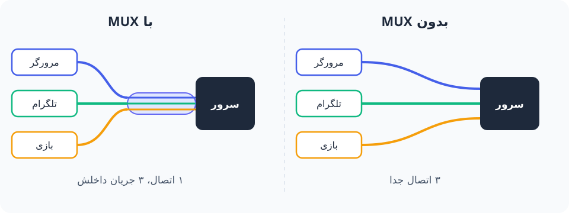
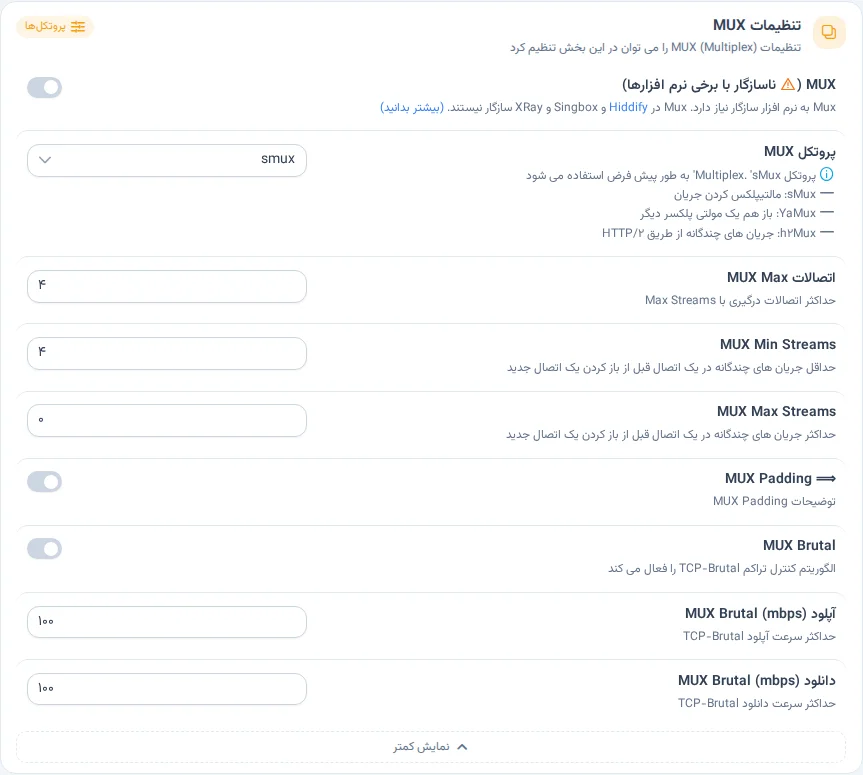

# کاربرد و نحوه عملکرد MUX

## MUX چیست؟
Multiplexing که معمولاً به عنوان MUX شناخته می‌شود، به عنوان یک جزء حیاتی در پروتکل‌های VPN (شبکه خصوصی مجازی) عمل می‌کند و امکان انتقال همزمان جریان‌های داده‌های متعدد را از طریق یک کانال ارتباطی واحد فراهم می‌کند. در حوزه VPNها، مالتی‌پلکس نقشی اساسی در بهینه‌سازی انتقال داده ایفا می‌کند. با تعریف مجموعه‌ای از جریان‌ها برای MUX در پروتکل VPN، جلساتی برای تسهیل عبور همه ترافیک از طریق این جریان‌ها ایجاد می‌شوند. این رویکرد نه تنها فرآیند انتقال را ساده می‌کند، بلکه اقدامات امنیتی را با پنهان کردن الگوهای انتقال افزایش می‌دهد، بنابراین رهگیری یا دستکاری داده‌ها را برای نهادهای غیرمجاز چالش‌برانگیزتر می‌کند.

## پروتکل‌های MUX
ماکس عموما از ۳ کتابخانه برای مالتی‌پلکس کردن استفاده می‌کند که به ترتیب توضیحات مختصری درباره هر کدام ارائه می‌گردد.

#### SMUX
Smux (Simple MUltipleXing) یک کتابخانه مالتی پلکسی برای Golang است. برای ارائه قابلیت اطمینان و سفارش، مانند TCP یا KCP، به یک اتصال اساسی متکی است و مالتی پلکسی جریان محور را فراهم می‌کند. هدف اصلی این کتابخانه قدرت مدیریت اتصال برای kcp-go است. [بیشتر بخوانید](https://github.com/xtaci/smux)

#### YAMUX
یک کتابخانه دیگر برای Golang است که قابلیت اطمینان‌پذیری و سفارشی‌سازی بالایی دارد و بر مبنای پروتکل TCP است. [بیشتر بخوانید](https://github.com/hashicorp/yamux)
#### H2MUX
در این الگوریتم که برمبنای HTTP2 است، پروتکل مقاوم‌تری برای مالتی‌پلکس نمودن ارائه می‌شود که بر روی Golang نسخه 1.6 به بعد کار می‌کند. [بیشتر بخوانید](https://pkg.go.dev/golang.org/x/net/http2)

## ماکزیمم اتصالات MUX
حداکثر تعداد کانکشنی که هنگام مالتی‌پلکس در استریم‌ها برقرار می‌گردد را تعیین می‌کند.
## مینیمم تعداد استریم MUX
هنگامی که مالتی‌پلکس برقرار می‌شود، یک تعداد کانال به مقصد برقرار می‌شود به این کانال‌ها استریم می‌گویند و همه کانکشن‌های TCP از درون این کانال‌ها ارسال می‌گردند. این پارامتر حداقل تعداد استریم را در MUX معین می‌کند.
## ماکزیمم تعداد استریم MUX
این پارامتر حداکثر تعداد استریم را در MUX معین می‌کند.
## MUX Padding
این پارامتر زمانی که فعال می‌شود، کانکشن‌های بدون پد ریجکت می‌شوند.
## MUX Brutal
الگوریتم کنترل ترافیک TCP است که کمک می‌کند در زمانی که نویز روی ترافیک اعمال می‌شود (فیلترینگ)، کاهش سرعت محسوس نباشد. بدین صورت وقتی ترافیک به عنوان مثال تا ۱۰مگابیت بر ثانیه افزایش می‌یابد، موقع ارتباط مجدد، سرعت از صفر شروع نمی‌شود بلکه از ۱۰ مگابیت بر ثانیه آغاز می‌شود و این کمک می‌کند کاهش سرعت بر اثر نویز محسوس نباشد. حداکثر سرعت آپلود و دانلود آن (بر حسب مگابیت بر ثانیه) با **آپلود (mbps) MUX Brutal** و **دانلود (mbps) MUX Brutal** تعیین می‌شود.

## تنظیم MUX در هیدیفای‌منیجر { #settings }
در هیدیفای‌منیجر نسخهٔ ۱۴.۵ به **تنظیمات** بروید و کارت **تنظیمات MUX** را پیدا کنید. همهٔ تنظیمات آن پیشرفته‌اند: کلید **نمایش تنظیمات پیشرفته** را بالای صفحه روشن کنید (یا در خود کارت روی نمایش ۹ تنظیم پیشرفته بزنید).

- **MUX:** ماکس را برای کانفیگ‌های کاربران روشن می‌کند (همین کلید در صفحهٔ **پروتکل‌ها** هم هست). بعد از ذخیره، در صفحهٔ **اقدامات** روی **الان اعمال کن** بزنید.
- **پروتکل MUX:** `smux` (پیش‌فرض)، `yamux` یا `h2mux`.
- **اتصالات MUX Max**، **MUX Min Streams** و **MUX Max Streams:** همان محدودیت‌هایی که بالاتر توضیح داده شد. Max Connections و Max Streams با هم تداخل دارند؛ فقط یکی را تنظیم کنید.
- **MUX Padding**، **MUX Brutal** و سرعت‌های آپلود و دانلود آن.

کل کارت، با تنظیمات پیشرفتهٔ باز:

!!! warning "ماکس به اپ سازگار نیاز دارد"
    ماکسِ اپ هیدیفای و sing-box با ماکسِ Xray سازگار نیست. اگر بعد از روشن کردن ماکس، اپ بعضی کاربران وصل نشد، آن را دوباره خاموش کنید.

## مقاله‌های مرتبط

- [مفاهیم پایهٔ اینترنت و پروکسی](/fa/manager/basic-concepts-and-troubleshooting/Basic-Concepts/)
- [ترفند TLS چیست](/fa/manager/basic-concepts-and-troubleshooting/How-the-TLS-Trick-works-and-its-usage/)
- [پیدا کردن مقادیر ترفند TLS](/fa/manager/basic-concepts-and-troubleshooting/A-good-way-to-find-TLS-trick-values/)
- [عیب‌یابی مشکلات اتصال](/fa/manager/basic-concepts-and-troubleshooting/Troubleshooting-connectivity-issues-with-HiddifyManager-and-proxies/)

