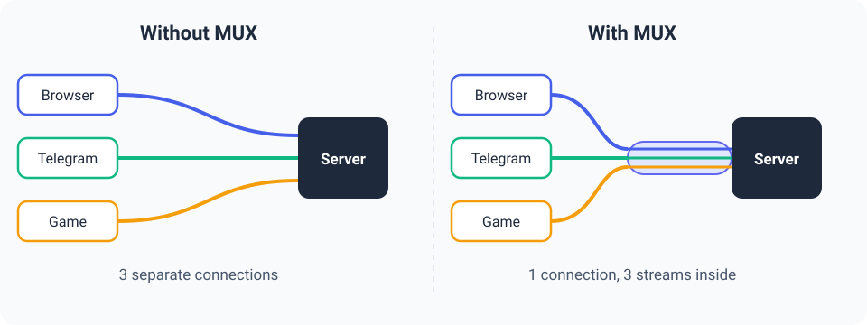

# How MUX works and its usage
## What is MUX?
Multiplexing, commonly known as MUX, serves as a critical component in VPN (Virtual Private Network) protocols, allowing multiple data streams to be transmitted simultaneously over a single communication channel. In the field of VPNs, multiplexing plays an essential role in optimizing data transmission. By defining a set of flows for the MUX in the VPN protocol, sessions are created to facilitate all traffic passing through these flows. This approach not only simplifies the transmission process, but also enhances security measures by obscuring transmission patterns, thus making it more challenging for unauthorized entities to intercept or manipulate data.

## MUX protocols
MUX generally uses 3 libraries for multiplexing, which are briefly explained in order:
#### SMUX
Smux (Simple MUltipleXing) is a multiplexing library for Golang. To provide reliability and ordering, like TCP or KCP, it relies on an underlying connection and provides stream-oriented multiplexing. The main purpose of this library is connection management power for kcp-go. [read more](https://github.com/xtaci/smux)

#### YAMUX
It is another library for Golang that has high reliability and customization and is based on the TCP protocol. [Read more](https://github.com/hashicorp/yamux)
#### H2MUX
In this algorithm, which is based on HTTP2, a more robust protocol for multiplexing is presented, which works on Golang version 1.6 and later. [read more](https://pkg.go.dev/golang.org/x/net/http2)

## MUX max connections
It determines the maximum number of connections that are established when multiplexing streams.
## MUX min streams
When multiplexing is established, a number of channels are allocated to the destination, these channels are called streams, and all TCP connections are sent through these channels. This parameter determines the minimum number of streams in the MUX.
## MUX max streams
This parameter determines the maximum number of streams in the MUX.
## MUX Padding
When this parameter is enabled, connections without pads will be rejected.
## Brutal MUX
It is a TCP traffic control algorithm that helps reduce the speed when noise is applied to the traffic (filtering). In this way, when the traffic increases, for example, to 10 Mbps, when reconnecting, the speed does not start from zero, but from 10 Mbps, and this helps to not notice the decrease in speed due to noise. Its maximum upload and download speed (in Mbps) are set by **MUX Brutal Upload** and **MUX Brutal Download**.

## Setting MUX in Hiddify Manager { #settings }
In Hiddify Manager v14.5, open **Settings** and find the **MUX Config** card. All its settings are advanced: turn on **Show Advanced Settings** at the top of the page (or click **Show 9 advanced settings** in the card).

- **MUX:** turns MUX on for your users' configs (the same switch is on the **Protocols** page, under **Security & tricks**). After saving, click **Apply now** on the **Actions** page.
- **MUX Protocol:** `smux` (the default), `yamux` or `h2mux`.
- **MUX Max Connections**, **MUX Min Streams** and **MUX Max Streams:** the limits described above. Max Connections and Max Streams conflict: set one of them.
- **MUX Padding**, **MUX Brutal**, **MUX Brutal Upload (mbps)** and **MUX Brutal Download (mbps)**.

The whole card, with the advanced settings shown:

!!! warning "MUX needs compatible clients"
    MUX of the Hiddify app and sing-box is not compatible with Xray's. If some users' apps stop connecting after you turn MUX on, turn it off again.

## Related articles

- [Internet and proxy basics](/manager/basic-concepts-and-troubleshooting/Basic-Concepts/)
- [How the TLS trick works](/manager/basic-concepts-and-troubleshooting/How-the-TLS-Trick-works-and-its-usage/)
- [Finding TLS trick values](/manager/basic-concepts-and-troubleshooting/A-good-way-to-find-TLS-trick-values/)
- [Connection problems](/manager/basic-concepts-and-troubleshooting/Troubleshooting-connectivity-issues-with-HiddifyManager-and-proxies/)

