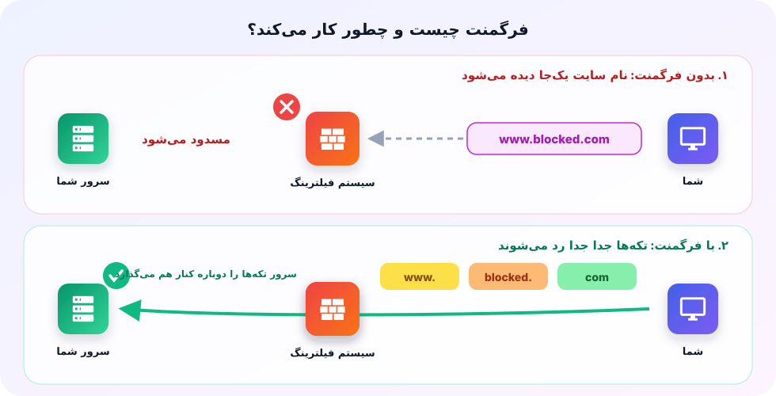
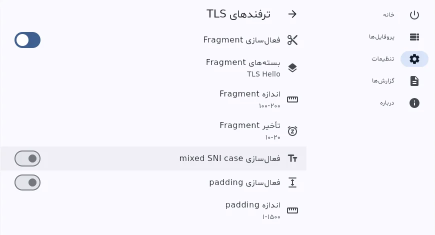
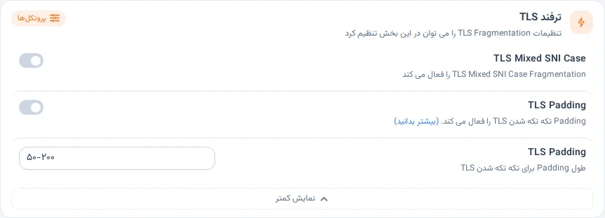
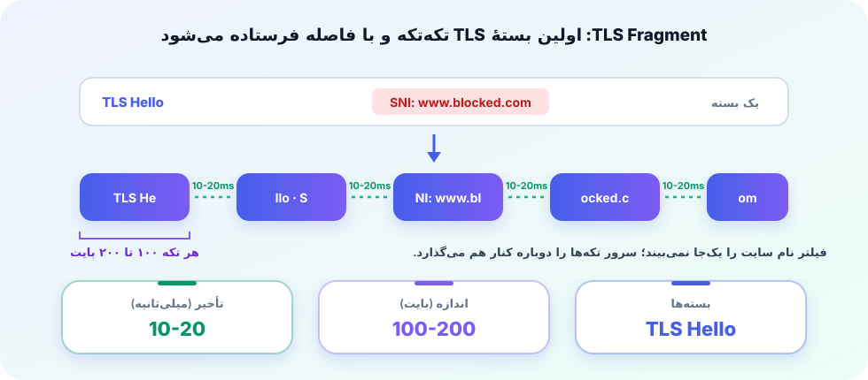

# کاربرد و نحوه عملکرد TLS Trick
## TLS Fragment
در حالت عادی وقتی شما می‌خواهید درخواست باز شدن سایت‌ها و اپ‌ها را به اینترنت ارسال کنید، ممکن است SNI توسط سیستم فیلترینگ تشخیص داده شود. SNI یا نام سرور در حقیقت مقصد اصلی بسته‌های ارسالی است که ما سعی می‌کنیم آن را با پروتکل‌های مختلف از دید سیستم فیلترینگ مخفی نگه داریم. اما خیلی وقت‌ها به دلایل مختلف از جمله استفاده از پروتکل‌های ضعیف SNI قابل تشخیص است.

حالا فرگمنت بسته‌های ارسالی را تکه تکه میکنه. در این صورت SNI در چند تکه ارسال می‌گردد و این‌گونه توسط سیستم فیلترینگ غیر قابل شناسایی می‌شود.

در تصویر زیر می‌بینید که درخواست برای باز شدن سایت `www.bbc.com` است که فیلتر است و اگر این درخواست به صورت عادی ارسال شود احتمالا صفحه مورد نظر توسط سیستم فیلترینگ بلاک می‌گردد و صفحه جعلی برای شما باز می‌شود.

حالا اگه این درخواست در چند تکه ارسال گردد، می‌تواند این سیستم را دور بزند و پس از عبور از سیستم فیلترینگ، در سرور این تکه‌ها به همدیگر می‌پیوندند.

#### کدام بسته‌ها تکه شوند
در اپ هیدیفای، گزینهٔ **بسته‌های Fragment** تعیین می‌کند چه چیزی تکه شود:

- **TLS Hello:** فقط اولین بستهٔ TLS (همان بسته‌ای که SNI را دارد). انتخاب معمول همین است.
- **1-1، 1-2 تا 1-5:** اولین بسته، یا ۲ تا ۵ بستهٔ اول اتصال.

#### ترفندهای TLS را کجا تنظیم کنیم { #where-to-set }
- **اپ هیدیفای:** به **تنظیمات** و بخش **ترفندهای TLS** بروید. در آنجا fragment را روشن می‌کنید و **بسته‌های Fragment**، **اندازه Fragment**، **تأخیر Fragment**، **mixed SNI case** و **padding** و اندازهٔ آن را تنظیم می‌کنید. این تنظیمات روی همهٔ کانفیگ‌های اپ اعمال می‌شوند.
- **هیدیفای‌منیجر (نسخهٔ ۱۴.۵):** به **تنظیمات** و کارت **ترفند TLS** بروید (اول کلید **نمایش تنظیمات پیشرفته** را روشن کنید). در آنجا **TLS Mixed SNI Case**، **TLS Padding** و طول padding هست که در کانفیگ‌های لینک اشتراک کاربران قرار می‌گیرند (TLS Padding به صورت کلید در صفحهٔ **پروتکل‌ها** هم هست). تنظیمات fragment دیگر در پنل نیستند و کاربران fragment را در اپ خودشان تنظیم می‌کنند.
- اپ‌های قدیمی HiddifyN و HiddifyNG همین تنظیمات را در منوی پیشرفته داشتند؛ این اپ‌ها دیگر به‌روز نمی‌شوند.

در اپ هیدیفای (**تنظیمات › ترفندهای TLS**)، با fragment روشن و مقادیر پیشنهادی پایین:

در هیدیفای‌منیجر (**تنظیمات › ترفند TLS**):

## اندازه‌ی TLS Fragment
این پارامتر اندازه سایز بسته‌های تکه شده می‌باشد. توصیه می‌شود حداقل یک عدد کمتر از تعداد کاراکترهای دامنه در نظر گرفته شود که همیشه مطمئن شوید که دامنه تکه تکه می‌شود.

## فاصلهٔ زمانی TLS Fragment
این آپشن فاصله زمانی میان بسته‌ها را تعیین می‌کند.
## TLS Mixed SNI Case

در این حالت کاراکترهای دامنه به صورت حروف بزرگ کوچک و بزرگ (به صورت رندوم) ارسال می‌گردند. مثلا دامنه `www.bbc.com` به صورت `wWw.bBc.cOM` ارسال می‌گردد و این کار نیز می‌تواند در دور زدن فیلترینگ موثر باشد. 

## TLS Padding
این گزینه به کاراکترهای دامنه مجموعه‌ای از کاراکترهای رندوم اضافه می‌کند و باعث می‌شود که فیلترینگ دور زده شود.

## سایز TLS Padding
این گزینه سایز بسته‌هایی که به دامنه اضافه می‌گردند را تعیین می‌کند.

## تعیین مقادیر TLS trick برای اپلیکیشن هیدیفای
در این اپلیکیشن با توجه به شرایط مختلف اعداد متفاوتی برای هر بخش می‌بایست تعیین نمود اما طبق تست‌های صورت گرفته اعداد زیر جواب نسبتا مناسبی داده است:

| تنظیم | مقدار |
|---|---|
| بسته‌های Fragment | `TLS Hello` |
| اندازهٔ Fragment | `100-200` |
| تأخیر Fragment | `10-20` |

!!! warning "دقت کنید"
    - بسته به اپراتور ممکن است مقادیر دیگری لازم باشد.
    - TLS fragment و TLS padding را هم‌زمان روشن نکنید، چون اثر همدیگر را خنثی می‌کنند.

در [این مقاله](/fa/manager/basic-concepts-and-troubleshooting/A-good-way-to-find-TLS-trick-values/)، یک روش مناسب برای پیدا کردن این مقادیر و تنظیم آن در هیدیفای‌منیجر و اپ هیدیفای معرفی شده است.

## مقاله‌های مرتبط

- [مفاهیم پایهٔ اینترنت و پروکسی](/fa/manager/basic-concepts-and-troubleshooting/Basic-Concepts/)
- [پیدا کردن مقادیر ترفند TLS](/fa/manager/basic-concepts-and-troubleshooting/A-good-way-to-find-TLS-trick-values/)
- [MUX چیست](/fa/manager/basic-concepts-and-troubleshooting/How-MUX-works-and-its-usage/)
- [عیب‌یابی مشکلات اتصال](/fa/manager/basic-concepts-and-troubleshooting/Troubleshooting-connectivity-issues-with-HiddifyManager-and-proxies/)

