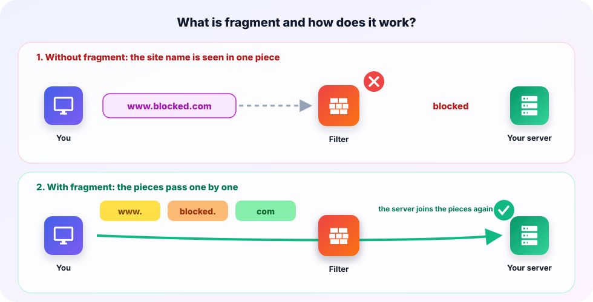
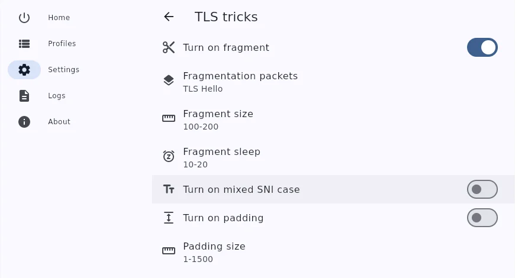
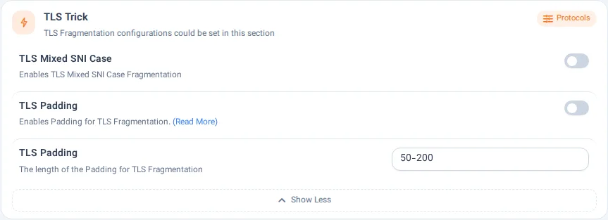
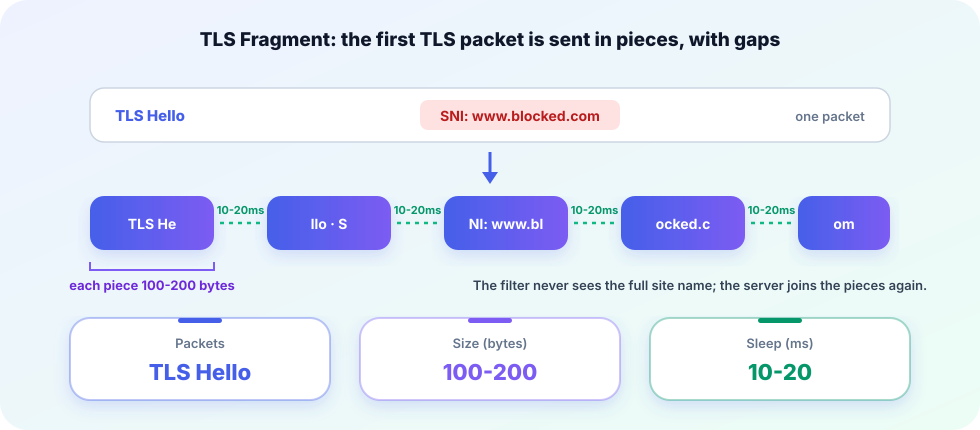

# How the TLS Trick works and its usage

## TLS Fragment
When you open a site or an app, the name of the site (the SNI) is sent at the start of the connection and may be detected by the filtering system. SNI or server name is actually the main destination of the sent packets that we try to keep hidden from the filtering system with different protocols. But many times it can be detected for various reasons, including the use of weak SNI protocols.

Now the fragment breaks the sent packets into pieces. In this case, SNI is sent in several pieces and thus cannot be detected by the filtering system.

In the picture below, you can see that the request to open `www.bbc.com` is filtered, and if this request is sent normally, the desired page will probably be blocked by the filtering system and a fake page will be opened for you.

Now, if this request is sent in several pieces, it can bypass this system and after passing through the filtering system, these pieces will join each other on the server.

#### Which packets are split
In the Hiddify app, **Fragmentation packets** chooses what is split:

- **TLS Hello:** only the first TLS packet (the one that carries the SNI). This is the usual choice.
- **1-1, 1-2 … 1-5:** the first packet, or the first 2 to 5 packets of the connection.

#### Where to set the TLS tricks { #where-to-set }
- **Hiddify app:** open **Settings** › **TLS tricks**. There you turn on fragment and set **Fragmentation packets**, **Fragment size**, **Fragment sleep**, **mixed SNI case** and **padding** and its size. They apply to every config in the app.
- **Hiddify Manager (v14.5):** open **Settings** › **TLS Trick** (turn on **Show Advanced Settings** first). It has **TLS Mixed SNI Case**, **TLS Padding** and the padding length; they go into the configs of your users' subscription (TLS Padding is also a switch on the **Protocols** page, under **Security & tricks**). The fragment settings are no longer in the panel: users set fragment in their app.
- The old apps HiddifyN and HiddifyNG had the same settings in their advanced menu; they are no longer updated.

In the Hiddify app (**Settings › TLS tricks**), with fragment on and the values suggested below:

In Hiddify Manager (**Settings › TLS Trick**):

## The size of the TLS Fragment
This parameter is the size of the fragmented packets. It is recommended that the length be one less than the number of characters in the domain to always ensure that the domain is fragmented.

## TLS Fragment Interval
This option determines the time interval between packets.

## TLS Mixed SNI Case
In this case, domain characters are sent as uppercase, lowercase and uppercase letters (randomly). For example, the domain `www.bbc.com` is sent as `wWw.bBc.cOM` and this can also be effective in bypassing filtering.

## TLS Padding
This option adds a set of random characters to the domain characters and causes filtering to be bypassed.

## Size of TLS Padding
This option determines the size of packets to be added to the domain.

## Determining TLS trick values for the Hiddify app
In this application, according to the different conditions, different numbers should be determined for each section, but the following tests have given a relatively good answer:

| Setting | Value |
|---|---|
| Fragment packets | `TLS Hello` |
| Fragment size | `100-200` |
| Fragment sleep | `10-20` |

!!! warning "Be careful"
    - Depending on your internet provider, you may need other values.
    - Do not turn on TLS fragment and TLS padding at the same time: they cancel each other out.

In [this article](/manager/basic-concepts-and-troubleshooting/A-good-way-to-find-TLS-trick-values/), a suitable method for finding these values and configuring them in Hiddify Manager and the Hiddify app is introduced.

## Related articles

- [Internet and proxy basics](/manager/basic-concepts-and-troubleshooting/Basic-Concepts/)
- [Finding TLS trick values](/manager/basic-concepts-and-troubleshooting/A-good-way-to-find-TLS-trick-values/)
- [How MUX works](/manager/basic-concepts-and-troubleshooting/How-MUX-works-and-its-usage/)
- [Connection problems](/manager/basic-concepts-and-troubleshooting/Troubleshooting-connectivity-issues-with-HiddifyManager-and-proxies/)

