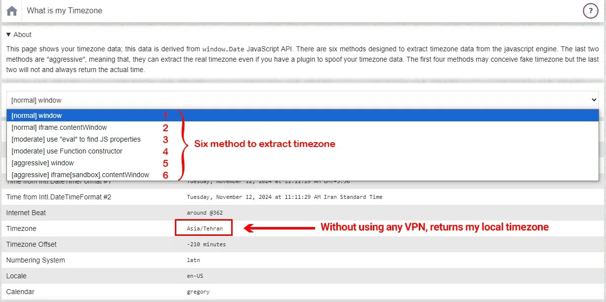
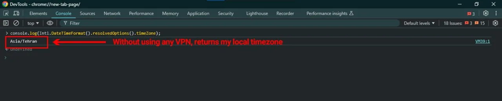
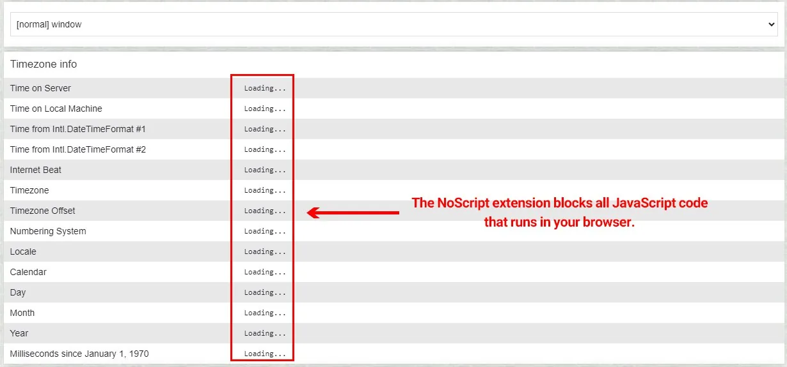
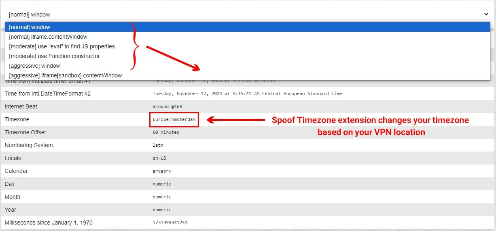
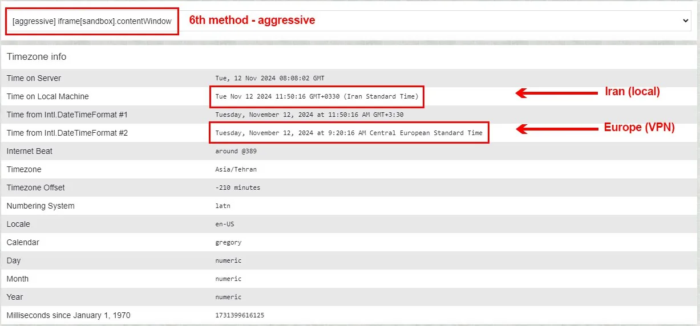

# Time zone leak

This page shows you how to check whether your browser reveals your real time zone while you use a VPN, and how to stop it. You only need a browser on your computer.

## What is a time zone leak?

Websites can read your device's **time zone** (for example `Asia/Tehran`) with a few lines of JavaScript. A **time zone leak** happens when this time zone does not match the country of your VPN server. For example, if your VPN server is in Germany but your browser reports Iran's time zone, a website can guess that you are using a VPN and where you really are.

## How to test for a time zone leak

### Method 1: a test website

1. Connect to your VPN.
2. Open [webbrowsertools.com/timezone](https://webbrowsertools.com/timezone/). The site checks your time zone in six different ways. The last one ("aggressive") is the hardest to fool.
3. Compare the time zone the site finds with your VPN server's country. If the site shows your real time zone, you have a leak.

In the picture below, no extension is used, and simple JavaScript on the site detects the Iran time zone. If your VPN server is in another country, this gives you away.



### Method 2: the browser console

1. Press `F12` (or right-click the page and choose **Inspect**), then open the **Console** tab.
2. Paste this line and press Enter:

    ```js
    console.log(Intl.DateTimeFormat().resolvedOptions().timeZone);
    ```

3. The console prints your browser's time zone.



## How to prevent time zone leaks

There are two recommended methods. After each one, run the test again.

### 1. Use the NoScript extension

**NoScript** blocks websites from running JavaScript, so they cannot read your time zone. Install it for [Chrome](https://chromewebstore.google.com/detail/noscript/doojmbjmlfjjnbmnoijecmcbfeoakpjm) or [Firefox](https://addons.mozilla.org/addon/noscript/).



Keep in mind that many sites need JavaScript, so some features may stop working while NoScript is on.

### 2. Use the Spoof Timezone extension

**Spoof Timezone** makes your browser report a different time zone. Install it for [Chrome](https://chromewebstore.google.com/detail/spoof-timezone/kcabmhnajflfolhelachlflngdbfhboe?hl=en) or [Firefox](https://addons.mozilla.org/en-US/firefox/addon/spoof-timezone/). It has two modes:

- **Mode 1: Greenwich Mean Time (GMT).** If you don't change any settings, the extension reports GMT.
- **Mode 2: match your VPN's IP address.** To turn this on:
    1. Right-click the extension icon and choose **Options**.
    2. Tick **Automatically update timezone based on my IP address**.
    3. Right-click the extension icon again and choose **Update Timezone from IP**.
    4. Each time you switch to a VPN server in a different country, repeat step 3.



!!! warning "Spoof Timezone does not stop every test"
    The sixth ("aggressive") method on the test site is very strict. As the picture below shows, it can still find your real time zone even with Spoof Timezone. NoScript blocks this method completely.



## Related articles

- [Connection problems](/manager/basic-concepts-and-troubleshooting/Troubleshooting-connectivity-issues-with-HiddifyManager-and-proxies/)
- [Is the server's IP or domain clean?](/manager/basic-concepts-and-troubleshooting/How-to-make-sure-the-server's-IP-or-domain-is-clean/)
- [DNS leaks](/manager/basic-concepts-and-troubleshooting/How-to-check-and-prevent-DNS-leaks/)
- [Server speed test](/manager/basic-concepts-and-troubleshooting/How-to-do-speed-test-on-server/)
