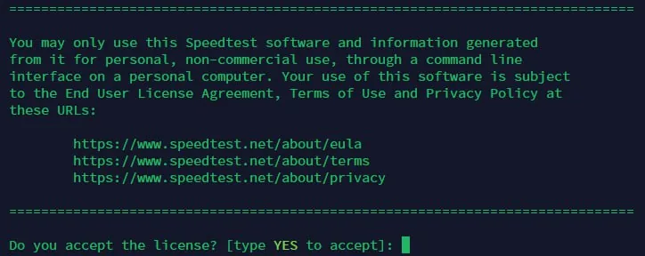
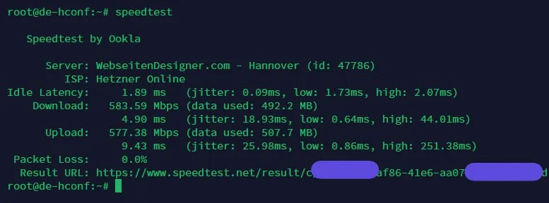
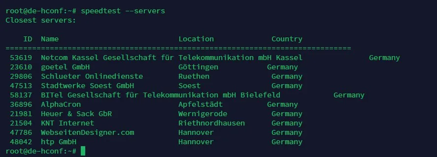
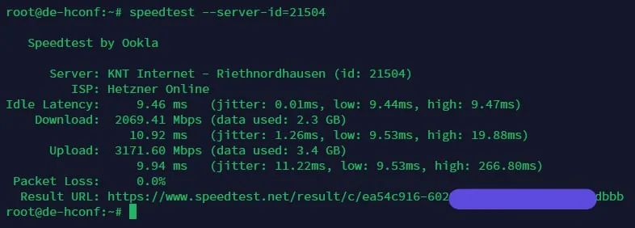
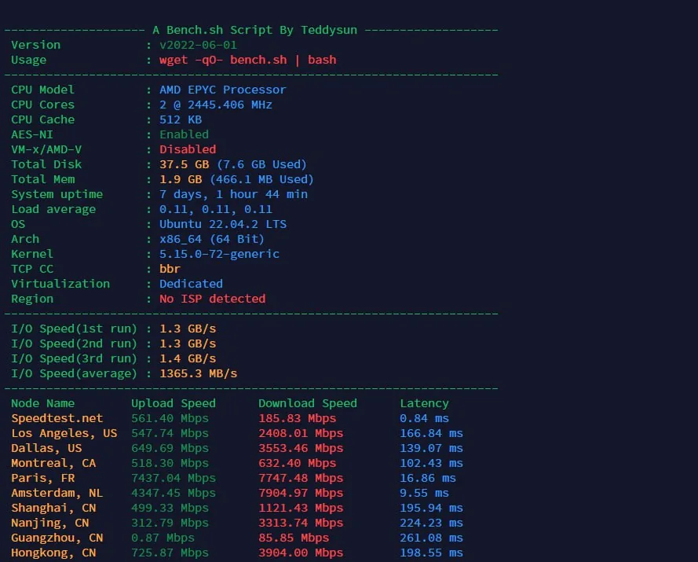

<div dir="rtl" markdown=1>

# آموزش تست سرعت روی سرور

در این صفحه یاد می‌گیرید چطور سرعت دانلود و آپلود سرور خود را از خط فرمان اندازه بگیرید. وقتی کاربران‌تان می‌گویند اتصال کند است و می‌خواهید بدانید مشکل از پهنای باند خود سرور (یعنی مقدار داده‌ای که اتصال شبکه‌ی سرور در هر ثانیه جابه‌جا می‌کند) است یا نه، از این روش استفاده کنید.

بیشتر سرورها محیط گرافیکی و مرورگر ندارند و نمی‌توانید سایت تست سرعت را روی آن‌ها باز کنید. به جای آن، یک برنامه‌ی کوچک تست را در ترمینال سرور اجرا می‌کنید.

## پیش از شروع

- باید بتوانید با **SSH** (روشی امن برای وارد کردن دستور روی سرور از راه دور) به سرور وصل شوید. اگر تا به حال این کار را نکرده‌اید، [آموزش اتصال به سرور با SSH](/fa/manager/installation-and-setup/How-to-connect-to-server-via-SSH/) را بخوانید.
- با کاربر `root` یا کاربری که اجازه‌ی استفاده از `sudo` دارد وارد شده باشید.

بعد از ورود ممکن است منوی هیدیفای‌منیجر باز شود. برای بستن آن و رفتن به ترمینال، `Cancel` (یا کلید `Esc`) را بزنید. اگر منو هنوز روی صفحه بود، `clear` را تایپ کنید و Enter بزنید.

## روش اول: Speedtest شرکت Ookla

برنامه‌ی Speedtest نسخه‌ی رسمی خط فرمانِ سایت speedtest.net است.

1. فقط اگر قبلا برنامه‌ی قدیمی `speedtest-cli` را نصب کرده‌اید، اول آن را حذف کنید. این دستور را روی سرور و از طریق SSH اجرا کنید:

    ```bash
    sudo apt-get remove speedtest-cli
    ```

    اگر پیام داد که این بسته نصب نیست، مشکلی نیست. به مرحله‌ی بعد بروید.

2. برنامه‌ی `curl` را نصب کنید و منبع بسته‌های Ookla را اضافه کنید:

    ```bash
    sudo apt-get install curl
    curl -s https://packagecloud.io/install/repositories/ookla/speedtest-cli/script.deb.sh | sudo bash
    ```

3. برنامه‌ی `speedtest` را نصب کنید:

    ```bash
    sudo apt-get install speedtest
    ```

4. تست را اجرا کنید:

    ```bash
    speedtest
    ```

5. بار اول، برنامه شرایط استفاده و توضیحی درباره‌ی داده‌هایی که Speedtest جمع‌آوری می‌کند نشان می‌دهد. برای هر پیام `yes` را تایپ کنید و Enter بزنید.

    

    

6. چند ثانیه صبر کنید. باید پینگ، سرعت دانلود و سرعت آپلود سرور را ببینید.

    

هر وقت خواستید دوباره تست بگیرید، کافی است باز هم `speedtest` را اجرا کنید.

### تست با یک لوکیشن مشخص

Speedtest به طور پیش‌فرض یک سرور تست نزدیک به سرور شما انتخاب می‌کند. برای تست با یک لوکیشن دیگر:

1. فهرست سرورهای تست نزدیک را بگیرید:

    ```bash
    speedtest --servers
    ```

    

2. در ستون `ID` لوکیشن مورد نظرتان را پیدا کنید و عدد آن را کپی کنید.
3. تست را با همان سرور اجرا کنید. به جای `ID` عددی را که کپی کرده‌اید بگذارید:

    ```bash
    speedtest --server-id=ID
    ```

    

## روش دوم: اسکریپت bench.sh

`bench.sh` یک اسکریپت غیررسمی (ساخت دیگران، نه هیدیفای) است. علاوه بر تست سرعت با چند لوکیشن در نقاط مختلف دنیا، مشخصات سخت‌افزاری سرور مثل CPU، فضای دیسک، رم و معماری پردازنده را هم نشان می‌دهد.

1. این دستور را روی سرور و از طریق SSH اجرا کنید:

    ```bash
    wget -qO- bench.sh | bash
    ```

2. حدود ۵ تا ۸ دقیقه صبر کنید. اسکریپت از چند لوکیشن در قاره‌های مختلف تست سرعت می‌گیرد و بعد نتیجه را نشان می‌دهد.

    

## معنی نتیجه‌ها

- **سرعت‌ها خیلی کمتر از چیزی است که سرویس‌دهنده‌ی سرور وعده داده:** مشکل از خود سرور یا دیتاسنتر آن است. با سرویس‌دهنده‌ی سرور تماس بگیرید یا سرور دیگری تهیه کنید.
- **سرعت‌ها خوب است ولی اتصال کاربران هنوز کند است:** پهنای باند سرور مشکلی ندارد. کندی به احتمال زیاد در مسیر بین کاربران و سرور است (مثلا فیلترینگ یا مسیر ضعیف اینترنت کاربر). صفحه‌ی [رفع مشکلات اتصال](/fa/manager/basic-concepts-and-troubleshooting/Troubleshooting-connectivity-issues-with-HiddifyManager-and-proxies/) را ببینید.

## مقاله‌های مرتبط

- [عیب‌یابی مشکلات اتصال](/fa/manager/basic-concepts-and-troubleshooting/Troubleshooting-connectivity-issues-with-HiddifyManager-and-proxies/)
- [تمیز بودن آی‌پی یا دامنه](/fa/manager/basic-concepts-and-troubleshooting/How-to-make-sure-the-server's-IP-or-domain-is-clean/)
- [نشتی DNS](/fa/manager/basic-concepts-and-troubleshooting/How-to-check-and-prevent-DNS-leaks/)
- [نشتی تایم‌زون](/fa/manager/basic-concepts-and-troubleshooting/How-to-check-and-prevent-TimeZone-leaks/)

</div>
