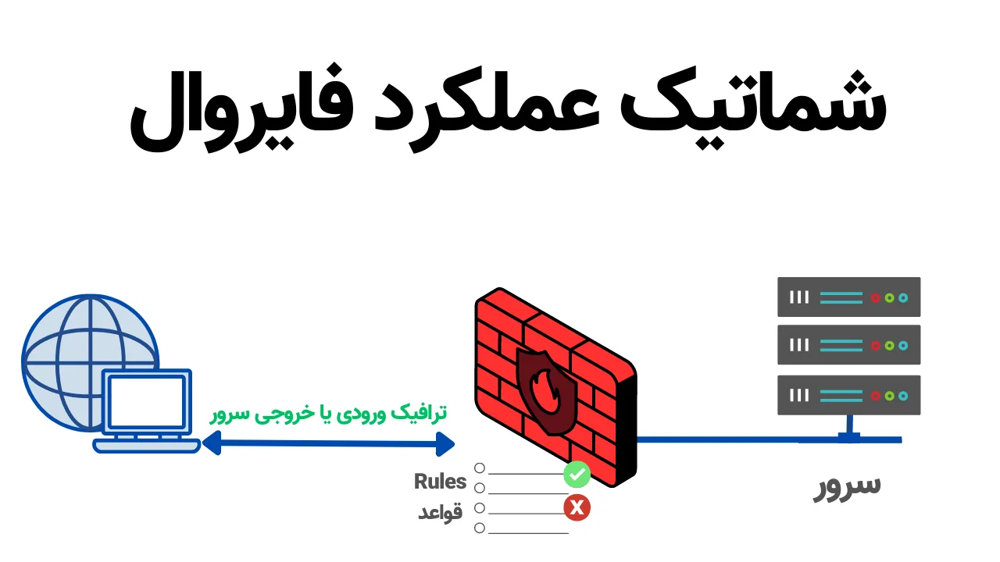

<div dir=rtl markdown=1>

# آموزش تنظیم فایروال سرور

در این صفحه می‌خوانید فایروال چیست، چطور فایروال داخلی هیدیفای‌منیجر را روشن کنید، و وقتی برنامه‌ای که هیدیفای‌منیجر آن را نمی‌شناسد به یک پورت نیاز دارد، چطور آن پورت را دستی باز کنید.

## فایروال چیست؟

**فایروال** (Firewall یا دیواره‌ی آتش) نرم‌افزار یا سخت‌افزاری است که تعیین می‌کند کدام ترافیک شبکه اجازه دارد به کامپیوتر یا سرور برسد و بقیه را مسدود می‌کند. اینجا فقط با فایروال نرم‌افزاری روی سرورهای لینوکسی سر و کار داریم.

<div align=center markdown=1>



</div>

یکی از ابزارهای رایج فایروال در لینوکس **iptables** است. به این ابزار فهرستی از قانون‌ها (Rule) می‌دهید. هر قانون مشخص می‌کند کدام ترافیک (مثلا کدام **پورت**، یعنی «در» شماره‌داری که سرویس پشت آن منتظر اتصال است) اجازه‌ی عبور دارد و کدام مسدود می‌شود. هیدیفای‌منیجر از iptables استفاده می‌کند.

## فایروال در پنل هیدیفای‌منیجر

هیدیفای‌منیجر می‌تواند فایروال سرور را برای شما مدیریت کند. وقتی این فایروال روشن است:

- فقط پورت‌هایی که هیدیفای‌منیجر لازم دارد باز می‌مانند: SSH (پورت `22` و پورتی که سرور SSH شما واقعا از آن استفاده می‌کند)، `80`، `443`، `53` و همه‌ی پورت‌هایی که پروکسی‌های فعال شما استفاده می‌کنند (همان فهرستی که **پورت‌های عمومی** در صفحه‌ی **اقدامات** پنل نشان می‌دهد).
- بقیه‌ی اتصال‌های ورودی مسدود می‌شوند.
- پینگ (ICMP) همچنان مجاز است، پس هنوز می‌توانید [تمیز بودن آی‌پی را تست کنید](/fa/manager/basic-concepts-and-troubleshooting/How-to-make-sure-the-server%27s-IP-or-domain-is-clean/).
- وقتی در پنل پورتی را عوض می‌کنید یا پروکسی‌ای را روشن و خاموش می‌کنید، هیدیفای‌منیجر هنگام اعمال تغییرات قانون‌های فایروال را خودش به‌روز می‌کند.

فایروال **به طور پیش‌فرض خاموش است**. پیشنهاد ما این است که آن را روشن کنید، چون حمله به سرور را سخت‌تر می‌کند.

برای روشن کردن آن:

1. وارد پنل هیدیفای‌منیجر شوید.
2. در منوی کناری، زیر **تنظیمات**، روی **تنظیمات** بزنید و کارت **تنظیمات عمومی** را پیدا کنید. می‌توانید «فایروال» را در کادر جستجوی تنظیمات هم بنویسید.
3. گزینه‌ی **فایروال** را روشن کنید.
4. روی **ذخیره** بزنید و وقتی پنل خواست، تغییرات را اعمال کنید.

<div align=center markdown=1>


</div>

!!! warning "قبل از روشن کردن"
    اگر روی همین سرور برنامه‌های دیگری دارید که پورت مخصوص خودشان را لازم دارند (مثلا یک پنل دیگر یا وب‌سرور)، اول پورت آن‌ها را مثل روش زیر دستی باز کنید. در غیر این صورت بعد از روشن شدن فایروال از کار می‌افتند.

## باز کردن دستی یک پورت

این کار را فقط برای برنامه‌هایی انجام دهید که هیدیفای‌منیجر مدیریت‌شان نمی‌کند. هیدیفای‌منیجر پورت پروکسی‌های خودش را خودش باز می‌کند.

قبل از شروع، با **SSH** (روشی امن برای وارد کردن دستور روی سرور از راه دور) به سرور وصل شوید. اگر نمی‌دانید چطور، [آموزش اتصال به سرور با SSH](/fa/manager/installation-and-setup/How-to-connect-to-server-via-SSH/) را ببینید. اگر منوی هیدیفای‌منیجر باز شد، `Cancel` (یا کلید `Esc`) را بزنید تا بسته شود. اگر منو هنوز روی صفحه بود، `clear` را تایپ کنید و Enter بزنید.

1. این دستور را روی سرور و از طریق SSH اجرا کنید. این مثال پورت TCP شماره‌ی `1234` را باز می‌کند. به جای `1234` شماره‌ی پورتی را که لازم دارید بنویسید:

    ```bash
    iptables -I INPUT -p tcp --dport 1234 -j ACCEPT
    ```

    اگر برنامه از UDP استفاده می‌کند، همین دستور را با `-p udp` به جای `-p tcp` اجرا کنید. اگر سرور شما IPv6 دارد، همین دستور را یک بار دیگر با `ip6tables` به جای `iptables` اجرا کنید.

2. بررسی کنید قانون اضافه شده باشد:

    ```bash
    iptables -L INPUT -n --line-numbers
    ```

    باید خطی با `ACCEPT` و `dpt:1234` (شماره‌ی پورت شما) ببینید.

3. قانون‌ها را ذخیره کنید تا بعد از ریبوت هم باقی بمانند:

    ```bash
    netfilter-persistent save
    ```

    اگر پیام داد این دستور پیدا نشد، با `apt install iptables-persistent` آن را نصب کنید و دوباره اجرا کنید.

## بستن پینگ (اختیاری)

قانون‌های فایروال هیدیفای‌منیجر همیشه اجازه‌ی پینگ را می‌دهند. بهتر است همین طور بماند، چون پینگ به شما کمک می‌کند بفهمید سرور در دسترس است یا نه. اگر باز هم می‌خواهید پینگ را ببندید، این دستور را روی سرور و از طریق SSH اجرا کنید:

<div dir=ltr markdown=1>

```bash
iptables -I INPUT -p icmp -j DROP
```

</div>

برای باز کردن دوباره‌ی پینگ، همان قانون را حذف کنید:

<div dir=ltr markdown=1>

```bash
iptables -D INPUT -p icmp -j DROP
```

</div>

یادتان باشد تا وقتی پینگ بسته است، تست‌های آنلاین پینگ جواب نمی‌دهند. به جای آن از تست TCP روی پورت `443` استفاده کنید.

## عیب‌یابی

- **بعد از روشن کردن فایروال نمی‌توانید با SSH وصل شوید:** هیدیفای‌منیجر هنگام اعمال قانون‌های فایروال، پورت `22` و پورتی را که سرور SSH در آن لحظه استفاده می‌کند باز می‌کند. اگر بعد از آن پورت SSH را عوض کرده‌اید، تنظیمات پنل را دوباره اعمال کنید، یا از کنسول وب سرویس‌دهنده‌ی سرور وارد شوید و دستور `hiddify apply` را اجرا کنید.
- **برنامه‌ی دیگری روی سرور از کار افتاده:** پورت آن بسته شده است. آن را مثل روش بالا دستی باز کنید.
- **پورتی که دستی باز کرده بودید بعد از ریبوت دوباره بسته شده:** قانون‌ها را ذخیره نکرده‌اید. دستور `netfilter-persistent save` را اجرا کنید.

## مقاله‌های مرتبط

- [تغییر پورت SSH](/fa/manager/basic-concepts-and-troubleshooting/How-to-change-SSH-port-on-your-server/)
- [بستن ورود با رمز در SSH](/fa/manager/basic-concepts-and-troubleshooting/Disable-SSH-Password-Authentication/)
- [تنظیم TLS برای امنیت بیشتر](/fa/manager/basic-concepts-and-troubleshooting/TLS-setting-for-increased-security/)
- [تنظیم DNS سرور](/fa/manager/basic-concepts-and-troubleshooting/How-to-set-DNS-server/)

</div>
