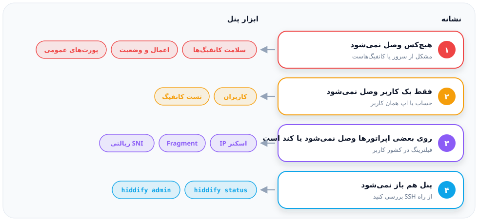
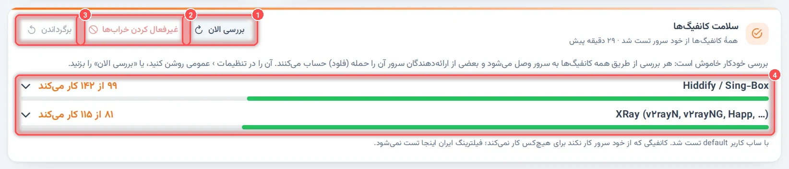
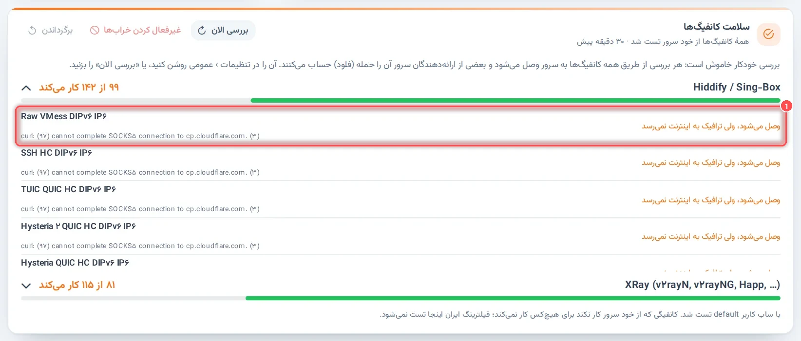
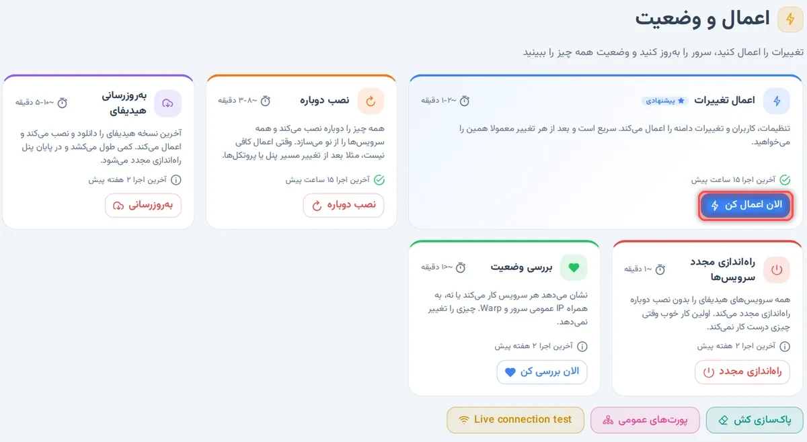
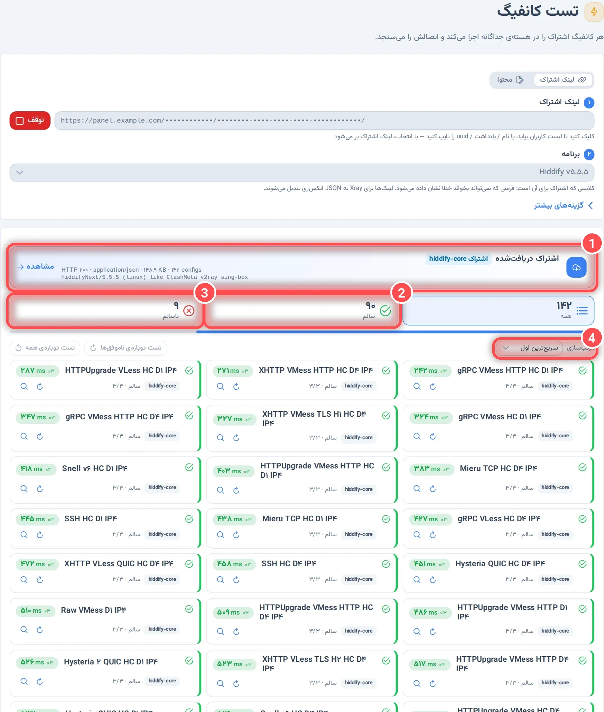
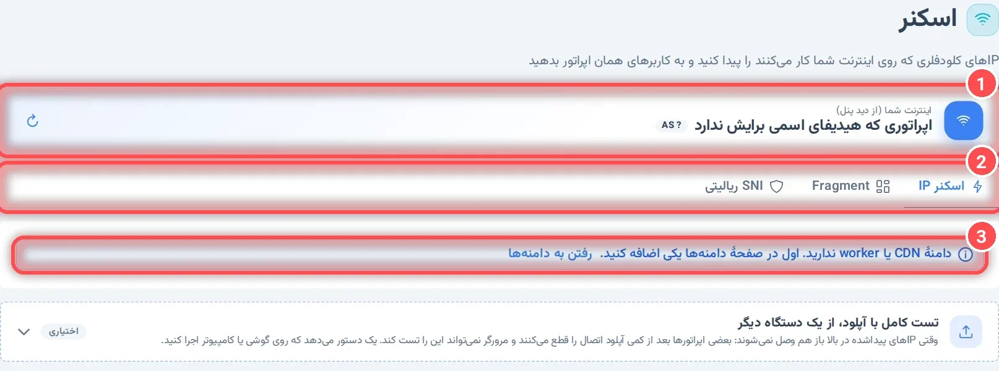
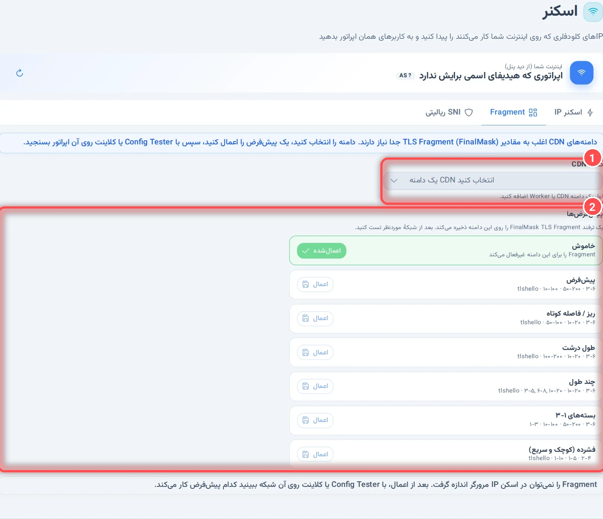
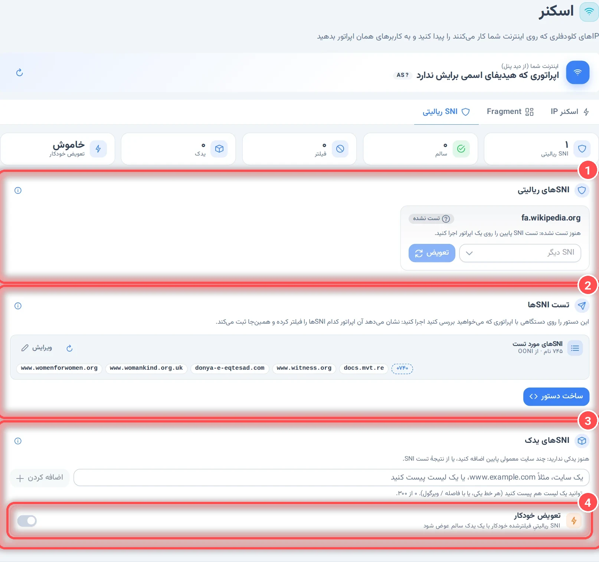

# عیب‌یابی مشکلات اتصال با هیدیفای‌منیجر و پروکسی‌ها

کانفیگ‌ها وصل نمی‌شوند، یا روی یک اپراتور وصل می‌شوند و روی دیگری نه؟ پنل هیدیفای‌منیجر (نسخهٔ ۱۴.۵) ابزارهایی دارد که بیشتر این مشکل‌ها را پیدا و درست می‌کنند. این صفحه می‌گوید برای هر نشانه سراغ کدام ابزار بروید.

## اول بفهمید مشکل از کجاست { #where }

مهم‌ترین سؤال این است: **مشکل برای همه است، یا فقط برای بعضی کاربران و اپراتورها؟** اگر برای همه باشد، چیزی روی سرور یا در کانفیگ‌ها خراب است و ابزارهای پنل مستقیم پیدایش می‌کنند. اگر فقط روی بعضی اپراتورها باشد، فیلترینگ است و باید از همان اپراتور تست کنید.

## ۱. هیچ‌کس وصل نمی‌شود: سرور و کانفیگ‌ها { #nobody }

### سلامت کانفیگ‌ها را بررسی کنید

در **داشبورد**، کارت **سلامت کانفیگ‌ها** را پیدا کنید و **بررسی الان** را بزنید. پنل همهٔ کانفیگ‌های یک لینک اشتراک را **از خود سرور** تست می‌کند، همان‌طور که اپ هیدیفای و اپ‌های ایکس‌ری آن را می‌گیرند.

روی ردیفی که کانفیگ خراب دارد بزنید تا دلیلش را به زبان ساده ببینید:

| دلیل | معمولاً چه کار کنید |
|---|---|
| وصل می‌شود، ولی ترافیک به اینترنت نمی‌رسد | [خروجی](/fa/manager/configuration-and-advanced-settings/How-to-use-Outbounds-on-HiddifyManager/) آن کانفیگ (مثلاً وارپ) یا IPv6 سرور را بررسی کنید. |
| اتصال رد شد | آن پروتکل یا پورت خاموش است: در **پروتکل‌ها** روشنش کنید و تغییرات را اعمال کنید. |
| دست‌دهی TLS ناموفق بود | گواهی دامنه یا تنظیم ریالتی آن دامنه را در **دامنه‌ها** بررسی کنید. |
| به‌موقع جوابی نیامد | سرویس یا پورت جواب نمی‌دهد: وضعیت سرویس‌ها و فایروال را در قدم‌های بعد ببینید. |

**غیرفعال کردن خراب‌ها** کانفیگ‌هایی را که برای هیچ اپی کار نمی‌کنند از لینک اشتراک همه برمی‌دارد تا کاربران وقتشان را روی آن‌ها هدر ندهند؛ **برگرداندن** دوباره روشنشان می‌کند. [همه‌چیز دربارهٔ سلامت کانفیگ‌ها](/fa/manager/configuration-and-advanced-settings/Automatic-config-health-checks-on-HiddifyManager/)

### وضعیت سرویس‌ها را ببینید

در منو **اقدامات** را باز کنید. در صفحهٔ **اعمال و وضعیت**:

1. **بررسی وضعیت** › **الان بررسی کن**: نشان می‌دهد هر سرویس کار می‌کند یا نه. چیزی را تغییر نمی‌دهد.
2. اگر سرویسی خاموش است، **ری‌استارت** را بزنید. اگر تازه تنظیماتی را عوض کرده‌اید، **الان اعمال کن** را بزنید.
3. در بخش **لاگ‌ها** روی آیکون چشم بزنید تا خطای آن سرویس را بخوانید.

### پورت‌ها در فایروال باز باشند

اگر سرویس‌ها روشن‌اند ولی هیچ کانفیگی از بیرون وصل نمی‌شود، معمولاً فایروال سرور یا فایروال ارائه‌دهندهٔ سرور پورت‌ها را بسته است. در همان صفحهٔ **اعمال و وضعیت** روی **پورت‌های عمومی** بزنید: فهرست همهٔ پورت‌هایی که سرور باید باز باشد، به‌همراه **دستورهای فایروال (ufw)** آماده، را می‌بینید. این پورت‌ها را در فایروال سرور و در پنل ارائه‌دهندهٔ سرور باز کنید.

## ۲. فقط یک کاربر وصل نمی‌شود { #one-user }

1. در **کاربران** ببینید روزها یا حجم آن کاربر تمام نشده و غیرفعال نیست.
2. در **ابزارها** › **تست کانفیگ**، روی کادر لینک بزنید و همان کاربر را انتخاب کنید، **برنامه** را روی اپی که کاربر استفاده می‌کند بگذارید و **شروع تست** را بزنید. پنل دقیقاً همان چیزی را تست می‌کند که اپ آن کاربر دریافت می‌کند.

    

3. اگر اینجا کانفیگ‌ها سالم‌اند، مشکل از اپ یا اینترنت کاربر است: بخواهید لینک اشتراک را در اپ به‌روز کند. [اپ هیدیفای](/fa/app/How-to-install-Hiddify-app/) همهٔ پروتکل‌های پنل را می‌شناسد؛ بعضی اپ‌های دیگر نه. [لاگ اپ](/fa/app/Logs-and-reporting-a-problem/) دلیل دقیق را نشان می‌دهد.

## ۳. روی بعضی اپراتورها وصل نمی‌شود یا کند است: فیلترینگ { #filtering }

ابزارهای بخش ۱ از خود سرور تست می‌کنند و فیلترینگ کشور کاربران را نمی‌بینند. برای این بخش، **اسکنر** پنل (**ابزارها** › **اسکنر**) را **روی همان اپراتوری که مشکل دارد و با فیلترشکن خاموش** باز کنید؛ مثلاً یک بار با گوشی روی همراه اول و یک بار روی ایرانسل. اسکنر در مرورگر شما و روی اینترنت همان لحظهٔ شما کار می‌کند.

=== "دامنهٔ CDN"

    آی‌پی کلادفلری که کاربران می‌گیرند روی آن اپراتور مسدود یا کند است. در تب **اسکنر IP**، دامنهٔ CDN و اپراتور را انتخاب کنید، **شروع** را بزنید و بعد **ذخیره در دامنه**. کاربران با به‌روزرسانی بعدی اشتراک، آی‌پی‌های سالم را می‌گیرند.

    

    اگر آی‌پی‌ها پیدا شدند ولی اتصال بعد از کمی آپلود قطع می‌شود، از **تست کامل با آپلود، از یک دستگاه دیگر** استفاده کنید.

=== "TLS / Fragment"

    اپراتور نام سایت را در اولین بستهٔ TLS می‌خواند. در تب **Fragment** یک **پیش‌فرض** را روی دامنهٔ CDN **اعمال** کنید و نتیجه را با یک اپ روی همان اپراتور بررسی کنید. کاربران اپ هیدیفای می‌توانند fragment را خودشان هم در اپ روشن کنند.

    

=== "ریالتی"

    کانفیگ ریالتی شبیه بازدید از یک سایت دیگر (SNI) است؛ اگر اپراتور آن سایت را فیلتر کند، کانفیگ کار نمی‌کند. در تب **SNI ریالتی**، **ساخت دستور** را بزنید و دستور را روی دستگاهی با همان اپراتور اجرا کنید تا SNIهای فیلترشده مشخص شوند. با **تعویض خودکار**، SNI فیلترشده خودکار با یک **SNI یدک** سالم عوض می‌شود.

    

### اگر آی‌پی خود سرور مسدود است

با [بررسی تمیز بودن آی‌پی یا دامنه](/fa/manager/basic-concepts-and-troubleshooting/How-to-make-sure-the-server%27s-IP-or-domain-is-clean/) مطمئن شوید. پنل نمی‌تواند آی‌پی مسدود را باز کند؛ یا آی‌پی سرور را عوض کنید (خیلی از ارائه‌دهنده‌ها آی‌پی جدید می‌فروشند)، یا از راهی که مسدود نیست به سرور برسید:

<a class="hi-card" href="/fa/manager/configuration-and-advanced-settings/How-to-use-Reality-on-Hiddify/"><svg aria-hidden="true" xmlns="http://www.w3.org/2000/svg" viewBox="0 0 24 24"><path d="M21 11c0 5.55-3.84 10.74-9 12-5.16-1.26-9-6.45-9-12V5l9-4 9 4v6m-9 10c3.75-1 7-5.46 7-9.78V6.3l-7-3.12L5 6.3v4.92C5 15.54 8.25 20 12 21m2.8-10V9.5C14.8 8.1 13.4 7 12 7S9.2 8.1 9.2 9.5V11c-.6 0-1.2.6-1.2 1.2v3.5c0 .7.6 1.3 1.2 1.3h5.5c.7 0 1.3-.6 1.3-1.2v-3.5c0-.7-.6-1.3-1.2-1.3m-1.3 0h-3V9.5c0-.8.7-1.3 1.5-1.3s1.5.5 1.5 1.3V11Z"/></svg><b>ریالتی</b><small>شبیه بازدید از یک سایت معمولی؛ جایی که TLS بسته است کار می‌کند.</small></a>
<a class="hi-card" href="/fa/manager/domain-worker-cdn-and-tunneling/How-to-use-Cloudflare-CDN/"><svg aria-hidden="true" xmlns="http://www.w3.org/2000/svg" viewBox="0 0 24 24"><path d="M6.5 20q-2.28 0-3.89-1.57Q1 16.85 1 14.58q0-1.95 1.17-3.48 1.18-1.53 3.08-1.95.63-2.3 2.5-3.72Q9.63 4 12 4q2.93 0 4.96 2.04Q19 8.07 19 11q1.73.2 2.86 1.5 1.14 1.28 1.14 3 0 1.88-1.31 3.19T18.5 20m-12-2h12q1.05 0 1.77-.73.73-.72.73-1.77t-.73-1.77Q19.55 13 18.5 13H17v-2q0-2.07-1.46-3.54Q14.08 6 12 6 9.93 6 8.46 7.46 7 8.93 7 11h-.5q-1.45 0-2.47 1.03Q3 13.05 3 14.5q0 1.45 1.03 2.5 1.02 1 2.47 1m5.5-6Z"/></svg><b>CDN کلادفلر</b><small>فیلتر فقط آی‌پی CDN را می‌بیند، نه آی‌پی سرور شما.</small></a>
<a class="hi-card" href="/fa/manager/domain-worker-cdn-and-tunneling/How-to-add-relay-domain-to-Hiddify-manager/"><svg aria-hidden="true" xmlns="http://www.w3.org/2000/svg" viewBox="0 0 24 24"><path d="M13 19h1a1 1 0 0 1 1 1h7v2h-7a1 1 0 0 1-1 1h-4a1 1 0 0 1-1-1H2v-2h7a1 1 0 0 1 1-1h1v-2H4a1 1 0 0 1-1-1v-4a1 1 0 0 1 1-1h16a1 1 0 0 1 1 1v4a1 1 0 0 1-1 1h-7v2M4 3h16a1 1 0 0 1 1 1v4a1 1 0 0 1-1 1H4a1 1 0 0 1-1-1V4a1 1 0 0 1 1-1m5 4h1V5H9v2m0 8h1v-2H9v2M5 5v2h2V5H5m0 8v2h2v-2H5Z"/></svg><b>سرور میانی (رله)</b><small>یک سرور داخل کشور ترافیک را به سرور شما می‌رساند.</small></a>
<a class="hi-card" href="/fa/manager/domain-worker-cdn-and-tunneling/Domain-types-and-how-to-register-them/"><svg aria-hidden="true" xmlns="http://www.w3.org/2000/svg" viewBox="0 0 24 24"><path d="M16.36 14c.08-.66.14-1.32.14-2 0-.68-.06-1.34-.14-2h3.38c.16.64.26 1.31.26 2s-.1 1.36-.26 2m-5.15 5.56c.6-1.11 1.06-2.31 1.38-3.56h2.95a8.03 8.03 0 0 1-4.33 3.56M14.34 14H9.66c-.1-.66-.16-1.32-.16-2 0-.68.06-1.35.16-2h4.68c.09.65.16 1.32.16 2 0 .68-.07 1.34-.16 2M12 19.96c-.83-1.2-1.5-2.53-1.91-3.96h3.82c-.41 1.43-1.08 2.76-1.91 3.96M8 8H5.08A7.923 7.923 0 0 1 9.4 4.44C8.8 5.55 8.35 6.75 8 8m-2.92 8H8c.35 1.25.8 2.45 1.4 3.56A8.008 8.008 0 0 1 5.08 16m-.82-2C4.1 13.36 4 12.69 4 12s.1-1.36.26-2h3.38c-.08.66-.14 1.32-.14 2 0 .68.06 1.34.14 2M12 4.03c.83 1.2 1.5 2.54 1.91 3.97h-3.82c.41-1.43 1.08-2.77 1.91-3.97M18.92 8h-2.95a15.65 15.65 0 0 0-1.38-3.56c1.84.63 3.37 1.9 4.33 3.56M12 2C6.47 2 2 6.5 2 12a10 10 0 0 0 10 10 10 10 0 0 0 10-10A10 10 0 0 0 12 2Z"/></svg><b>دامنهٔ جدید یا جعلی</b><small>وقتی دامنهٔ فعلی شناسایی و مسدود شده است.</small></a>

## ۴. پنل هم باز نمی‌شود { #panel-down }

[با SSH به سرور وصل شوید](/fa/manager/installation-and-setup/How-to-connect-to-server-via-SSH/) و از این دستورها استفاده کنید:

| دستور | چه می‌کند |
|---|---|
| `hiddify status` | وضعیت همهٔ سرویس‌ها |
| `hiddify admin` | لینک‌های ادمین فعلی (شاید بعد از یک تغییر عوض شده باشند) |
| `hiddify restart` | راه‌اندازی دوبارهٔ سرویس‌ها بدون تغییر تنظیمات |
| `hiddify apply` | اعمال تنظیماتی که در پنل ذخیره شده‌اند |

یا فقط `hiddify` را بزنید تا [منوی هیدیفای‌منیجر](/fa/manager/configuration-and-advanced-settings/How-to-connect-and-troubleshoot-via-SSH/) باز شود، با گزینه‌های وضعیت، لینک ادمین و لاگ‌ها.

## هنوز کار نمی‌کند؟ { #still }

اگر ابزار دیگری به **همان سرور و همان دامنه** وصل می‌شود ولی کانفیگ‌های هیدیفای‌منیجر نه، لطفاً به ما خبر دهید. لینک کانفیگی را که کار می‌کند (VLESS، VMess یا Trojan) در یک [issue در گیت‌هاب](https://github.com/hiddify/Hiddify-Manager/issues) بفرستید تا آن نوع کانفیگ را به پنل اضافه کنیم. پیش از فرستادن، لینک را در **ابزارها** › **رمزگشای متن** باز کنید و آدرس واقعی سرور و رمزها را از آن بردارید.

## مقاله‌های مرتبط

- [ابزارهای پنل](/fa/manager/configuration-and-advanced-settings/How-to-use-the-panel-tools-in-HiddifyManager/)
- [بررسی خودکار سلامت کانفیگ‌ها](/fa/manager/configuration-and-advanced-settings/Automatic-config-health-checks-on-HiddifyManager/)
- [آی‌پی تمیز کلادفلر](/fa/manager/domain-worker-cdn-and-tunneling/Guide-for-finding-a-clean-Cloudflare-IP/)
- [کاربرد ترفند TLS](/fa/manager/basic-concepts-and-troubleshooting/How-the-TLS-Trick-works-and-its-usage/)

