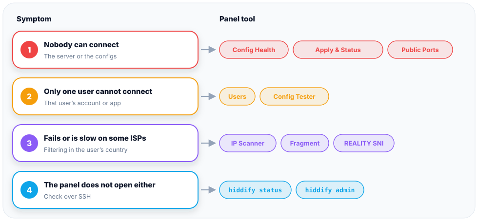
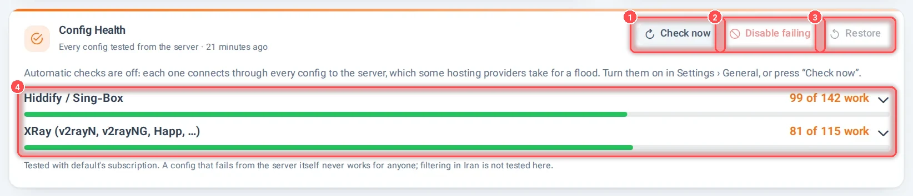
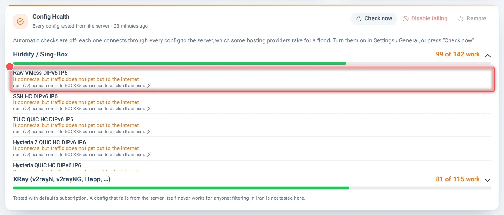
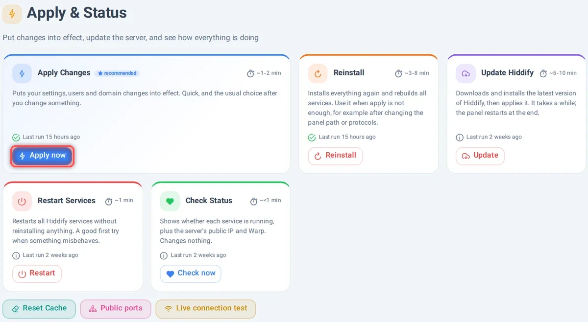
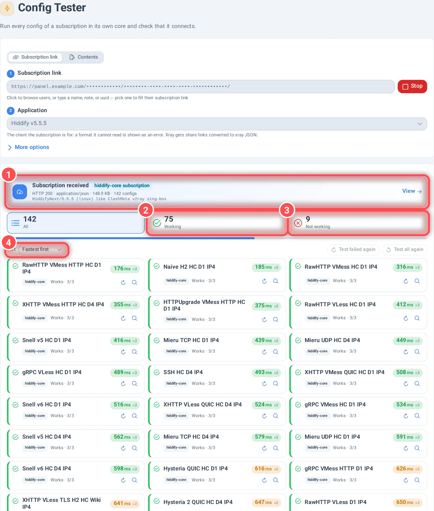
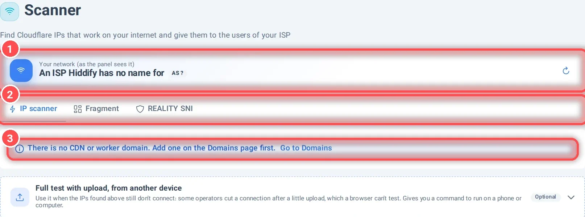
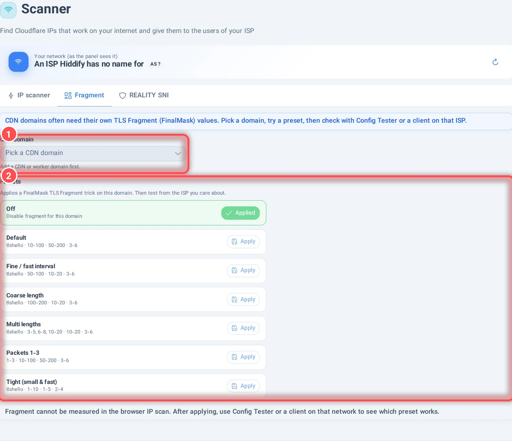
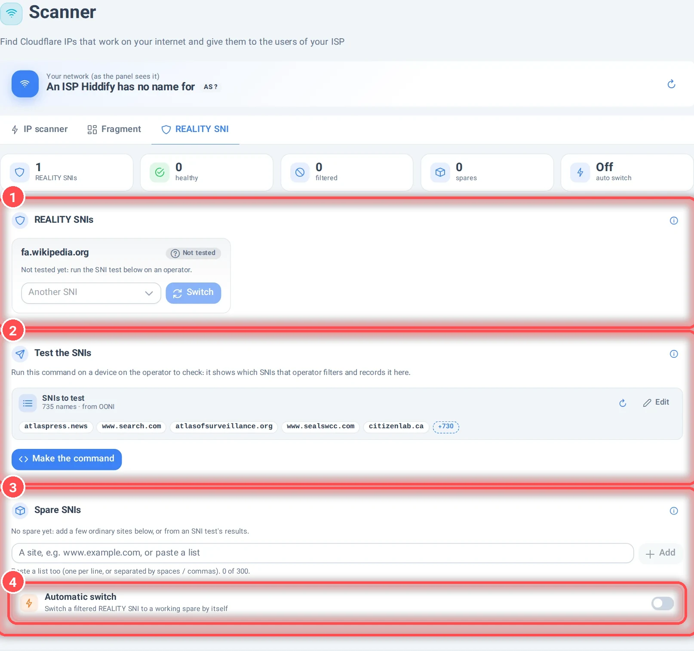

# Troubleshooting connectivity issues with HiddifyManager and proxies

Configs do not connect, or they connect on one ISP and not on another? The Hiddify Manager panel (v14.5) has tools that find and fix most of these problems. This page tells you which tool to use for each symptom.

## First, find where the problem is { #where }

The key question is: **does it fail for everyone, or only for some users and ISPs?** If it fails for everyone, something is broken on the server or in the configs, and the panel tools find it directly. If it fails only on some ISPs, it is filtering, and you must test from that ISP.

## 1. Nobody can connect: the server and the configs { #nobody }

### Check config health

On the **Dashboard**, find the **Config Health** card and click **Check now**. The panel tests every config of a subscription **from the server itself**, the way the Hiddify app and the Xray apps receive it.

Click a row with failing configs to see the reason in plain words:

| Reason | What to do, usually |
|---|---|
| Connects, but traffic does not reach the internet | Check the config’s [outbound](/manager/configuration-and-advanced-settings/How-to-use-Outbounds-on-HiddifyManager/) (for example WARP) or the server’s IPv6. |
| Connection refused | That protocol or port is off: turn it on in **Protocols** and apply. |
| TLS handshake failed | Check the domain’s certificate or its Reality setting in **Domains**. |
| No answer in time | A service or port does not answer: check the services and the firewall in the next steps. |

**Disable failing** removes the configs that work for no app from everyone’s subscription, so users do not waste time on them; **Restore** turns them back on. [All about config health](/manager/configuration-and-advanced-settings/Automatic-config-health-checks-on-HiddifyManager/)

### Check the services

Open **Actions** in the menu. On the **Apply & Status** page:

1. **Check Status** › **Check now**: shows whether each service runs. It changes nothing.
2. If a service is down, click **Restart**. If you just changed settings, click **Apply now**.
3. In **Logs**, click the eye icon to read that service’s error.

### Make sure the ports are open in the firewall

If the services run but no config connects from outside, usually the server’s firewall or the provider’s firewall blocks the ports. On the same **Apply & Status** page, click **Public Ports**: it lists every port the server needs open, with ready **Firewall Commands (ufw)**. Open these ports in the server’s firewall and in your provider’s panel.

## 2. Only one user cannot connect { #one-user }

1. In **Users**, check that the user still has days and traffic left and is not disabled.
2. In **Tools** › **Config Tester**, click the link box and pick that user, set **App** to the app the user has, and click **Start Test**. The panel tests exactly what that user’s app receives.

    

3. If the configs work here, the problem is the user’s app or internet: ask them to update the subscription in the app. The [Hiddify app](/app/How-to-install-Hiddify-app/) understands every panel protocol; some other apps do not. The [app log](/app/Logs-and-reporting-a-problem/) shows the exact reason.

## 3. It fails or is slow on some ISPs: filtering { #filtering }

The tools of part 1 test from the server, so they do not see the filtering in your users’ country. For this part, open the panel’s **Scanner** (**Tools** › **Scanner**) **on the ISP that has the problem, with your VPN off**; for example once on a phone with one mobile ISP and once with another. The scanner runs in your browser, on your own internet at that moment.

=== "CDN domain"

    The Cloudflare IP your users get is blocked or slow on that ISP. In the **IP Scanner** tab, choose the CDN domain and the ISP, click **Start**, then **Save to the Domain**. Users get the working IPs with their next subscription update.

    

    If IPs are found but the connection drops after a little upload, use **Full test with upload, from another device**.

=== "TLS / Fragment"

    The ISP reads the site name in the first TLS packet. In the **Fragment** tab, **Apply** a **preset** to the CDN domain and check it with an app on that ISP. Hiddify app users can also turn fragment on in the app themselves.

    

=== "Reality"

    A Reality config looks like a visit to another site (its SNI); if the ISP filters that site, the config fails. In the **REALITY SNI** tab, click **Make the Command** and run it on a device on that ISP to find the filtered SNIs. With **Automatic Switch**, a filtered SNI is replaced by a working **Spare SNI** by itself.

    

### If the server’s own IP is blocked

Confirm it with [How to check if the server IP or domain is clean](/manager/basic-concepts-and-troubleshooting/How-to-make-sure-the-server%27s-IP-or-domain-is-clean/). The panel cannot unblock a blocked IP: either change the server’s IP (many providers sell a new one), or reach the server through something that is not blocked:

<a class="hi-card" href="/manager/configuration-and-advanced-settings/How-to-use-Reality-on-Hiddify/"><svg aria-hidden="true" xmlns="http://www.w3.org/2000/svg" viewBox="0 0 24 24"><path d="M21 11c0 5.55-3.84 10.74-9 12-5.16-1.26-9-6.45-9-12V5l9-4 9 4v6m-9 10c3.75-1 7-5.46 7-9.78V6.3l-7-3.12L5 6.3v4.92C5 15.54 8.25 20 12 21m2.8-10V9.5C14.8 8.1 13.4 7 12 7S9.2 8.1 9.2 9.5V11c-.6 0-1.2.6-1.2 1.2v3.5c0 .7.6 1.3 1.2 1.3h5.5c.7 0 1.3-.6 1.3-1.2v-3.5c0-.7-.6-1.3-1.2-1.3m-1.3 0h-3V9.5c0-.8.7-1.3 1.5-1.3s1.5.5 1.5 1.3V11Z"/></svg><b>Reality</b><small>Looks like visiting a normal site; works where TLS is blocked.</small></a>
<a class="hi-card" href="/manager/domain-worker-cdn-and-tunneling/How-to-use-Cloudflare-CDN/"><svg aria-hidden="true" xmlns="http://www.w3.org/2000/svg" viewBox="0 0 24 24"><path d="M6.5 20q-2.28 0-3.89-1.57Q1 16.85 1 14.58q0-1.95 1.17-3.48 1.18-1.53 3.08-1.95.63-2.3 2.5-3.72Q9.63 4 12 4q2.93 0 4.96 2.04Q19 8.07 19 11q1.73.2 2.86 1.5 1.14 1.28 1.14 3 0 1.88-1.31 3.19T18.5 20m-12-2h12q1.05 0 1.77-.73.73-.72.73-1.77t-.73-1.77Q19.55 13 18.5 13H17v-2q0-2.07-1.46-3.54Q14.08 6 12 6 9.93 6 8.46 7.46 7 8.93 7 11h-.5q-1.45 0-2.47 1.03Q3 13.05 3 14.5q0 1.45 1.03 2.5 1.02 1 2.47 1m5.5-6Z"/></svg><b>Cloudflare CDN</b><small>The filter sees only the CDN’s IP, not your server’s.</small></a>
<a class="hi-card" href="/manager/domain-worker-cdn-and-tunneling/How-to-add-relay-domain-to-Hiddify-manager/"><svg aria-hidden="true" xmlns="http://www.w3.org/2000/svg" viewBox="0 0 24 24"><path d="M13 19h1a1 1 0 0 1 1 1h7v2h-7a1 1 0 0 1-1 1h-4a1 1 0 0 1-1-1H2v-2h7a1 1 0 0 1 1-1h1v-2H4a1 1 0 0 1-1-1v-4a1 1 0 0 1 1-1h16a1 1 0 0 1 1 1v4a1 1 0 0 1-1 1h-7v2M4 3h16a1 1 0 0 1 1 1v4a1 1 0 0 1-1 1H4a1 1 0 0 1-1-1V4a1 1 0 0 1 1-1m5 4h1V5H9v2m0 8h1v-2H9v2M5 5v2h2V5H5m0 8v2h2v-2H5Z"/></svg><b>Relay server</b><small>A server inside the country passes the traffic to yours.</small></a>
<a class="hi-card" href="/manager/domain-worker-cdn-and-tunneling/Domain-types-and-how-to-register-them/"><svg aria-hidden="true" xmlns="http://www.w3.org/2000/svg" viewBox="0 0 24 24"><path d="M16.36 14c.08-.66.14-1.32.14-2 0-.68-.06-1.34-.14-2h3.38c.16.64.26 1.31.26 2s-.1 1.36-.26 2m-5.15 5.56c.6-1.11 1.06-2.31 1.38-3.56h2.95a8.03 8.03 0 0 1-4.33 3.56M14.34 14H9.66c-.1-.66-.16-1.32-.16-2 0-.68.06-1.35.16-2h4.68c.09.65.16 1.32.16 2 0 .68-.07 1.34-.16 2M12 19.96c-.83-1.2-1.5-2.53-1.91-3.96h3.82c-.41 1.43-1.08 2.76-1.91 3.96M8 8H5.08A7.923 7.923 0 0 1 9.4 4.44C8.8 5.55 8.35 6.75 8 8m-2.92 8H8c.35 1.25.8 2.45 1.4 3.56A8.008 8.008 0 0 1 5.08 16m-.82-2C4.1 13.36 4 12.69 4 12s.1-1.36.26-2h3.38c-.08.66-.14 1.32-.14 2 0 .68.06 1.34.14 2M12 4.03c.83 1.2 1.5 2.54 1.91 3.97h-3.82c.41-1.43 1.08-2.77 1.91-3.97M18.92 8h-2.95a15.65 15.65 0 0 0-1.38-3.56c1.84.63 3.37 1.9 4.33 3.56M12 2C6.47 2 2 6.5 2 12a10 10 0 0 0 10 10 10 10 0 0 0 10-10A10 10 0 0 0 12 2Z"/></svg><b>A new or fake domain</b><small>When the current domain has been found and blocked.</small></a>

## 4. The panel does not open either { #panel-down }

[Connect to the server with SSH](/manager/installation-and-setup/How-to-connect-to-server-via-SSH/) and use these commands:

| Command | What it does |
|---|---|
| `hiddify status` | The status of every service |
| `hiddify admin` | The current admin links (they may have changed after a change) |
| `hiddify restart` | Restart the services without changing the settings |
| `hiddify apply` | Apply the settings saved in the panel |

Or just run `hiddify` to open the [Hiddify Manager menu](/manager/configuration-and-advanced-settings/How-to-connect-and-troubleshoot-via-SSH/), with status, admin link and logs.

## Still not working? { #still }

If another tool connects to **the same server and the same domain** but the Hiddify Manager configs do not, please tell us. Send the working config link (VLESS, VMess or Trojan) in a [GitHub issue](https://github.com/hiddify/Hiddify-Manager/issues) so we can add that kind of config to the panel. Before you send it, open the link in **Tools** › **Text Decoders** and remove the real server address and the passwords.

## Related articles

- [The panel tools](/manager/configuration-and-advanced-settings/How-to-use-the-panel-tools-in-HiddifyManager/)
- [Automatic config health checks](/manager/configuration-and-advanced-settings/Automatic-config-health-checks-on-HiddifyManager/)
- [Clean Cloudflare IP](/manager/domain-worker-cdn-and-tunneling/Guide-for-finding-a-clean-Cloudflare-IP/)
- [How the TLS trick works](/manager/basic-concepts-and-troubleshooting/How-the-TLS-Trick-works-and-its-usage/)

