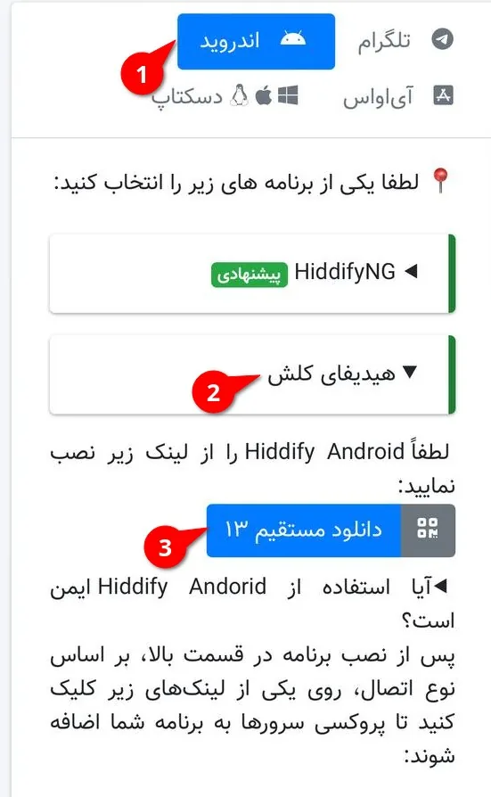
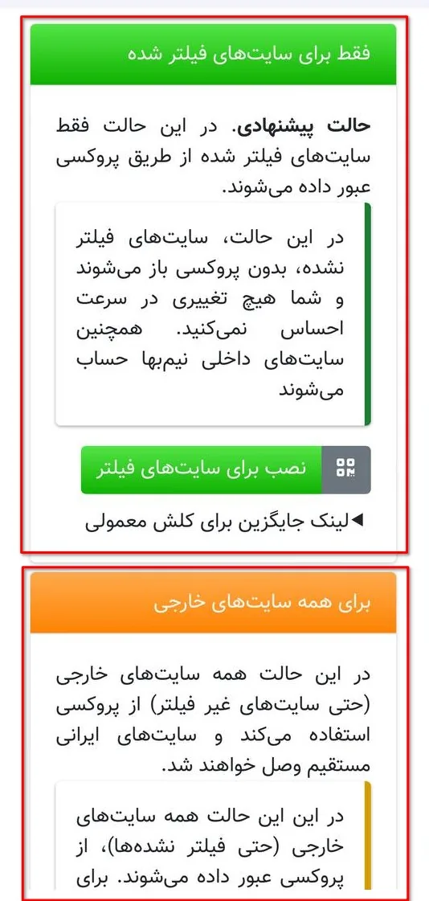
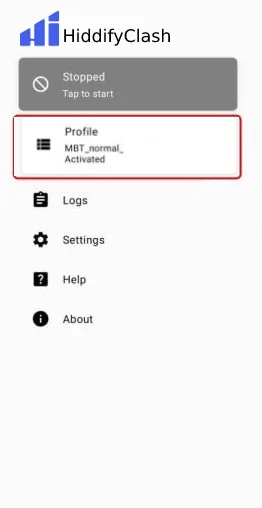
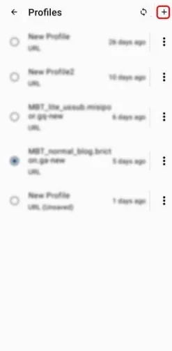
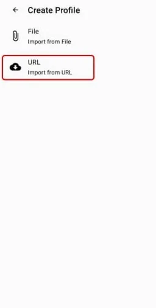
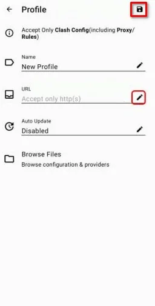
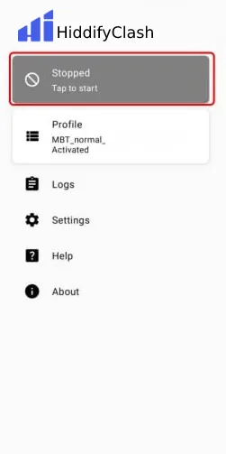
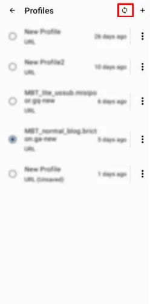

# آموزش کار با نرم‌افزار HiddifyClashAndroid

!!! warning "HiddifyClashAndroid دیگر توسعه داده نمی‌شود"
    HiddifyClashAndroid یکی از اپ‌های قدیمی هیدیفای است. دیگر توسعه داده نمی‌شود و به‌روز نمی‌شود، و ممکن است پروتکل‌ها و قابلیت‌های جدید هیدیفای‌منیجر در آن کار نکنند. [اپ هیدیفای](/fa/app/) جای آن را گرفته و روی اندروید، iOS، ویندوز، مک و لینوکس کار می‌کند: [نصب اپ هیدیفای](/fa/app/How-to-install-Hiddify-app/) را ببینید. این صفحه برای کسانی نگه داشته شده که هنوز از HiddifyClashAndroid استفاده می‌کنند.

<!--
این نرم‌افزار شبیه کلش هست با این تفاوت که از پروتکل‌های بیشتری پشتیبانی می‌کنه
روی هیدیفای کلش کلیک کنید تا گزینه‌ها رو برای شما بیاره، اولین گزینه مربوط به نصب نرم‌افزار هست. دو گزینه دیگه حالت‌های مختلفی هستن که شما می‌تونین برای نوع تونل گوشیتون انتخاب کنین، «حالت برای همه سایت‌های خارجی»، اگر این گزینه رو انتخاب کنین ترافیک سایت‌های ایرانی رو از تونل عبور نمی‌ده و تمام سایت‌ها و سرورهایی رو که در خارج از ایران قرار داره رو تونل می‌کنه اما «حالت فقط برای سایت‌های فیلتر شده»، فقط سایت‌هایی رو از تونل عبور می‌ده که فیلتر شدن و بنابراین سرعت شبکه شما بیشتر هست و ترافیکی که روی سرور هست کمتر می‌شه.
برای اضافه کردن لینک کافیه روی گزینه مورد نظر خودتون کلیک کنین تا به صورت اتوماتیک وارد نرم‌افزارتون بشه، در صورتی که می‌خواین حالت دستی فعال کنین روی علامت QR بارکد کلیک کنید سپس دکمه‌ی «کپی» رو بزنید. بعدش وارد نرم‌افزار Hiddify Android قسمت پروفایل وارد بشید روی علامت بعلاوه کلیک کنید و بعد از اون url را انتخاب کنید و در قسمت url کد کپی شده رو پیست کنید و در نهایت علامت ذخیره (save) رو بزنید.

-->

این نرم‌افزار بر پایه کلش توسعه داده شده است و امکانات زیادی در آن قرار داده شده است.

## دانلود برنامه

 برای این کار در پنل کاربری خود وارد تب اندروید شوید و بخش مربوط به `هیدیفای کلش` را باز کنید.

`دانلود مستقیم` را بزنید تا برنامه دانلود شود.

## نصب برنامه
برای نصب برنامه فایل دانلود شده را اجرا کنید. ممکن است خطای ناشناخته بودن منبع فایل را بدهد که می‌توانید آن را تایید کنید تا فایل نصب گردد.

## اضافه کردن پروفایل به برنامه

* در اینجا نیاز است با مفهومی به اسم پروفایل آشنا شوید. پروفایل یک فایل yml شامل تمامی کانکشن‌هاست که در این بخش قابل دسترسی است. دو نوع پروفایل وجود دارد

* پروفایل سبز رنگ یا `Lite` برای سایت‌های فیلتر شده که در این حالت فقط سایت‌های فیلترشده از فیلترشکن عبور داده می‌شوند و سایر سایت‌ها از جمله سایت‌های ایرانی بدون فیلترشکن باز می‌شوند که حالت بهتری است. بنابراین برای باز کردن این سایت‌ها نیاز به خاموش کردن VPN ندارید.

* حالت دوم پروفایل نارنجی یا `Normal` است که همه ترافیک را از فیلترشکن به سمت سرور می‌فرستد که اگر در سرور سایت‌های ایرانی بلاک شده باشند، باز نمی‌شوند یا اگر وارپ برای همه ترافیک فعال شده باشد،‌سایت‌های ایرانی با وارپ باز می‌شوند.

* در نهایت یکی از دو پروفایل را انتخاب کنید و `نصب` را بزنید تا پروفایل به صورت خودکار به برنامه اضافه گردد.

## اضافه کردن دستی پروفایل
* در اپ HiddifyClash در اندروید روی `Profile` بزنید.

* و در صفحه‌ای که باز می‌شود، دکمه `+` را تپ کنید.

* در این صفحه در قسمت `URL` بروید.

* و لینک پروفایل انتخاب شده را ازز صفحه کاربری کپی کنید و در اینجا قرار دهید و ذخیره نمایید.

* پروفایل مورد ظنر به برنامه اضافه می‌گردد.

## اتصال به فیلترشکن
برای اتصال نیز روی دکمه مشخص شده بزنید.

## آپدیت پروفایل
جهت آپدیت پروفایل و کانفیگ‌ها روی پروفایل بزنید و در صفحه باز شده روی علامت آپدیت بزنید تا پروفایل مطابق با آخرین تغییرات سرور آپدیت گردد.

## مقاله‌های مرتبط

- [V2rayNG](/fa/manager/client-software-on-android/Tutorial-for-V2rayNG-app/)
- [NekoBox](/fa/manager/client-software-on-android/Tutorial-for-Nekobox-app/)
- [sing-box](/fa/manager/client-software-on-ios/Tutorial-for-SingBox-app/)
- [Streisand](/fa/manager/client-software-on-ios/Tutorial-for-Streisand/)

