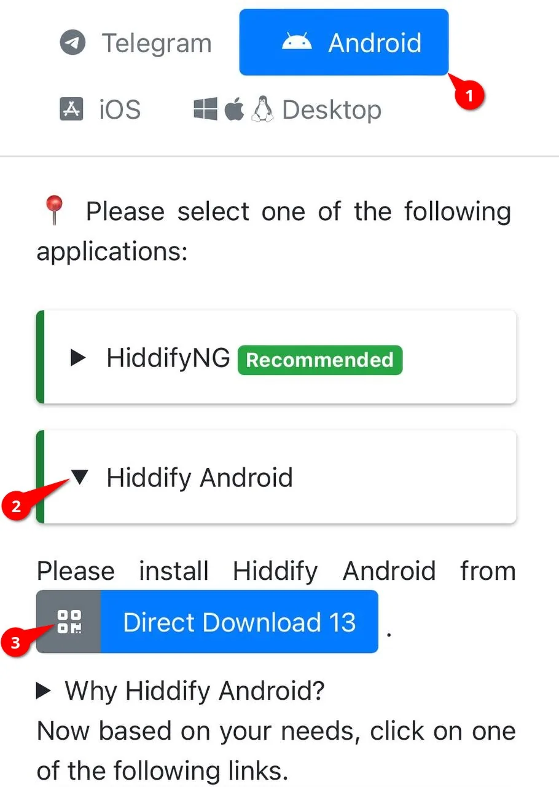
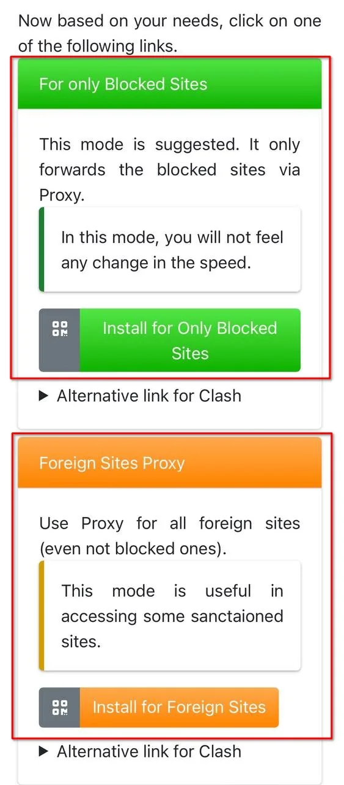
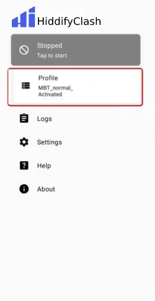
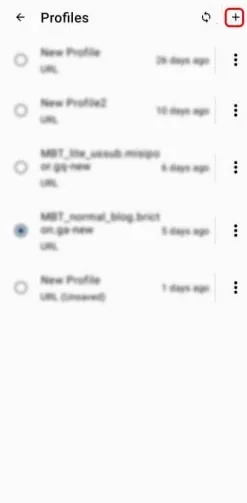
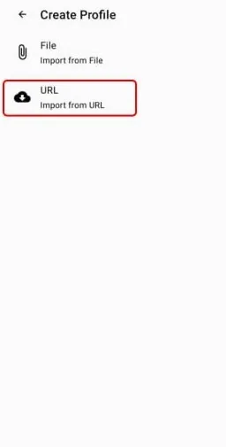
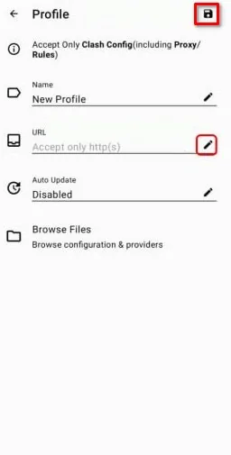
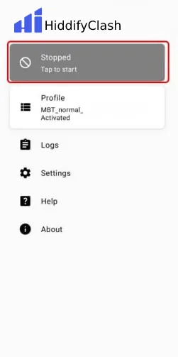
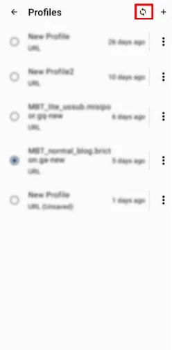

# Tutorial for HiddifyClashAndroid app

!!! warning "HiddifyClashAndroid is no longer developed"
    HiddifyClashAndroid is an old Hiddify app. It is no longer developed or updated, and new protocols and features of Hiddify Manager may not work in it. The [Hiddify app](/app/) replaces it, on Android, iOS, Windows, macOS and Linux: see [how to install the Hiddify app](/app/How-to-install-Hiddify-app/). This page is kept for people who still use HiddifyClashAndroid.

This software is developed based on Clash and many features are included in it.

## Download the app

To do this, enter the Android tab in your user panel and open the section related to `Hidify Android`.

- Click on `Direct Download` to download the application.

## Install the app
Run the downloaded file to install the program. It may give an error that the source of the file is unknown, which you can confirm to install the file.

## Add profile to the app

- Here you need to get acquainted with a concept called `profile`. The profile is a `yml` file includes all the connections that can be accessed in this section. There are two types of profiles

- `Green` or `lite` profile for filtered sites, in which case only filtered sites are passed through the VPN and other sites, including domestic sites, are opened without the VPN, which is a better mode. So you don't need to turn off VPN to open these sites.

- The second mode is the `orange` or `Normal` profile, which passes all traffic through the VPN to the server. If domestic sites are blocked on the server, they will not be opened, or if WARP is enabled for all traffic, domestic sites will be opened via WARP.

- Finally, choose one of the two profiles and click on `Install` so that the profile is automatically added to the program.

## Add profile manually
- Tap on `Profile` in the `HiddifyClash` app on Android.

- And on the screen that opens, tap the `+` button.

- On this page, go to the `URL` section.

- And copy the selected profile link from the user page and place it here and save it.

- The desired profile is added to the app.

## Connect to the app
Click on the specified button to connect.

## Update profile
To update the profile and configs, click on the profile. Then, on the opened page, click on the update sign so that the profile is updated according to the latest server changes.

## Related articles

- [V2rayNG](/manager/client-software-on-android/Tutorial-for-V2rayNG-app/)
- [NekoBox](/manager/client-software-on-android/Tutorial-for-Nekobox-app/)
- [sing-box](/manager/client-software-on-ios/Tutorial-for-SingBox-app/)
- [Streisand](/manager/client-software-on-ios/Tutorial-for-Streisand/)

