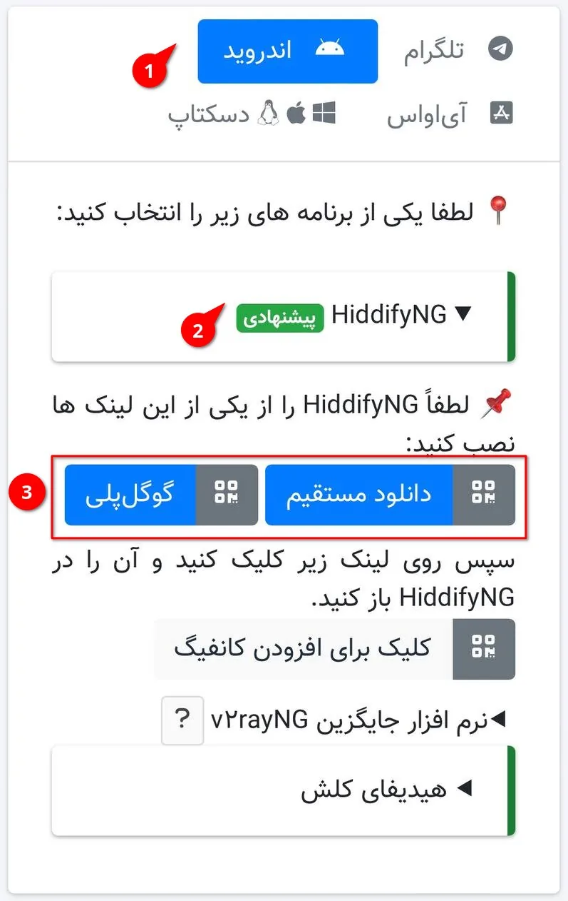
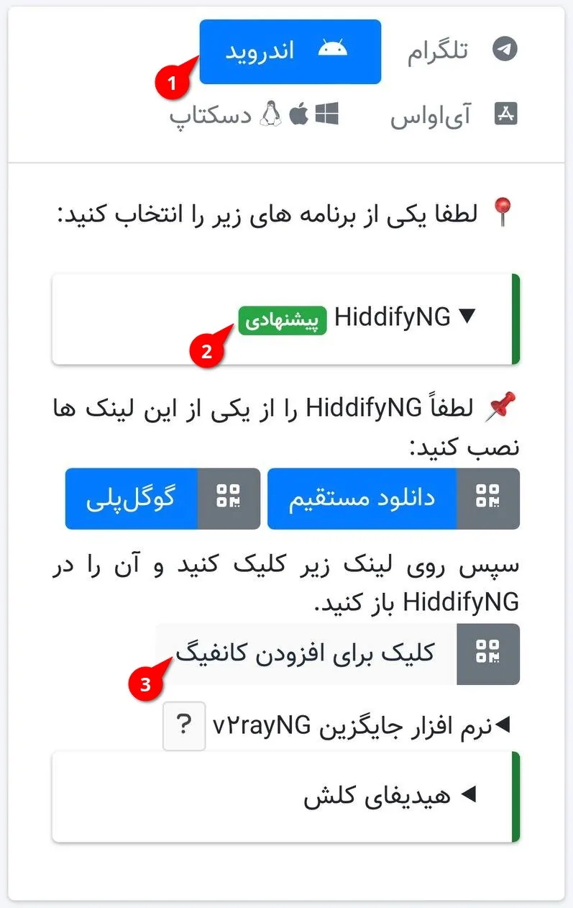
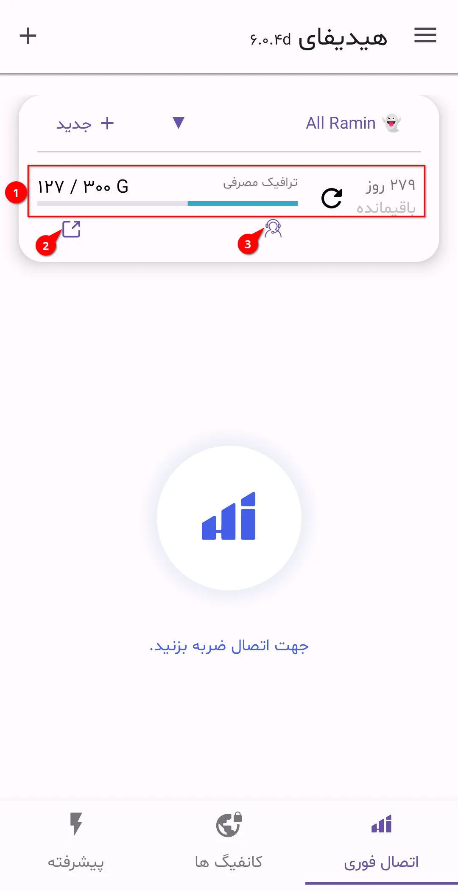
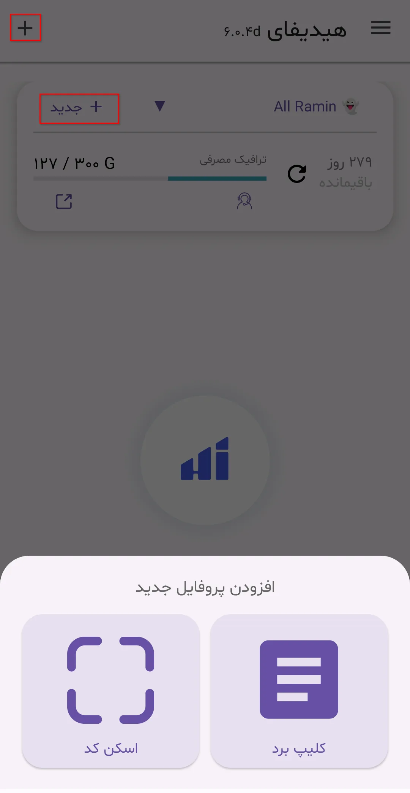
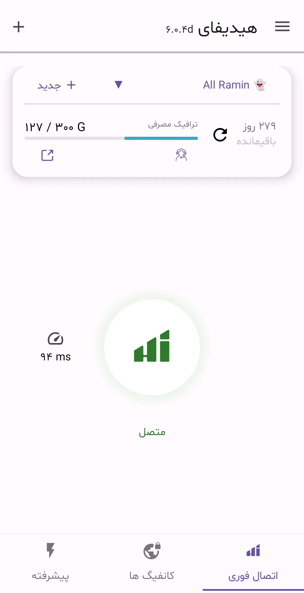
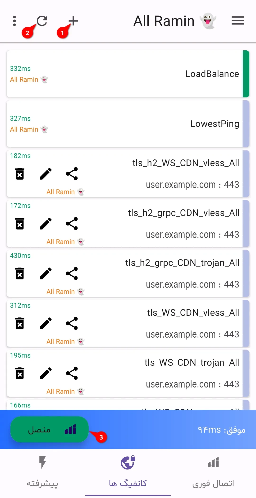
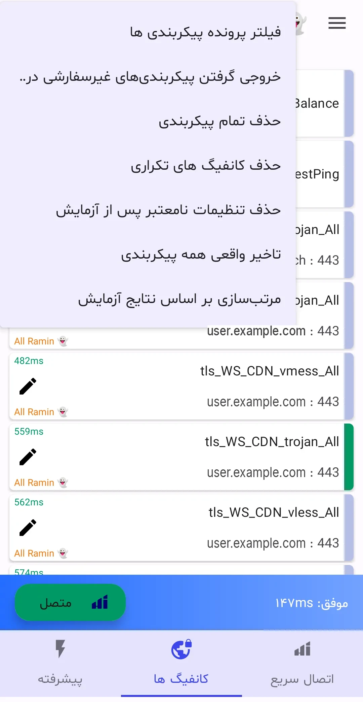
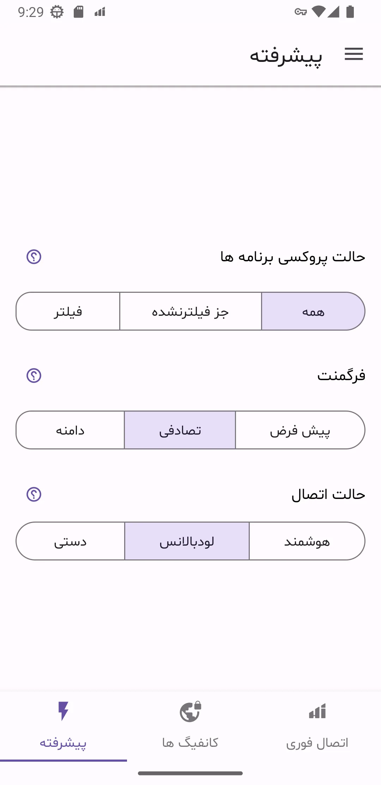
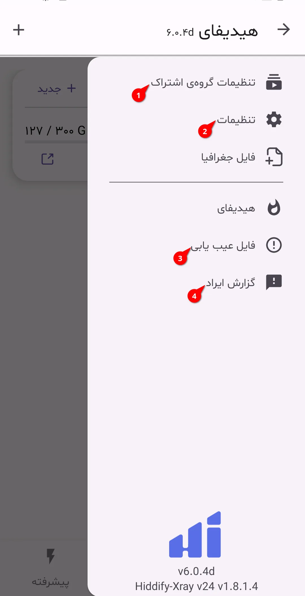

# آموزش کار با نرم‌افزار HiddifyNG

!!! warning "HiddifyNG دیگر توسعه داده نمی‌شود"
    HiddifyNG یکی از اپ‌های قدیمی هیدیفای است. دیگر توسعه داده نمی‌شود و به‌روز نمی‌شود، و ممکن است پروتکل‌ها و قابلیت‌های جدید هیدیفای‌منیجر در آن کار نکنند. [اپ هیدیفای](/fa/app/) جای آن را گرفته و روی اندروید، iOS، ویندوز، مک و لینوکس کار می‌کند: [نصب اپ هیدیفای](/fa/app/How-to-install-Hiddify-app/) را ببینید. این صفحه برای کسانی نگه داشته شده که هنوز از HiddifyNG استفاده می‌کنند.

این اپ بهترین نرم‌افزار برای اتصال به پروتکل‌های Xray در سیستم عامل اندروید است.

## دانلود و نصب نرم‌افزار
در پنل کاربری خود وارد تب `اندروید` شوید و بخش مربوط به `HiddifyNG` را باز کنید.

روی `دانلود مستقیم` بزنید تا برنامه دانلود شود.

همچنین می‌توانید برنامه را از [گیتهاب](https://github.com/hiddify/HiddifyNG/releases) و از [گوگل‌پلی](https://play.google.com/store/apps/details?id=ang.hiddify.com) به صورت مستقیم دانلود و نصب کنید.

## افزودن کانفیگ
برای این کار در همان بخش مربوط به برنامه `HiddifyNG` روی `کلیک برای افزودن کانفیک` بزنید تا کانفیگ به برنامه اضافه گردد.

## اتصال سریع
این صفحه برای اتصال سریع به فیلترشکن طراحی شده است که شامل چندین بخش است.

### بخش پروفایل

* در این قسمت می‌توانید پروفایل‌های ایمپورت شده خود را ببینید. میزان حجم مصرفی و حجم کلی را مشاهده کنید. همچنین تعداد روز باقیمانده از اکانت خود را مشاهده کنید. (بخش شماره ۱)

* از طریق دکمه شماره ۲ می‌توانید وارد صفحه کاربری خود در پنل شوید

* از طریق دکمه شماره ۳ می‌توانید با پشتیبانی خود در ارتباط باشید.

### اضافه کردن پروفایل جدید
برای این کار دکمه `+` را از بخش پروفایل یا از بالا سمت راست اپلیکیشن بزنید.

امکان استفاده از لینک کپی شده یا اسکن `QR code` آن برای شما فراهم می‌شود.

### اتصال به نرم‌افزار
برای این کار روی دکمه اتصال وسط صفحه بزنید.

پس از اتصال نتیجه تست اتصال نیز نمایش داده می‌شود.

## کانفیگ‌ها
در اینجا تک تک کانفیگ‌هایی که با استفاده از لینک سابسکریپشن اضافه شده بودند، نماش داده می‌شوند.

### اضافه کردن کانفیگ به صورت دستی
برای این کار از دکمه `+` شماره ۱ استفاده کنید.

### آپدیت کردن کانفیگ‌ها
برای این کار از دکمه آپدیت شماره ۲ استفاده کنید.

### اجرای کانفیگ‌ها
برای این کار از دکمه شماره ۳ استفاده کنید.

### منوی ۳ نقطه در کانفیگ‌ها
در این منو که زیر مجموعه منوی کانفیگ‌هاست، می‌توانید کارهای مختلفی انجام دهید که در ادامه اشاره می‌شوند.

#### فیلتر پرونده پیکربندی‌ها
این منوی برای فیلتر کردن کانفیگ‌هابر اساس یک مورد خاص می‌باشد.
#### خروجی گرفتن پیکربندی‌های غیر سفارشی
این منو برای خروج کانفیگ اضافه شده به برنامه و انتقال آن به دستگاه دیگر کاربرد دارد.
#### حذف تمام پیکربندی‌ها
این منوی برای حذف کل فایل کانفیگ‌ها از برنامه می‌باشد.
#### حذف کانفیگ‌های تکراری
بعضی وقت‌ها نیاز دارید به دلیل تعدد کانفیگ‌ها یک مرتب‌سازی صورت بگیرد و کانفیگ‌هایی که تکراری ایمپورت شده‌اند، از برنامه حذف شوند. برای این کار از این گزینه استفاده کنید.
#### حذف تنظیمات نامعتبر پس از آزمایش
بعضی وقت‌ها کانفیگ‌ها را دست کاری می‌کنید تا با تغییر پارامترها نتیجه بهتری بگیرید. در صورتی که نیاز داشته باشید کانفیگ‌هایی که تنظیم نامعتبر دارند را حذف نمایید، از این گزینه استفاده کنید.
#### تاخیر واقعی همه پیکربندی‌ها
این گزینه برای تست پینگ واقعی بر اساس اتصال به کانفیگ‌ها نتیجه را نمایش می‌دهد.
#### مرتب‌سازی بر اساس نتایج آزمایش
لیست کانفیگ‌ها را بر اساس نتیجه تست مرتب می‌کند. کانفیگ‌های با پینگ کمتر و نتیجه بهتر در بالای لیست قرار می‌گیرند.

برای این کار در قسمت مربوط به پروفایل تپ کنید تا بخش مربوط به تنظیمات آن‌ها باز شود.

می‌توان پروفایل‌های ایمپورت شده را ویرایش کرد یا پروفایل جدید اضافه نمود.

## منوی پیشرفته
در این صفحه تنظیمات پیشرفته قرار دارد که در ادامه به آن‌ها اشاره خواهد شد.

### تنظیمات حالت پروکسی برنامه‌ها
تنظیمات این بخش نحوه عبور ترافیک سایت‌ها و اپلیکیشن‌ها از فیلترشکن را تعیین می‌کند که شامل سه قسمت است.

#### همه
همه سایت‌ها و اپ‌ها را از فیلترشکن عبور می‌دهند.

#### فیلتر شده
سایت‌های فیلتر شناسایی شده را از فیلترشکن عبور می‌دهد.

#### جز فیلتر نشده
علاوه بر سایت‌های فیلتر شناسایی شده، سایت‌هایی را هم که وضعیت فیلترشدن یا نشدنشان نامعلوم است، از فیلترشکن عبور می‌دهد.

### فرگمنت
فرگمنت بسته‌های ارسالی را تکه تکه میکنه. اینطوری SNI از دید سیستم فیلترینگ مخفی میشه و فیلترینگ دور زده می‌شود. [اطلاعات بیشتر](/fa/manager/basic-concepts-and-troubleshooting/How-the-TLS-Trick-works-and-its-usage/)

تنظیمات این بخش نحوه انتقال اطلاعات را در قالب بسته‌های تکه تکه شده تعیین می‌کند. هدف از اعمال این تنظیمات ایجاد مقاومت در برابر سیستم فیلترینگ است.

#### پیش‌فرض
فرگمنتی که در کانفیگ یا لینک پروکسی تعریف شده است را اعمال می‌کند.

#### تصادفی
بسته‌ها به تکه‌های تصادفی تقسیم می‌کند.

#### دامنه
بسته‌ها را به دو تکه تقسیم می‌کند.

### حالت اتصال
تنظیمات این بخش نحوه اتصال به کانفیگ‌ها را تعیین می‌کند.

#### هوشمند
به صورت خودکار به کانفیگی با بیشترین سرعت (کمترین پینگ) متصل می‌شود.

#### لودبالانس
به صورت همزمان به چند کانفیگ وصل می‌شود و ترافیک بین آن‌ها پخش می‌شود. این حالت برای زمانی که آی‌پی مربوط به کانفیگ‌ها کثیف شده است خیلی مفید است با استفاده از این حالت و پخش بار روی چند کانفیگ سرعت قابل قبولی به دست می‌آید.

#### دستی
کانفیگ‌ها به صورت دستی وارد و جهت اتصال انتخاب می‌شوند. با کلیک روی این دکمه، نرم‌افزار وارد صفحه دیگری می‌شود که لیست کانفیگ‌ها را نشان می‌دهد.

## تنظیمات منوی سه خط نرم‌افزار
در این بخش چندین تنظیم کلی وجود دارد که کاربردی‌ترین قسمت‌ها این‌ها هستند.

### تنظیمات گروهی اشتراک
تنظیمات مربوط به همه لینک‌های سابسکریپشن این گزینه را انتخاب کنید.
### تنظیمات
تنظیمات کلی نرم‌افزار در این بخش وجود دارد.
### فایل عیب‌یابی
در صورت نیاز به فایل لاگ جهت عیب‌یابی از این گزینه استفاده کنید.
### گزارش ایراد
در صورت نیاز به گزارش کردن باگ‌ها و اشکالات از این منو استفاده کنید.

## مقاله‌های مرتبط

- [V2rayNG](/fa/manager/client-software-on-android/Tutorial-for-V2rayNG-app/)
- [NekoBox](/fa/manager/client-software-on-android/Tutorial-for-Nekobox-app/)
- [sing-box](/fa/manager/client-software-on-ios/Tutorial-for-SingBox-app/)
- [Streisand](/fa/manager/client-software-on-ios/Tutorial-for-Streisand/)

