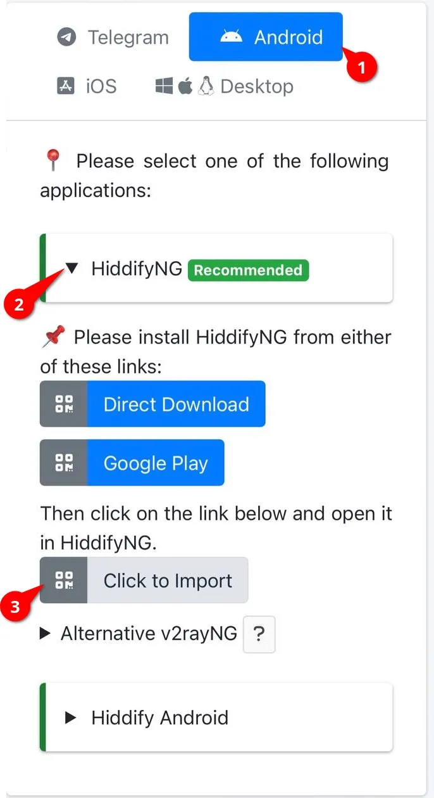
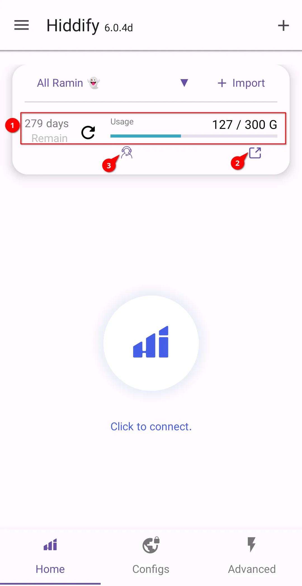
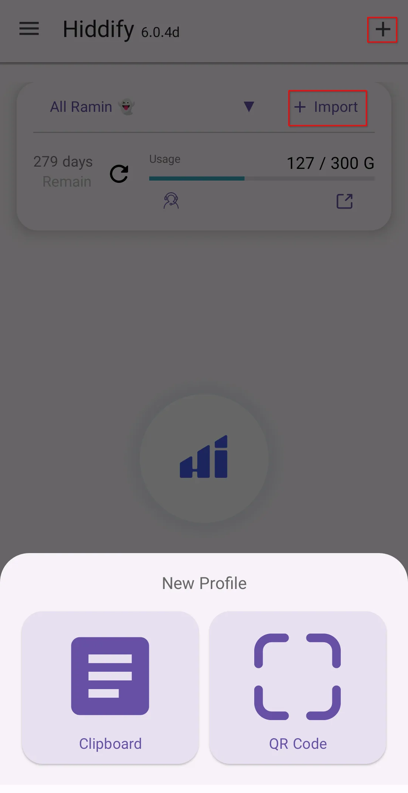
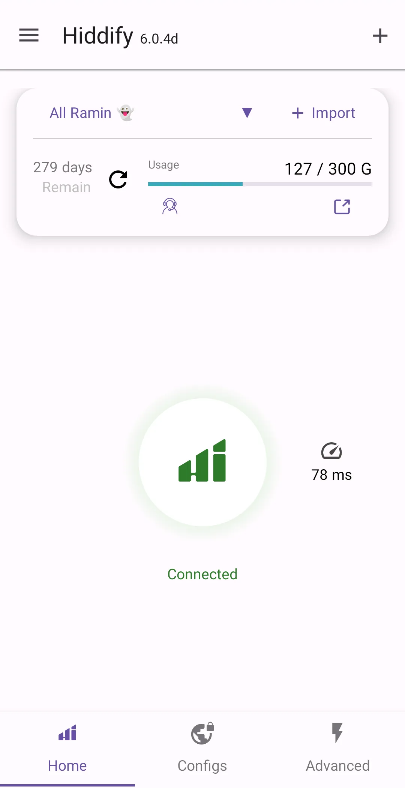
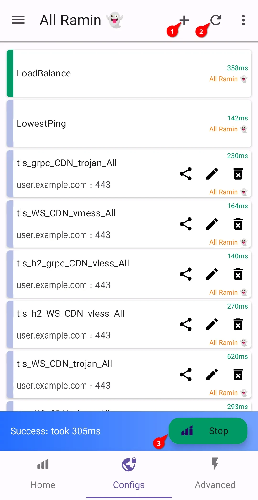
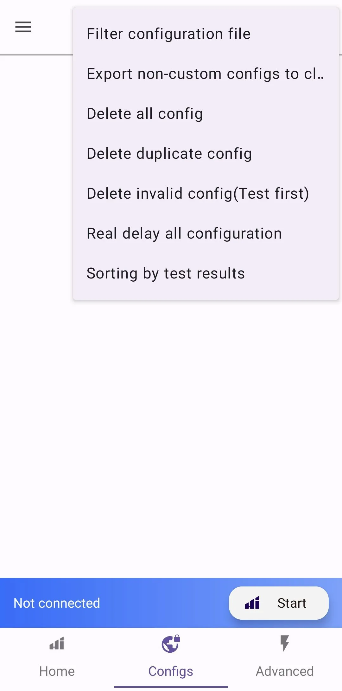
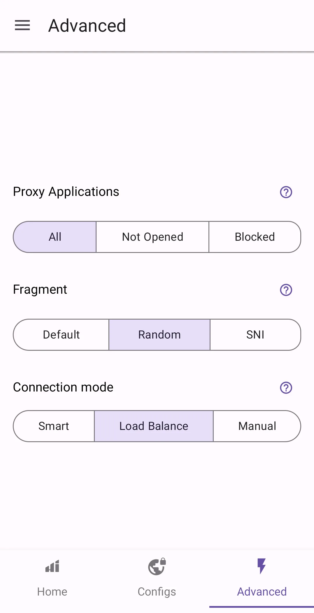
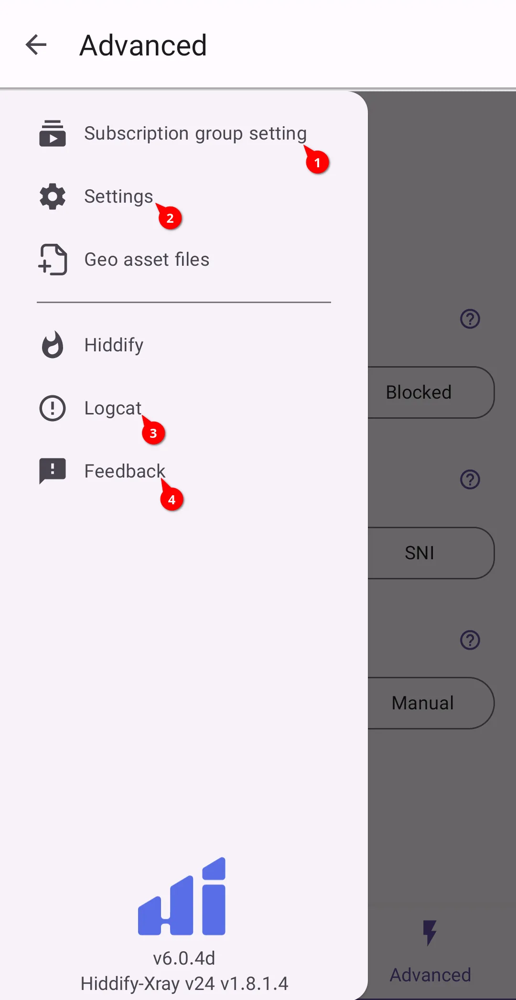

# Tutorial for HiddifyNG app

!!! warning "HiddifyNG is no longer developed"
    HiddifyNG is an old Hiddify app. It is no longer developed or updated, and new protocols and features of Hiddify Manager may not work in it. The [Hiddify app](/app/) replaces it, on Android, iOS, Windows, macOS and Linux: see [how to install the Hiddify app](/app/How-to-install-Hiddify-app/). This page is kept for people who still use HiddifyNG.

This app is the best software for connecting to Xray protocols on Android operating system.
Download and install the software

Enter the `Android` tab in your user panel and open the `HiddifyNG` section.

  

Click on Direct Download to download the application.

You can also download and install the program directly from [GitHub](https://github.com/hiddify/HiddifyNG/releases) and [Google Play](https://play.google.com/store/apps/details?id=ang.hiddify.com).

## Add config
To do this, in the same section related to the `HiddifyNG` program, click on `Click to Import` to add the configuration to the program.

  

## Home
This plate is designed for quick connection to the filter breaker, which consists of several parts.

### Profile section

  

In this section, you can see your imported profiles. 

- View the Traffic usage and the total traffic. Also see the number of days remaining in your account. (section number 1)

- You can enter your user page in the panel through button number 2

- You can contact your support through button number 3.

### Add new profile

For this, press the `+` button from the profile section or from the top right of the application.

You can use the copied link or scan its QR code.

  

### Connect to the software

To do this, click on the connection button in the middle of the screen.

  

After you connect, the result of the connection test is shown too.

## Configs
Here are the configs that were added using the subscription link.

  

### Add a config by hand
For this, use the `+` button number 1.

### Update configs
For this, use the update button number 2.

### Start or stop configs
For this, use the button number 3.

### Three-dot menu in configs
In this menu, which is a subset of the config menu, you can do various things that are mentioned below.

  

#### Filter configuration file
This menu is for filtering configurations based on a specific item.

#### Export non-custom configs
This menu is used to exit the configuration added to the program and transfer it to another device.

#### Remove all config
This menu is for deleting the entire config file from the program.

#### Remove duplicate config
Sometimes, due to the large number of configurations, you need to sort and remove the duplicate imported configurations from the program. Use this option for this.

#### Remove invalid config (Test first)
Sometimes you manipulate the configs to get better results by changing the parameters. If you need to delete configs that have invalid settings, use this option.

#### Real delay all configuration
This option displays the result for actual ping test based on the connection to the configs.

#### Sorting by test results
Sorts the list of configs based on the test result. Configurations with lower ping and better results are placed at the top of the list.

To do this, tap on the section related to the profile to open the section related to their settings.

You can edit the imported profiles or add a new profile.

## Advanced
On this page, there are advanced settings that will be mentioned later.

  

## Proxy mode settings

The settings of this section determine how the traffic of sites and applications pass through the VPN, which consists of three parts.

#### All
All sites and apps pass through the app.

#### Blocked
Passes detected filtered sites through the app.

#### Not Opened
In addition to the identified filter sites, it also passes through the app the sites whose filtering status is unknown.

## Fragment

Fragment splits the sent packets into some pieces. In this way, SNI is hidden from the GFW and filtering will be bypassed. [more information](/manager/basic-concepts-and-troubleshooting/How-the-TLS-Trick-works-and-its-usage/)

The settings in this section determine how information is transmitted in the form of fragmented packets. The purpose of applying these settings is to create resistance against the filtering system.

#### Default
Applies the fragment defined in the config or proxy link.

#### Random
It splits packets into random chunks.

#### SNI
It splits packets into two pieces.

## Connection mode
The settings in this section determine how to connect to configs.

#### Smart
It will automatically connect to the configuration with the highest speed (lowest ping).

#### Load Balance
It connects to several configs at the same time and traffic is distributed between them. This mode is very useful when the IP related to the configs is not clean. By using this mode and spreading the load on several configs, an acceptable speed would be obtained.

#### Manual
Configs are entered manually. By clicking this button, the app opens another page that shows the list of available configs in which you can choose your desired one.

## Three-line software menu settings
In this section, there are several general settings, the most useful parts of which are these.

  

### Subscription group setting
Settings for all subscription links Select this option.

### Settings
There are general software settings in this section.

### Logcat
Use this option if you need a log file for troubleshooting.

### Feedback
Use this menu if you need to report bugs and errors.

## Related articles

- [V2rayNG](/manager/client-software-on-android/Tutorial-for-V2rayNG-app/)
- [NekoBox](/manager/client-software-on-android/Tutorial-for-Nekobox-app/)
- [sing-box](/manager/client-software-on-ios/Tutorial-for-SingBox-app/)
- [Streisand](/manager/client-software-on-ios/Tutorial-for-Streisand/)

