

# آموزش کار با نرم‌افزار NekoBox

در این صفحه یاد می‌گیرید لینک اشتراک هیدیفای‌منیجر خود را به برنامهٔ رایگان **NekoBox** در اندروید اضافه کنید، کانفیگ‌ها را تست کنید، وصل شوید و دو پروکسی را پشت هم بگذارید. NekoBox بر پایهٔ sing-box است و روی گوشی‌های قدیمی هم خوب کار می‌کند. تصویرها از **NekoBox نسخهٔ 1.4.2** و صفحهٔ کاربری هیدیفای‌منیجر ۱۴.۵ هستند.

## نصب NekoBox { #install }

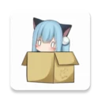
<b>NekoBox</b><small>v1.4.2Android 5+رایگانآبان ۱۴۰۵</small>

<a class="hi-store" href="https://github.com/MatsuriDayo/NekoBoxForAndroid/releases/latest"><small>Download APK on</small><b>GitHub</b></a>

<a class="hi-alt" href="/fa/app/How-to-install-Hiddify-app/"><b>پیشنهاد ما: اپ هیدیفای</b><small>رایگان، ساده‌تر و با پشتیبانی از همهٔ پروتکل‌های هیدیفای‌منیجر</small>نصب اپ ←</a>

برای گوشی‌های خیلی قدیمی فایل <code>armeabi-v7a.apk</code> را بگیرید. NekoBox را **از گوگل‌پلی نصب نکنید**: سازندگان NekoBox می‌گویند نسخهٔ گوگل‌پلی از سال ۲۰۲۴ دست شخص دیگری است و متن‌باز نیست. دکمهٔ دانلود صفحهٔ کاربری شما هم همان فایل APK گیت‌هاب را می‌دهد.

## افزودن لینک اشتراک: روش سریع (پیشنهادی) { #quick }

1. لینک صفحهٔ کاربری را در گوشی باز کنید و دکمهٔ گرد بزرگ را بزنید. اگر اپ هیدیفای هم نصب است و خودش باز شد، **لغو** را بزنید و به مرورگر برگردید.
2. در پنجرهٔ **VPN خود را پیکربندی کنید**، **مشاهده بیشتر** و بعد **NekoBox** را بزنید، سپس **وارد کردن در برنامه** را بزنید.

    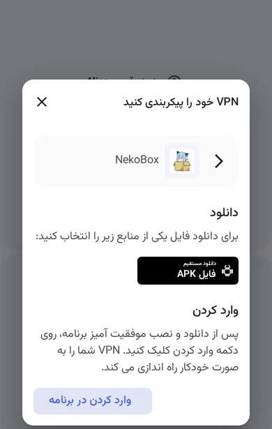

3. اگر اندروید پرسید با کدام برنامه باز شود، **NekoBox (Import subscription)** و بعد **Just once** را بزنید.

    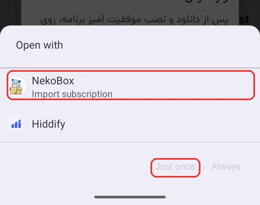

4. NekoBox می‌پرسد اشتراک را وارد کند یا نه؛ **YES** را بزنید. یک گروه جدید با کانفیگ‌های شما ساخته می‌شود.

    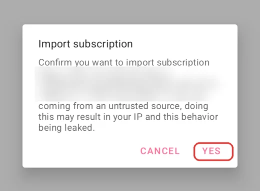

!!! info "چرا روش سریع بهتر است؟"
    در روش سریع، سرور کانفیگ‌ها را به قالب Clash Meta می‌فرستد و فقط کانفیگ‌هایی را می‌دهد که NekoBox می‌شناسد (در آزمایش ما ۷۵ کانفیگ). لینک **Subscription link** در روش دستی همهٔ کانفیگ‌ها را می‌دهد (۱۲۵ کانفیگ)، از جمله XHTTP که NekoBox پشتیبانی نمی‌کند و در تست «Unavailable» نشان داده می‌شود.

## افزودن لینک اشتراک به‌صورت دستی { #manual }

1. در صفحهٔ کاربری، دکمهٔ گرد را بزنید و زیر **ورود دستی**، **کپی لینک** را بزنید.
2. در NekoBox منوی کناری (سه خط) را باز کنید و **Group** را بزنید.

    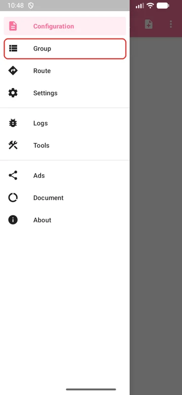

3. دکمهٔ افزودن گروه را بالای صفحه بزنید.

    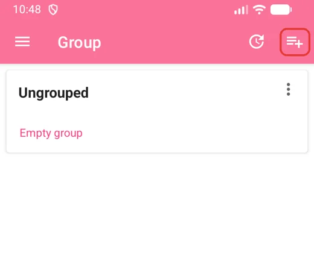

4. در **Group name** یک نام بنویسید (مثلاً نام سرور). **Group Type** را روی **Subscription** بگذارید. بعد **Subscription Link** را بزنید.

    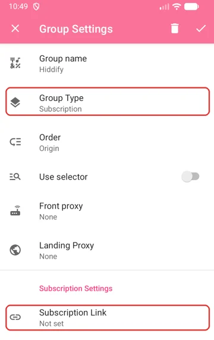

5. لینک کپی‌شده را بچسبانید و **OK** را بزنید.

    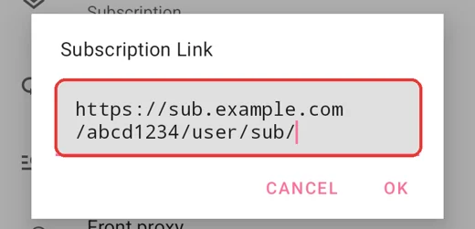

6. **Auto Update** را روشن کنید تا کانفیگ‌ها خودکار به‌روز شوند. **Force Resolve** را خاموش بگذارید. بعد دکمهٔ ✓ را بالای صفحه بزنید.

    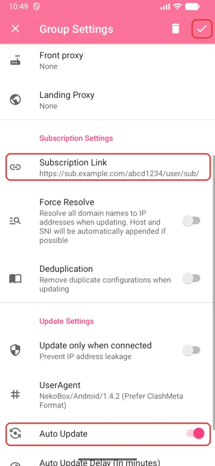

7. NekoBox فهرست کانفیگ‌های اضافه‌شده را نشان می‌دهد؛ **OK** را بزنید. کارت گروه حجم مصرف‌شده، حجم باقی‌مانده، تاریخ پایان و تعداد کانفیگ‌ها را نشان می‌دهد. با **UPDATE** هر وقت خواستید به‌روزش کنید.

    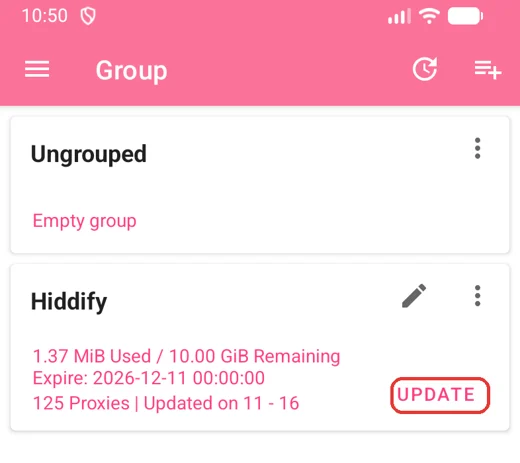

## تست و اتصال { #connect }

1. از منوی کناری به **Configuration** (صفحهٔ اصلی) برگردید. منوی سه نقطه را بزنید و **URL Test** را بزنید.

    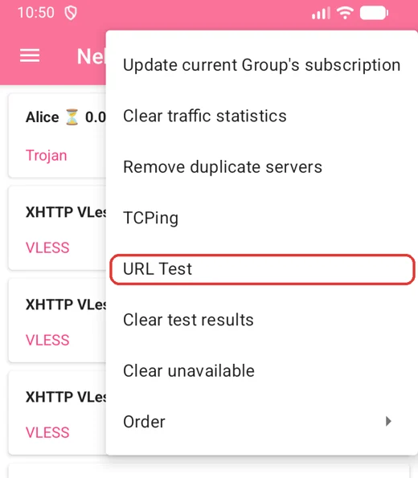

2. کنار هر کانفیگ زمان پاسخ به میلی‌ثانیه نوشته می‌شود؛ هرچه کمتر بهتر. **Unavailable** یا **Timeout** یعنی آن کانفیگ کار نمی‌کند. با **Order** › **By Delay** در همان منو، بهترین‌ها بالا می‌آیند و با **Clear unavailable** خراب‌ها پاک می‌شوند.

    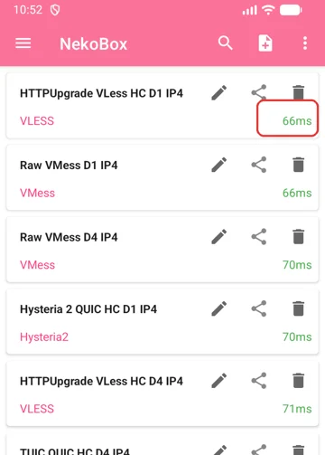

3. روی یک کانفیگ خوب بزنید (یک خط رنگی کنارش می‌آید) و دکمهٔ گرد پایین صفحه را بزنید. بار اول اندروید برای VPN اجازه می‌خواهد؛ **OK** را بزنید.
4. روی نوار پایین بزنید تا اتصال تست شود. باید پیامی مثل **Success: HTTP handshake took 75ms** ببینید.

    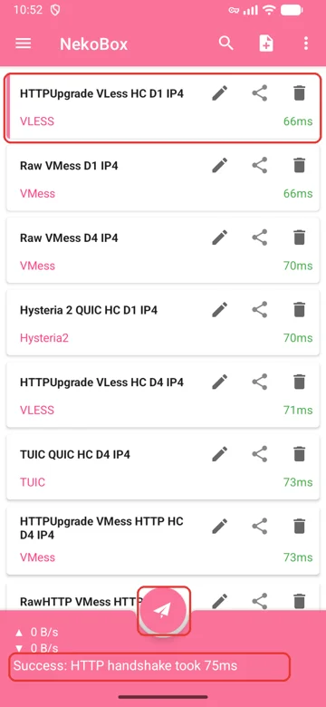

برای قطع اتصال، همان دکمهٔ گرد را دوباره بزنید.

## زنجیره پروکسی: عبور ترافیک از دو پروکسی

در **زنجیره پروکسی** (Proxy Chain) ترافیک شما اول از یک پروکسی و بعد از پروکسی دوم عبور می‌کند. سایت‌ها فقط آدرس آخرین پروکسی را می‌بینند. این کار مثلاً وقتی به درد می‌خورد که سایتی آی‌پی سرور شما را مسدود کرده باشد. سرعت زنجیره از یک پروکسی تنها کمتر است.

در این مثال، پروکسی اول یک کانفیگ ریالتی از سرور شماست و پروکسی دوم یک کانفیگ ورکر کلادفلر.

1. در صفحه اصلی دکمه `+` را بزنید و **Manual Settings** را بزنید.
2. **Proxy Chain** را انتخاب کنید.

    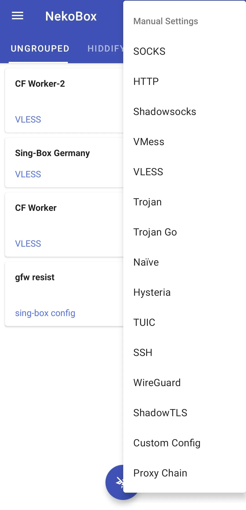

3. **Add Profile** را بزنید و کانفیگ اول را انتخاب کنید، مثلاً کانفیگ ریالتی.
4. دوباره **Add Profile** را بزنید و کانفیگ دوم را انتخاب کنید، مثلاً کانفیگ ورکر کلادفلر.
5. زنجیره را ذخیره کنید، آن را انتخاب کنید و وصل شوید.

برای بررسی، سایتی را باز کنید که آی‌پی شما را نشان می‌دهد، مثل [ipinfo.io](https://ipinfo.io/). اگر یک آی‌پی کلادفلر نشان داد، زنجیره درست کار می‌کند.

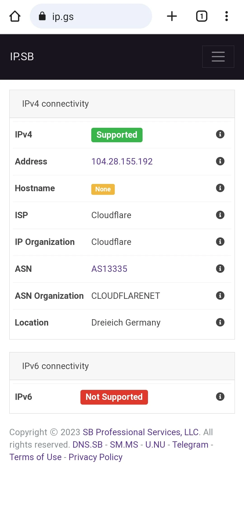

!!! note "نکته"
    - ممکن است تست اتصال برای زنجیره خطا نشان دهد، در حالی که زنجیره کار می‌کند. به‌جای آن با سایت بررسی آی‌پی امتحان کنید.
    - پروکسی‌های زنجیره می‌توانند `http` یا `socks5` هم باشند.
    - زنجیره می‌تواند بیش از دو پروکسی داشته باشد، ولی هر پروکسی اتصال را کندتر می‌کند.

## مقاله‌های مرتبط

- [ نصب اپ هیدیفای](/fa/app/How-to-install-Hiddify-app/)
- [ V2rayNG](/fa/manager/client-software-on-android/Tutorial-for-V2rayNG-app/)
- [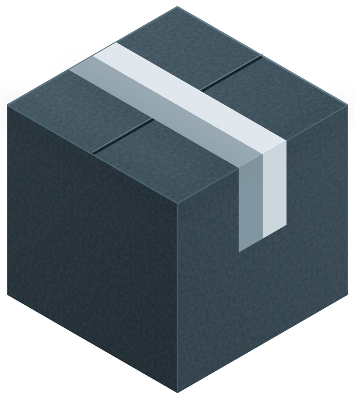 sing-box](/fa/manager/client-software-on-ios/Tutorial-for-SingBox-app/)
- [عیب‌یابی مشکلات اتصال](/fa/manager/basic-concepts-and-troubleshooting/Troubleshooting-connectivity-issues-with-HiddifyManager-and-proxies/)

