

# Tutorial for Nekobox app

This page shows you how to add your Hiddify Manager subscription to the free **NekoBox** app on Android, test the configs, connect, and chain two proxies. NekoBox is based on sing-box and also runs well on older phones. The pictures are from **NekoBox 1.4.2** and the Hiddify Manager v14.5 user page.

## Install NekoBox { #install }

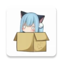
<b>NekoBox</b><small>v1.4.2Android 5+FreeNov 2026</small>

<a class="hi-store" href="https://github.com/MatsuriDayo/NekoBoxForAndroid/releases/latest"><small>Download APK on</small><b>GitHub</b></a>

<a class="hi-alt" href="/app/How-to-install-Hiddify-app/"><b>Our suggestion: the Hiddify app</b><small>Free, simpler, and supports every Hiddify Manager protocol</small>Install →</a>

For very old phones, take the <code>armeabi-v7a.apk</code> file. **Do not install NekoBox from Google Play**: its developers say the Google Play version has been run by someone else since 2024 and is not open source. The download button on your user page also gives the GitHub APK.

## Add the subscription: the quick way (recommended) { #quick }

1. Open your user page link on the phone and tap the big round button. If the Hiddify app is also installed and opens by itself, tap **Cancel** and go back to the browser.
2. In **Configure Your VPN**, tap **View More**, then **NekoBox**, then **Import To App**.

    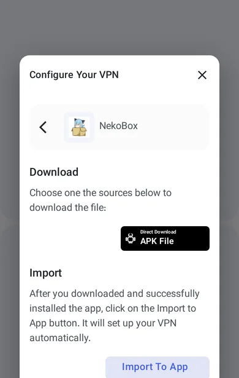

3. If Android asks which app to use, choose **NekoBox (Import subscription)**, then **Just once**.

    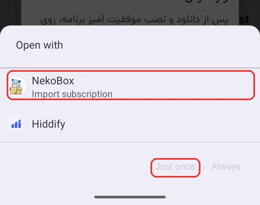

4. NekoBox asks you to confirm the import; tap **YES**. A new group with your configs is created.

    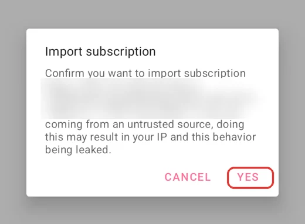

!!! info "Why the quick way is better"
    With the quick way, the server sends the configs in Clash Meta format and only the ones NekoBox understands (75 configs in our test). The **Subscription link** used in the manual way gives every config (125), including XHTTP, which NekoBox does not support and shows as "Unavailable" in the test.

## Add the subscription by hand { #manual }

1. On the user page, tap the round button, and under **Import Manually** tap **Copy Link**.
2. In NekoBox, open the side menu (three lines) and tap **Group**.

    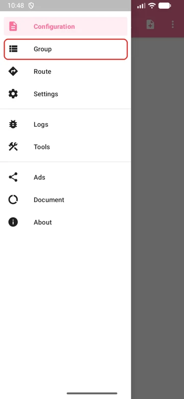

3. Tap the add group button at the top.

    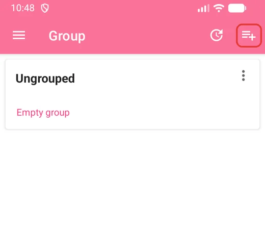

4. Type a **Group name** (for example your server’s name). Set **Group Type** to **Subscription**. Then tap **Subscription Link**.

    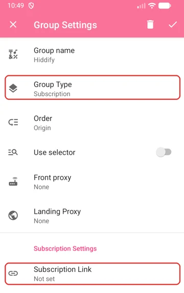

5. Paste the copied link and tap **OK**.

    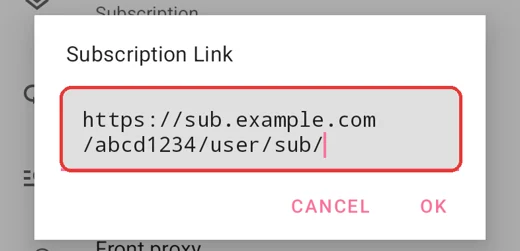

6. Turn on **Auto Update** so the configs update by themselves. Leave **Force Resolve** off. Then tap ✓ at the top.

    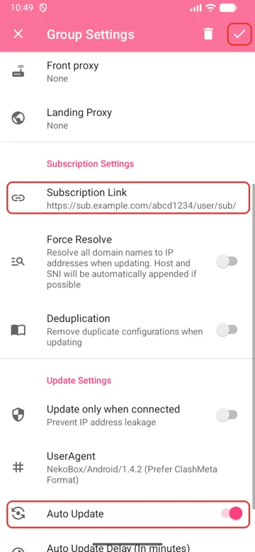

7. NekoBox lists the configs it added; tap **OK**. The group card shows the traffic used and left, the expiry date and the number of configs. Tap **UPDATE** to refresh it any time.

    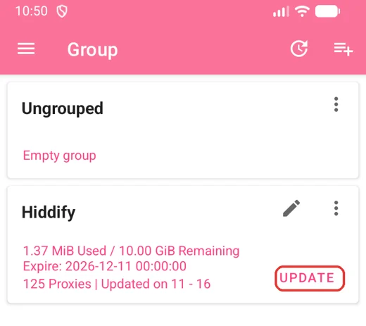

## Test and connect { #connect }

1. Go back to **Configuration** (the main screen) from the side menu. Tap the three-dot menu and tap **URL Test**.

    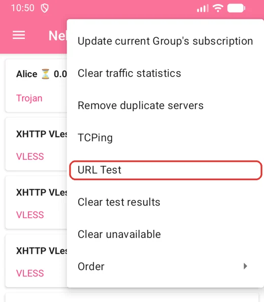

2. Each config shows its response time in milliseconds; lower is better. **Unavailable** or **Timeout** means that config does not work. **Order** › **By Delay** in the same menu puts the best ones on top, and **Clear unavailable** removes the broken ones.

    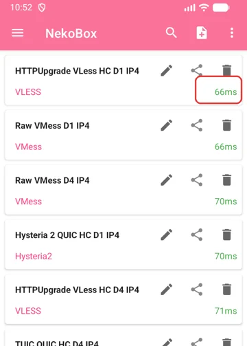

3. Tap a good config (a colored line appears next to it) and tap the round button at the bottom. The first time, Android asks for VPN permission; tap **OK**.
4. Tap the bar at the bottom to test the connection. You should see a message like **Success: HTTP handshake took 75ms**.

    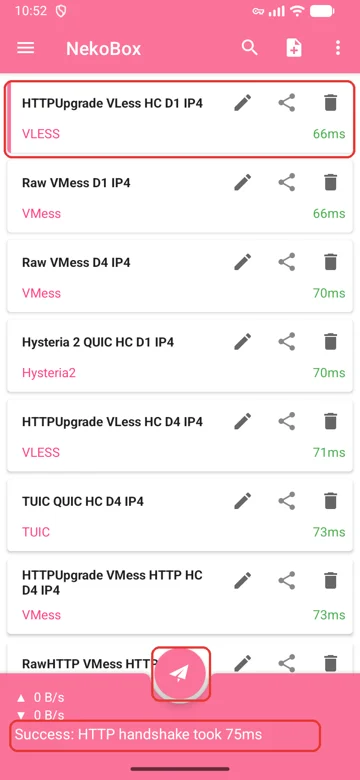

To disconnect, tap the round button again.

## Proxy chain: send traffic through two proxies

A **proxy chain** sends your traffic through one proxy and then through a second one. Websites only see the address of the last proxy. This is useful, for example, when a site blocks your server's IP. It is slower than a single proxy.

In this example, the first proxy is a Reality config from your server, and the second is a Cloudflare Worker config.

1. On the main screen, tap the **+** button and tap **Manual Settings**.
2. Choose **Proxy Chain**.

    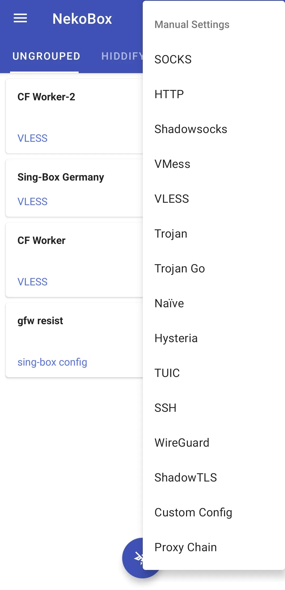

3. Tap **Add Profile** and choose the first config, for example your Reality config.
4. Tap **Add Profile** again and choose the second config, for example your Cloudflare Worker config.
5. Save the chain, select it, and connect.

To check it, open a site that shows your IP, such as [ipinfo.io](https://ipinfo.io/). If it shows a Cloudflare IP, the chain works.

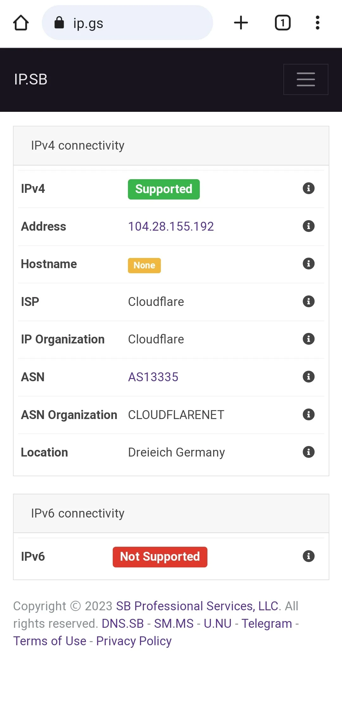

!!! note
    - The connection test may show an error for a chain even when the chain works. Check with the IP site instead.
    - The proxies in a chain can also be `http` or `socks5` proxies.
    - A chain can have more than two proxies, but each one makes the connection slower.

## Related articles

- [ Install the Hiddify app](/app/How-to-install-Hiddify-app/)
- [ V2rayNG](/manager/client-software-on-android/Tutorial-for-V2rayNG-app/)
- [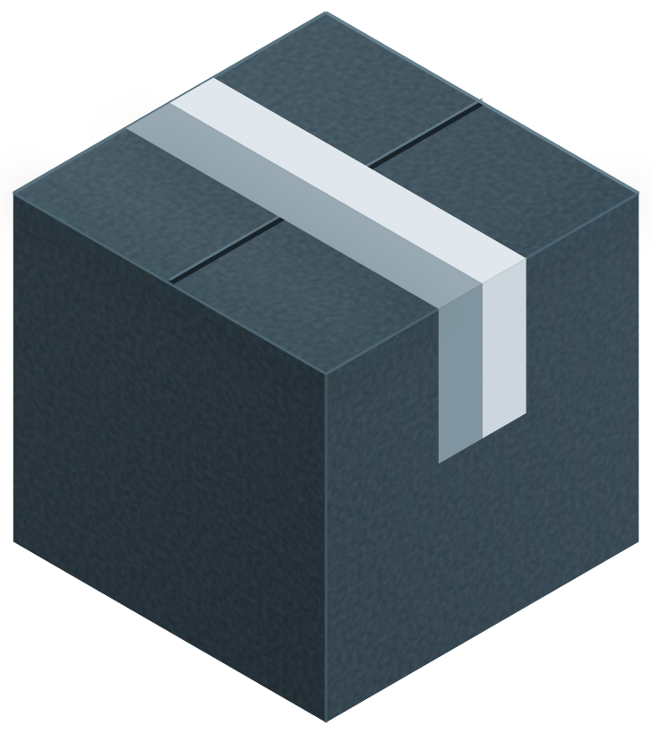 sing-box](/manager/client-software-on-ios/Tutorial-for-SingBox-app/)
- [Troubleshooting connectivity issues](/manager/basic-concepts-and-troubleshooting/Troubleshooting-connectivity-issues-with-HiddifyManager-and-proxies/)

