

# آموزش کار با نرم‌افزار V2rayNG

در این صفحه یاد می‌گیرید لینک اشتراک هیدیفای‌منیجر خود را به برنامهٔ رایگان **V2rayNG** در اندروید اضافه کنید، کانفیگ‌ها را تست کنید، وصل شوید و کانفیگ‌ها را به‌روز نگه دارید. تصویرها از **V2rayNG نسخهٔ 2.3.15** و صفحهٔ کاربری هیدیفای‌منیجر نسخهٔ ۱۴.۵ هستند.

## پیش از شروع

- **لینک صفحهٔ کاربری** خود را آماده داشته باشید. این همان لینکی است که مدیر سرور برایتان فرستاده و صفحهٔ شخصی هیدیفای‌منیجر شما را باز می‌کند.
- **لینک اشتراک** (سابسکریپشن) لینکی است که همهٔ تنظیمات اتصال (کانفیگ‌ها) را در خود دارد. **کانفیگ** یعنی تنظیمات یک اتصال به سرور. V2rayNG می‌تواند لینک اشتراک را بعداً به‌روز کند و کانفیگ‌های جدید را از سرور بگیرد.

## نصب V2rayNG { #install }

<b>V2rayNG</b><small>v2.3.15Android 7+رایگانآبان ۱۴۰۵</small>

<a class="hi-store" href="https://play.google.com/store/apps/details?id=com.v2ray.ang"><small>GET IT ON</small><b>Google Play</b></a><a class="hi-store" href="https://github.com/2dust/v2rayNG/releases/latest"><small>Download APK on</small><b>GitHub</b></a>

<a class="hi-alt" href="/fa/app/How-to-install-Hiddify-app/"><b>پیشنهاد ما: اپ هیدیفای</b><small>رایگان، ساده‌تر و با پشتیبانی از همهٔ پروتکل‌های هیدیفای‌منیجر</small>نصب اپ ←</a>

در گیت‌هاب، فایلی که نامش با `universal.apk` تمام می‌شود روی همهٔ گوشی‌ها کار می‌کند. دکمه‌های دانلود در صفحهٔ کاربری شما هم هستند (قدم ۳ در بخش بعد). اگر فایل APK دانلود کردید، آن را باز کنید تا نصب شود. اندروید ممکن است بخواهد نصب از «منابع ناشناس» را برای مرورگر اجازه دهید؛ اجازه بدهید.

## افزودن لینک اشتراک: روش سریع { #quick }

1. لینک صفحهٔ کاربری را در گوشی باز کنید و دکمهٔ گرد بزرگ وسط صفحه را بزنید.

    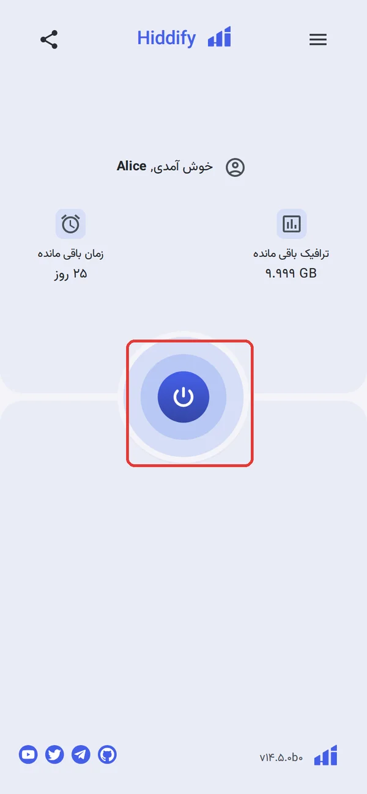

    اگر **اپ هیدیفای** هم روی گوشی نصب است، ممکن است گوشی مستقیم آن را باز کند و بپرسد **Add profile?**. برای V2rayNG، **Cancel** را بزنید و به مرورگر برگردید.

2. پنجرهٔ **VPN خود را پیکربندی کنید** باز می‌شود. **بیشتر...** را بزنید و بعد **V2RayNG** را انتخاب کنید.

    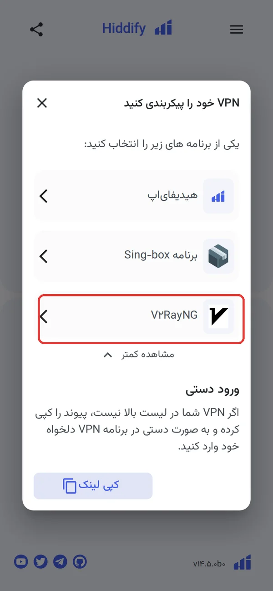

3. اگر هنوز برنامه را ندارید، از بخش **دانلود** نصبش کنید. بعد **وارد کردن در برنامه** را بزنید.

    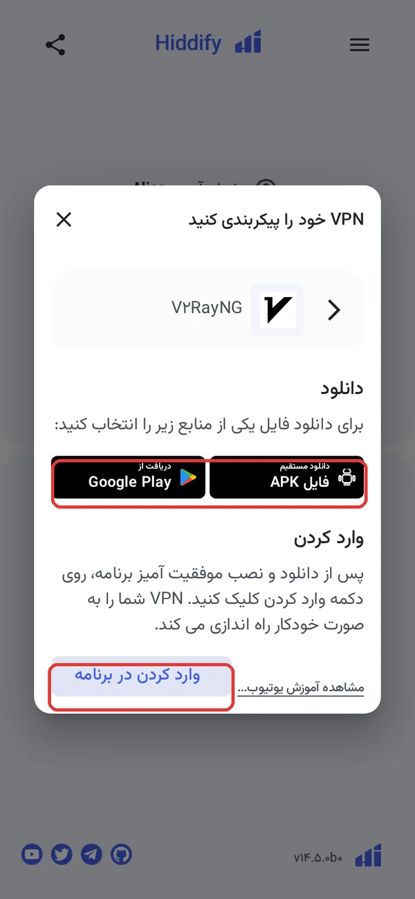

4. اگر اندروید پرسید با کدام برنامه باز شود، **v2rayNG** و بعد **Just once** را بزنید.

    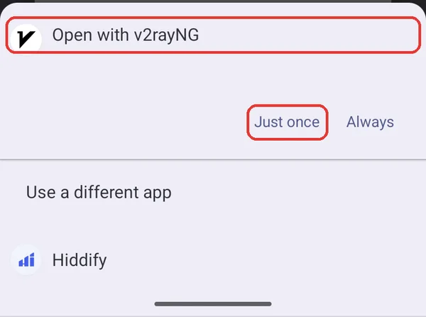

5. V2rayNG باز می‌شود و کانفیگ‌ها را در یک زبانهٔ جدید به نام **import sub** می‌گذارد. برنامه روی زبانهٔ **Default** می‌ماند و خالی به نظر می‌رسد؛ روی زبانهٔ **import sub** بزنید تا کانفیگ‌ها را ببینید.

    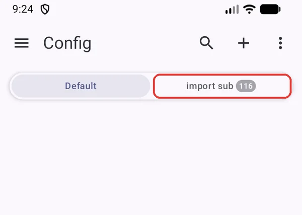

کانفیگ‌هایی که این‌طور اضافه می‌شوند برچسب **CUSTOM** دارند: کانفیگ کامل Xray هستند که سرور مخصوص V2rayNG می‌سازد. اگر این روش کار نکرد، لینک را دستی اضافه کنید.

## افزودن لینک اشتراک به‌صورت دستی { #manual }

1. در صفحهٔ کاربری، دکمهٔ گرد را بزنید و در پنجرهٔ باز شده، زیر **ورود دستی**، **کپی لینک** را بزنید.
2. V2rayNG را باز کنید، دکمهٔ منو (سه خط) را در گوشهٔ بالا بزنید و **Subscriptions** را انتخاب کنید.

    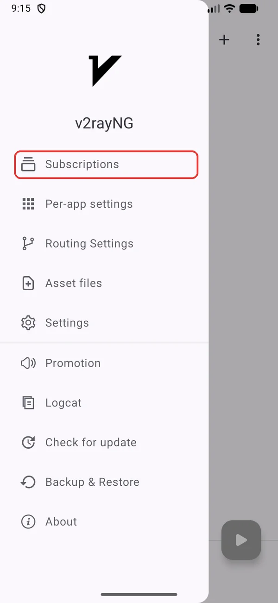

3. دکمهٔ **+** را در بالای صفحه بزنید.

    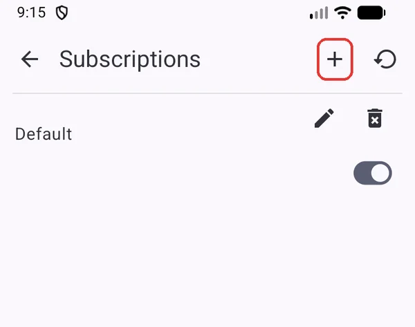

4. فرم را پر کنید:
    - **Remarks**: یک نام دلخواه، مثلاً نام سرورتان.
    - **Optional URL**: لینک کپی‌شده را اینجا بچسبانید.
    - **Enable update**: روشن بماند.
    - **Enable automatic update**: روشنش کنید تا برنامه هر روز (هر ۱۴۴۰ دقیقه) خودش کانفیگ‌ها را به‌روز کند.

    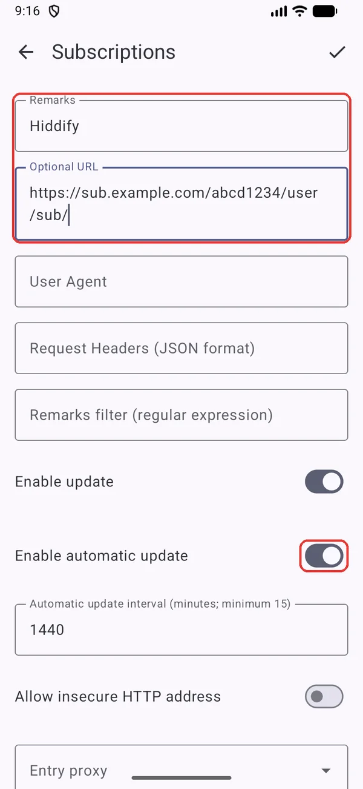

5. دکمهٔ ذخیره (✓) را در بالای صفحه بزنید و به صفحهٔ اصلی برگردید.
6. روی زبانهٔ لینک خود (همان نامی که در Remarks نوشتید) بزنید. منوی سه نقطه را بزنید و **Update subscription** را انتخاب کنید. کانفیگ‌ها در فهرست ظاهر می‌شوند.

    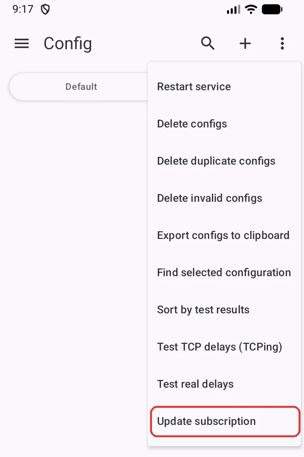

## تست کانفیگ‌ها { #test }

1. منوی سه نقطه را بزنید و **Test real delays** را انتخاب کنید.

    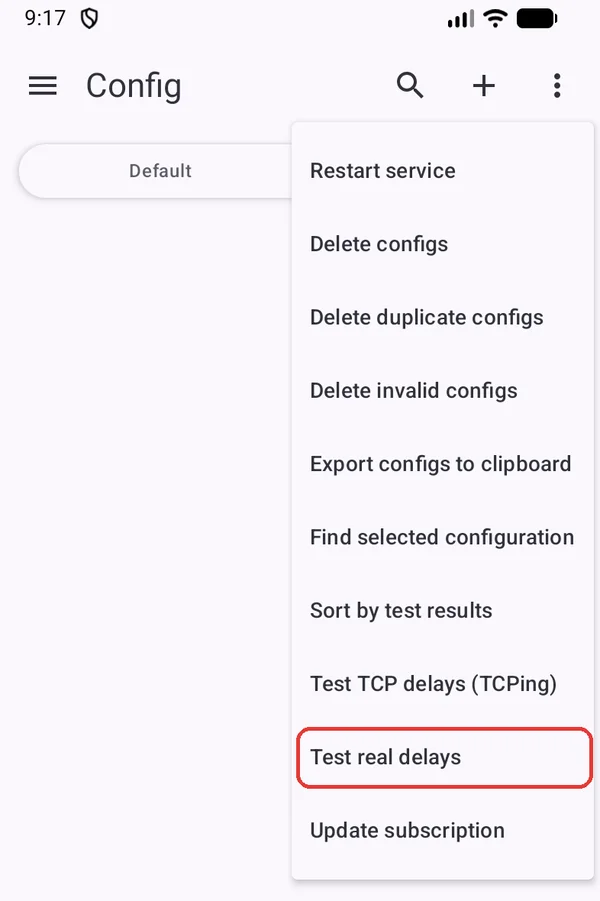

2. برنامه از طریق هر کانفیگ یک اتصال واقعی تست می‌کند و نتیجه را کنار آن به میلی‌ثانیه (ms) نشان می‌دهد. هرچه کمتر، بهتر. کانفیگی که `-1` نشان می‌دهد فعلاً کار نمی‌کند. با **Sort by test results** در همان منو، بهترین‌ها بالای فهرست می‌آیند.

    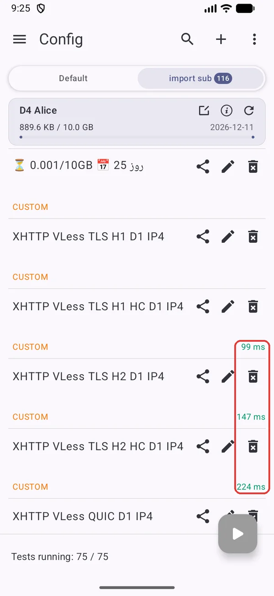

اولین ردیف فهرست (با حجم و روزهای باقی‌مانده) کانفیگ واقعی نیست؛ فقط اطلاعات اشتراک شماست. کارت بالای فهرست هم حجم مصرف‌شده و تاریخ پایان اشتراک را نشان می‌دهد.

## اتصال { #connect }

1. روی کانفیگی که نتیجهٔ تست خوبی داشته بزنید تا انتخاب شود (یک خط رنگی کنارش می‌آید).
2. دکمهٔ **▶** را در گوشهٔ پایین بزنید. بار اول، اندروید برای اتصال VPN اجازه می‌خواهد؛ **OK** را بزنید. اگر برنامه اجازهٔ دسترسی به دستگاه‌های نزدیک (nearby devices) خواست، برای اتصال لازم نیست.
3. دکمه نارنجی می‌شود. روی نوار پایین صفحه بزنید تا اتصال تست شود: باید **Connection succeeded** را ببینید.

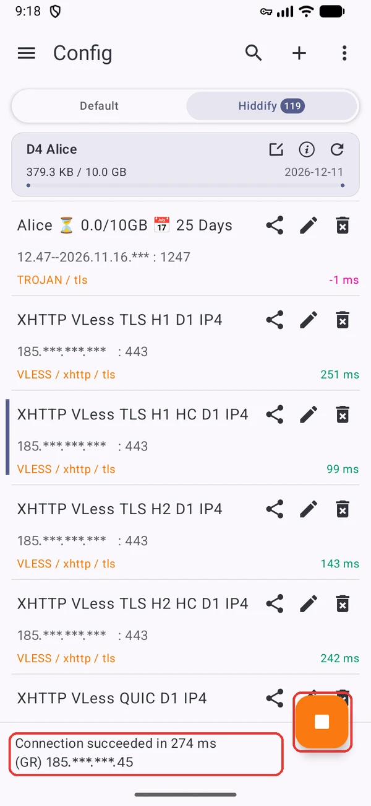

برای قطع اتصال، همان دکمه را دوباره بزنید.

## به‌روزرسانی لینک اشتراک { #update }

وقتی مدیر چیزی را روی سرور تغییر می‌دهد، لینک اشتراک را به‌روز کنید تا کانفیگ‌های جدید را بگیرید:

- در زبانهٔ لینک خود، منوی سه نقطه › **Update subscription** را بزنید، یا دکمهٔ **↻** روی کارت بالای فهرست را.
- اگر **Enable automatic update** را روشن کرده باشید، برنامه خودش هر روز به‌روز می‌کند. این قابلیت روی بعضی گوشی‌ها همیشه کار نمی‌کند؛ اگر کانفیگی از کار افتاد، دستی به‌روز کنید.

بعد از به‌روزرسانی، کانفیگ‌ها را دوباره تست کنید و وصل شوید.

## اگر وصل نشد { #help }

- لینک اشتراک را به‌روز کنید، کانفیگ‌ها را دوباره تست کنید و کانفیگ دیگری با نتیجهٔ خوب انتخاب کنید.
- بعضی کانفیگ‌ها، مثلاً آن‌هایی که پروتکل‌های جدیدتر دارند، در V2rayNG کار نمی‌کنند. [اپ هیدیفای](/fa/app/How-to-install-Hiddify-app/) را امتحان کنید.
- راهنمای [عیب‌یابی مشکلات اتصال](/fa/manager/basic-concepts-and-troubleshooting/Troubleshooting-connectivity-issues-with-HiddifyManager-and-proxies/) را ببینید.

## مقاله‌های مرتبط

- [ نصب اپ هیدیفای](/fa/app/How-to-install-Hiddify-app/)
- [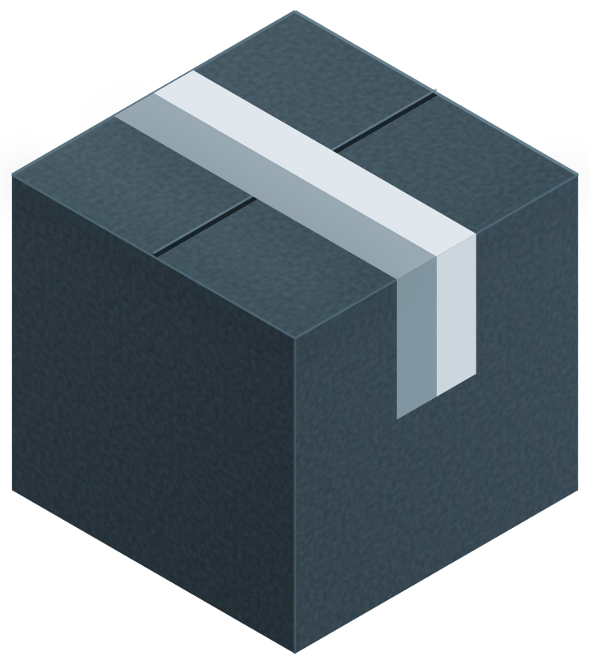 sing-box](/fa/manager/client-software-on-ios/Tutorial-for-SingBox-app/)
- [NekoBox](/fa/manager/client-software-on-android/Tutorial-for-Nekobox-app/)
- [عیب‌یابی مشکلات اتصال](/fa/manager/basic-concepts-and-troubleshooting/Troubleshooting-connectivity-issues-with-HiddifyManager-and-proxies/)

