

# Tutorial for V2rayNG app

This page shows you how to add your Hiddify Manager subscription link to the free **V2rayNG** app on Android, test the configs, connect and keep the configs up to date. The pictures are from **V2rayNG 2.3.15** and the Hiddify Manager v14.5 user page.

## Before you start

- Have your **user page link** ready. It is the link your server admin sent you; it opens your personal Hiddify Manager page.
- A **subscription link** holds all your connection settings (configs). A **config** is the settings for one connection to the server. V2rayNG can update the subscription link later and get new configs from the server.

## Install V2rayNG { #install }

<b>V2rayNG</b><small>v2.3.15Android 7+FreeNov 2026</small>

<a class="hi-store" href="https://play.google.com/store/apps/details?id=com.v2ray.ang"><small>GET IT ON</small><b>Google Play</b></a><a class="hi-store" href="https://github.com/2dust/v2rayNG/releases/latest"><small>Download APK on</small><b>GitHub</b></a>

<a class="hi-alt" href="/app/How-to-install-Hiddify-app/"><b>Our suggestion: the Hiddify app</b><small>Free, simpler, and supports every Hiddify Manager protocol</small>Install →</a>

On GitHub, the file ending in `universal.apk` works on every phone. The download buttons are on your user page too (step 3 in the next part). If you downloaded the APK file, open it to install. Android may ask you to allow installs from "unknown sources" for your browser; allow it.

## Add the subscription link: the quick way { #quick }

1. Open your user page link on the phone and tap the big round button in the middle.

    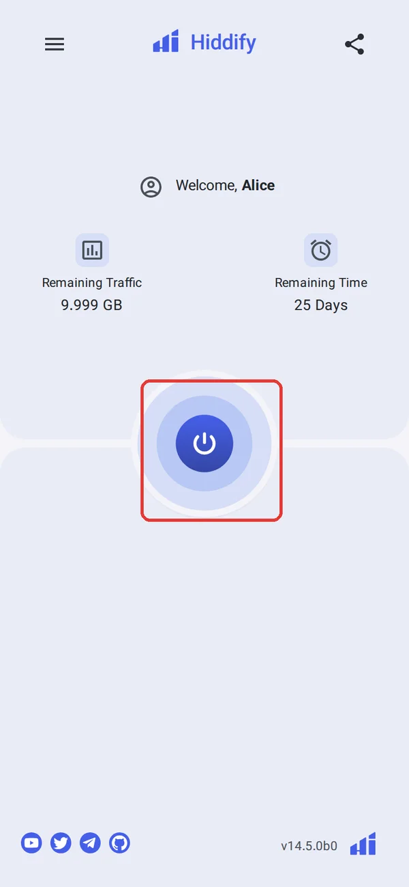

    If the **Hiddify app** is also on the phone, the phone may open it right away and ask **Add profile?**. For V2rayNG, tap **Cancel** and go back to the browser.

2. The **Configure Your VPN** window opens. Tap **View More**, then choose **V2RayNG**.

    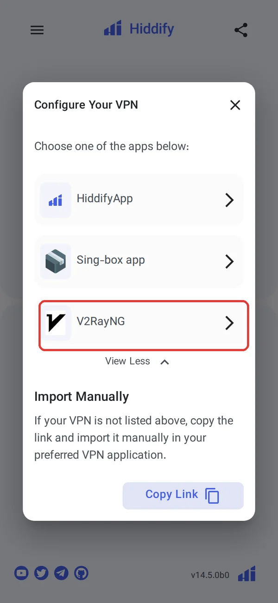

3. If you do not have the app yet, install it from **Download**. Then tap **Import To App**.

    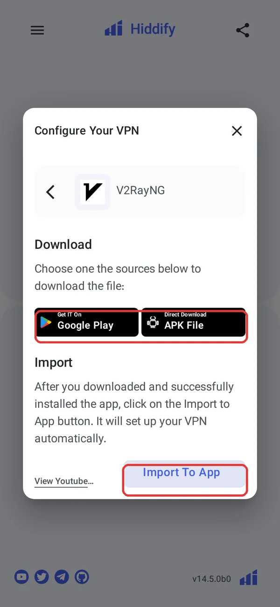

4. If Android asks which app to open it with, choose **v2rayNG**, then **Just once**.

    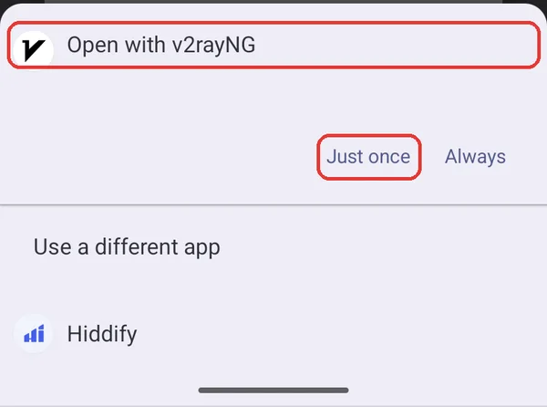

5. V2rayNG opens and puts the configs in a new tab called **import sub**. The app stays on the **Default** tab, so it looks empty: tap the **import sub** tab to see the configs.

    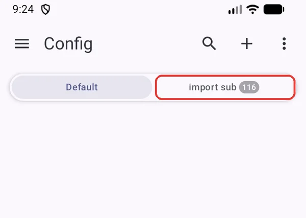

Configs added this way are labeled **CUSTOM**: they are full Xray configs that the server makes for V2rayNG. If this way does not work, add the link by hand.

## Add the subscription link by hand { #manual }

1. On the user page, tap the round button, and in the window that opens, under **Import Manually**, tap **Copy Link**.
2. Open V2rayNG, tap the menu button (three lines) in the top corner and choose **Subscriptions**.

    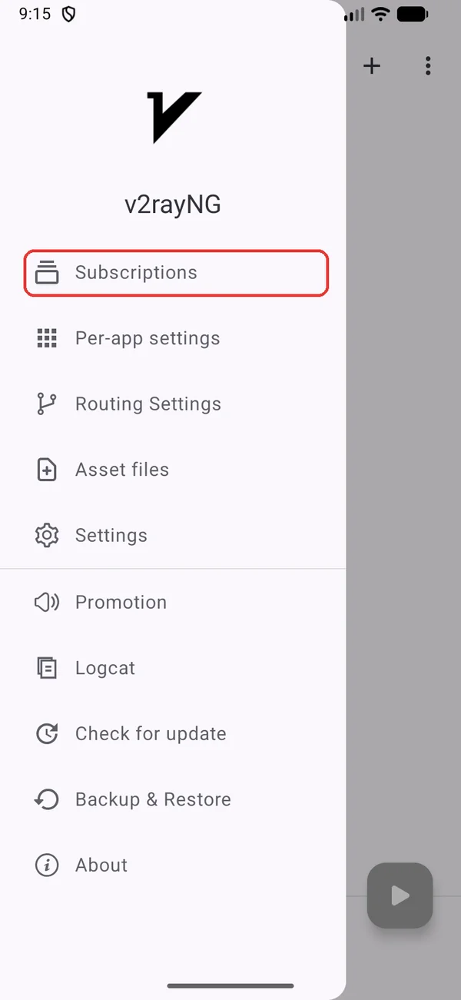

3. Tap the **+** button at the top.

    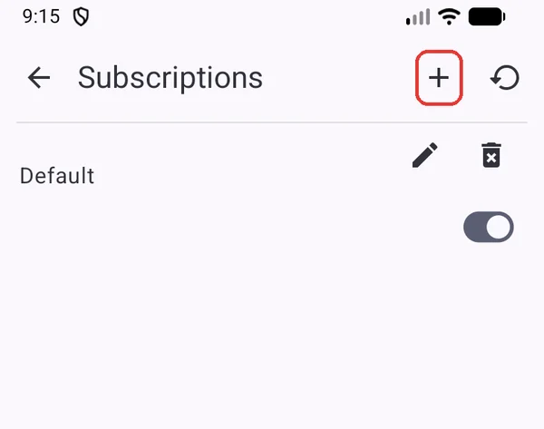

4. Fill in the form:
    - **Remarks**: any name, for example your server’s name.
    - **Optional URL**: paste the copied link here.
    - **Enable update**: keep it on.
    - **Enable automatic update**: turn it on so the app updates the configs by itself every day (every 1440 minutes).

    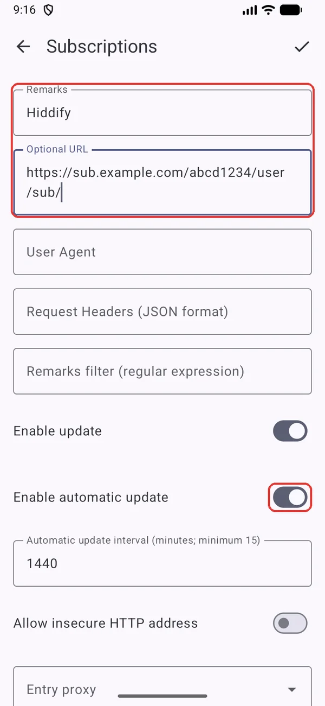

5. Tap the save button (✓) at the top and go back to the main screen.
6. Tap the tab of your link (the name you wrote in Remarks). Tap the three-dot menu and choose **Update subscription**. The configs appear in the list.

    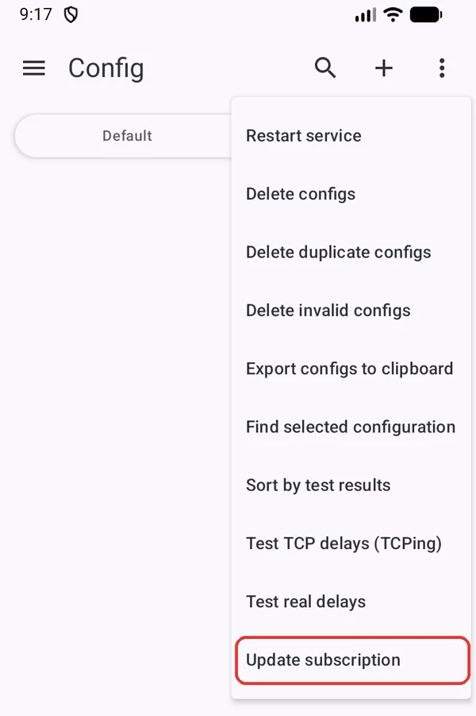

## Test the configs { #test }

1. Tap the three-dot menu and choose **Test real delays**.

    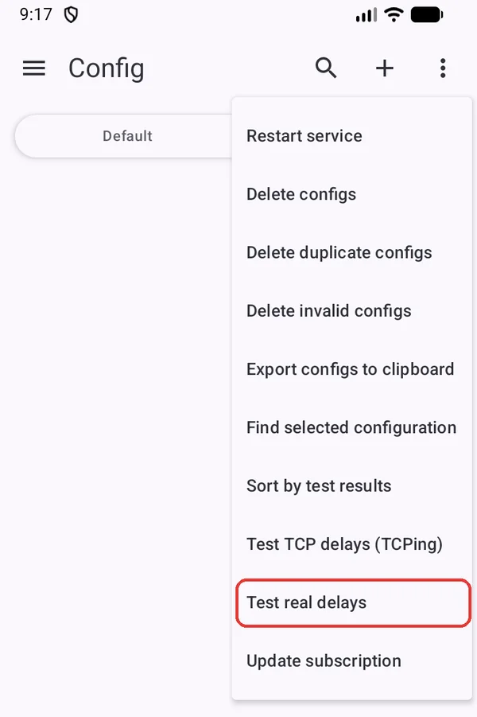

2. The app tests a real connection through each config and shows the result next to it in milliseconds (ms). Lower is better. A config that shows `-1` does not work right now. **Sort by test results** in the same menu puts the best ones at the top.

    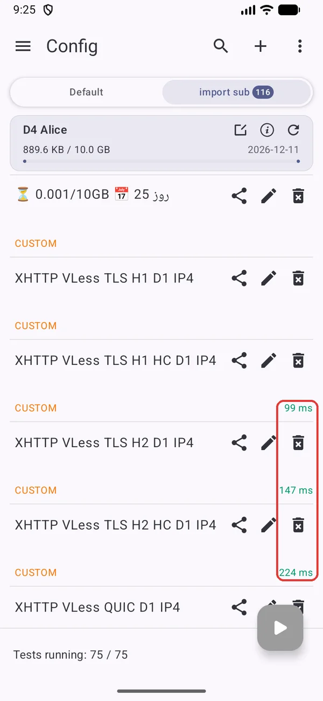

The first row of the list (with the remaining traffic and days) is not a real config; it only shows your subscription’s details. The card above the list also shows the traffic used and the date your subscription ends.

## Connect { #connect }

1. Tap a config with a good test result to select it (a colored line appears next to it).
2. Tap the **▶** button in the bottom corner. The first time, Android asks for permission to set up a VPN; tap **OK**. If the app asks for access to nearby devices, you do not need it to connect.
3. The button turns orange. Tap the bar at the bottom of the screen to test the connection: you should see **Connection succeeded**.

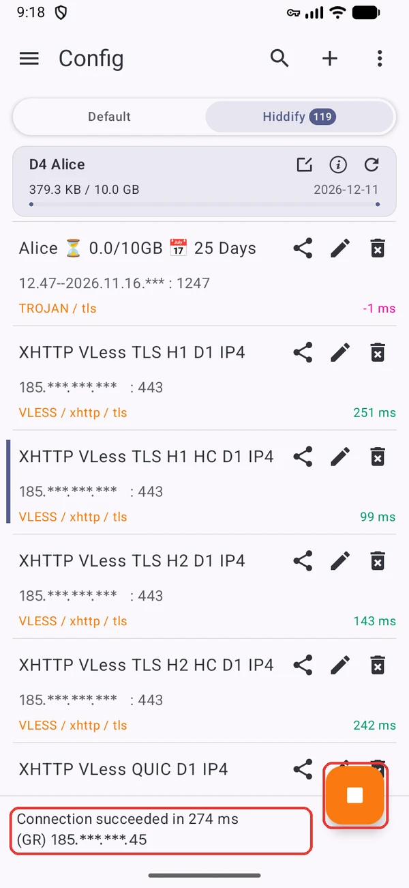

To disconnect, tap the same button again.

## Update the subscription link { #update }

When the admin changes something on the server, update the subscription link to get the new configs:

- In your link’s tab, tap the three-dot menu › **Update subscription**, or the **↻** button on the card above the list.
- If you turned on **Enable automatic update**, the app updates by itself every day. It does not always work on every phone; if a config stops working, update by hand.

After the update, test the configs again and connect.

## If it does not connect { #help }

- Update the subscription link, test the configs again and choose another config with a good result.
- Some configs, for example ones with newer protocols, do not work in V2rayNG. Try the [Hiddify app](/app/How-to-install-Hiddify-app/).
- See [Troubleshooting connectivity issues](/manager/basic-concepts-and-troubleshooting/Troubleshooting-connectivity-issues-with-HiddifyManager-and-proxies/).

## Related articles

- [ Install the Hiddify app](/app/How-to-install-Hiddify-app/)
- [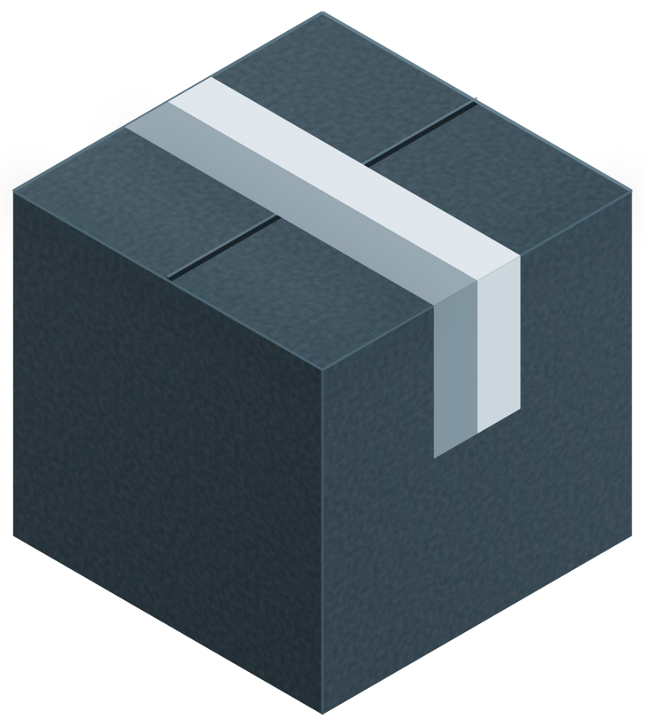 sing-box](/manager/client-software-on-ios/Tutorial-for-SingBox-app/)
- [NekoBox](/manager/client-software-on-android/Tutorial-for-Nekobox-app/)
- [Troubleshooting connectivity issues](/manager/basic-concepts-and-troubleshooting/Troubleshooting-connectivity-issues-with-HiddifyManager-and-proxies/)

