

# Tutorial for HiddifyN software

!!! warning "HiddifyN is no longer developed"
    HiddifyN is an old Hiddify app. It is no longer developed or updated, and new protocols and features of Hiddify Manager may not work in it. The [Hiddify app](/app/) replaces it, on Android, iOS, Windows, macOS and Linux: see [how to install the Hiddify app](/app/How-to-install-Hiddify-app/). This page is kept for people who still use HiddifyN.

This software is developed based on Xray and has many features that will be reviewed below.

## Software download
To download the program in your user panel, open the desktop tab and open the section related to HiddifyN and then click on the Windows icon (button number 3) to download the program.

  
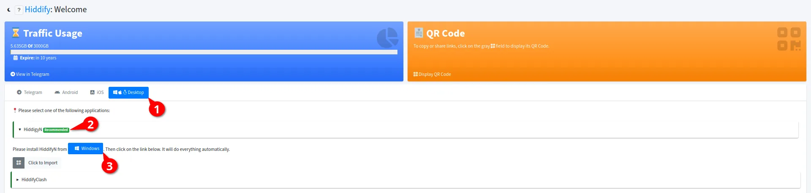

## Software installation
Installing the program is very simple. Just install the Runtime 6 program first and then extract the downloaded file and run the HiddifyN file in the corresponding folder.

## Add a profile to the app
In the user panel, go to the HiddifyN section again and `Click to import` so that the configurations are automatically added to the program.

  
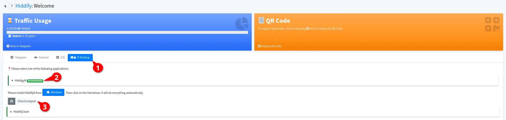

## Proxy modes
One of the most important parts of this application is the proxy modes, which will be explained about each part below.

  
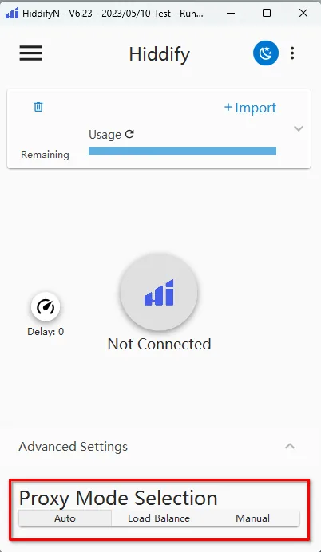

#### Auto/Smart
It will automatically connect to the configuration with the highest speed (lowest ping).

#### Load-Balance
It connects to several configs at the same time and traffic is distributed between them. This mode is very useful when you have several configurations with dirty IP, by spreading the load on several configurations at the same time, an acceptable speed is obtained.

#### Manual
It is used to set the configs manually. By clicking on it, the advanced settings of the program will be returned, which will be explained further.

## Changing the language of the software
To change the language of the software, click on the menu shown in the image below and select the language. Then close the program once and open it again.

  
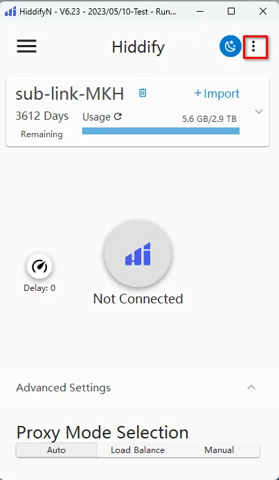

## Changing the theme of the software
Click on the specified button to change the software theme.

  
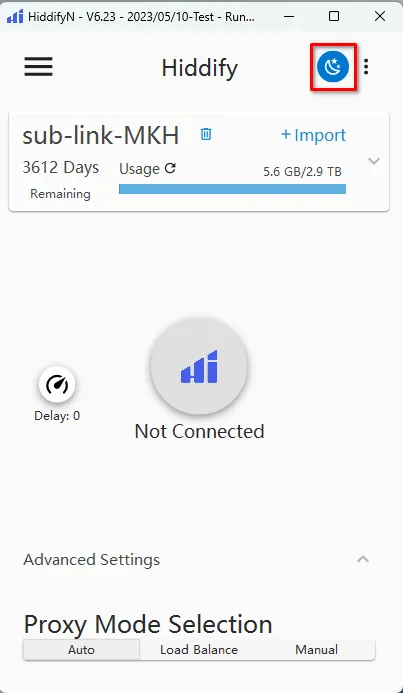

## User profile information
In the section displayed below, the information related to the imported user profile is displayed, including the expiration time and the total traffic as well as the consumed package.

  
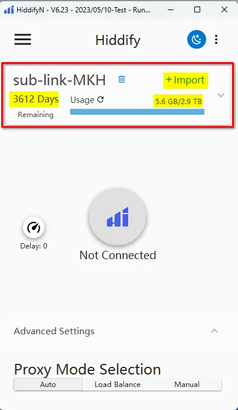

In this section, you can also add new profiles manually. Just click on `Import` and add the user to the copied link from the panel.

## Connection to the VPN
You need to click on the middle circular button to connect to the app. The software connects to the configurations based on the selected proxy mode, and the ping related to the configuration is displayed next to this button.

  
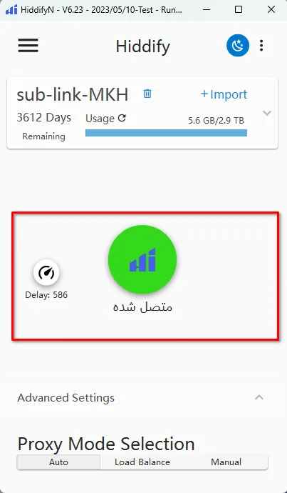

## Advanced settings
This section is opened by pressing the Manual button in the proxy mode section.

  
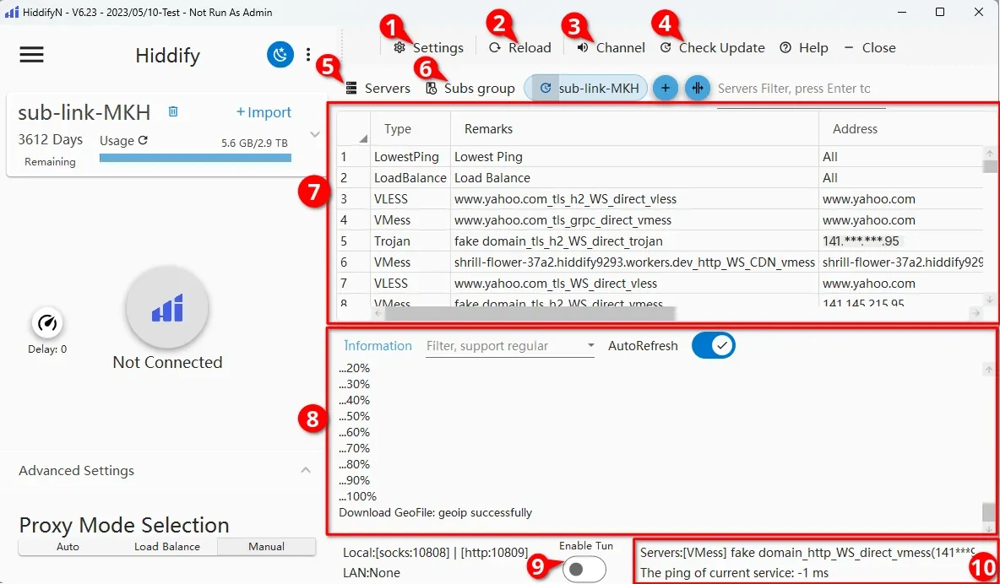

<h4>1. Settings</h4>

The advanced settings of the program are located in this section.

  
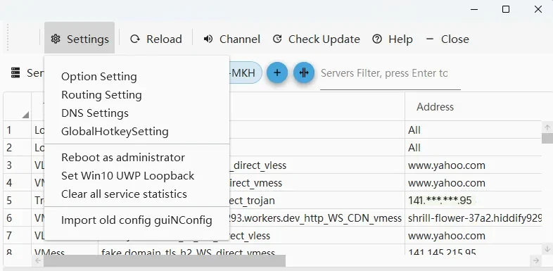

<h6>Option setting</h6>

In this subsection, there are optional settings of the program, which includes several different sections.

* `Core: basic settings` 

that do not need to be changed for everyday use. The only widely used option is the port used for the program, which can be changed in this section.

  
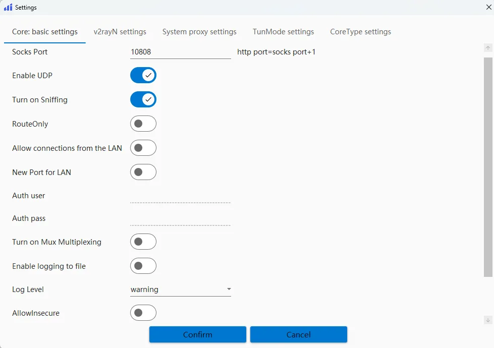

If you need to use proxy, you can set socks5 proxy on this port.

*V2rayN Settings 

This section contains the default settings of the V2rayN program, which is the main basis of the HIddifyN program.

  
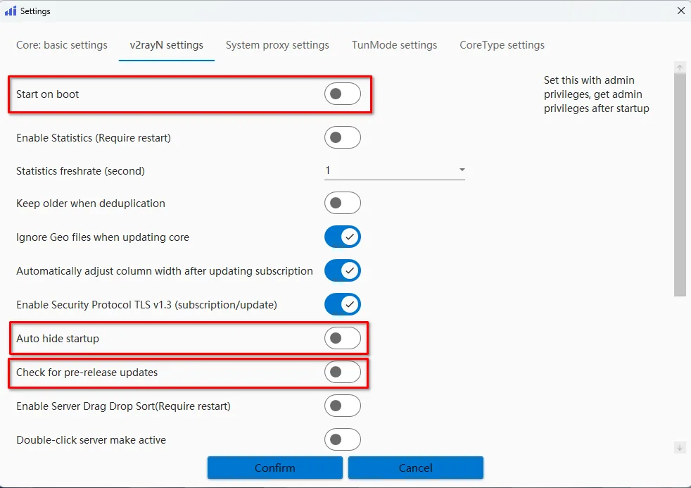

> * which Start on boot runs the program when the system boots.
> * Auto hide startup automatically hides the program running at the beginning of the work, and only the program icon is visible in the Notification Area.
> * Check for pre release update gives unofficial updates to the program.
> * Also, in the settings you see in the picture below, which of course are not used for everyday use.

  
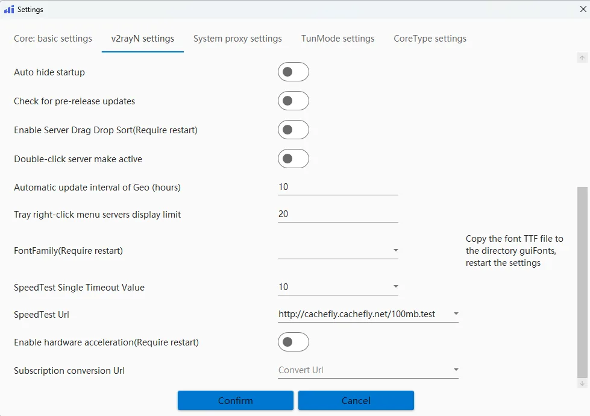

* System proxy settings

This section shows the settings related to the proxy system.

  
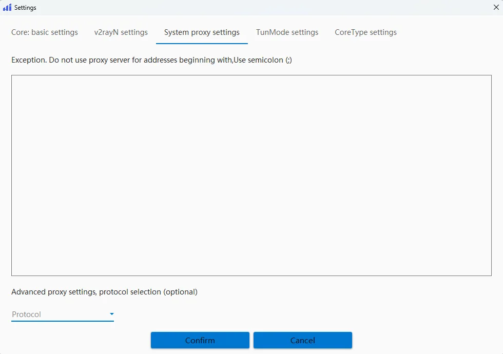

* Tun mode settings 

This section contains Tun mode settings that do not need to be changed for everyday use.

  
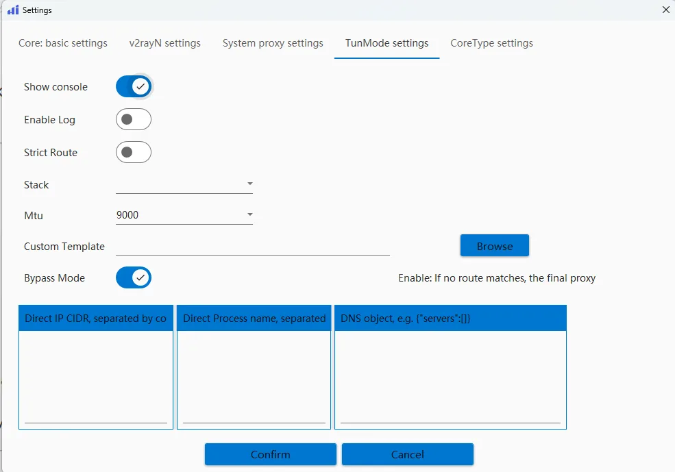

* Core type settings 

In this section, you can set kernels for different protocols, the default of which is Xray.

  
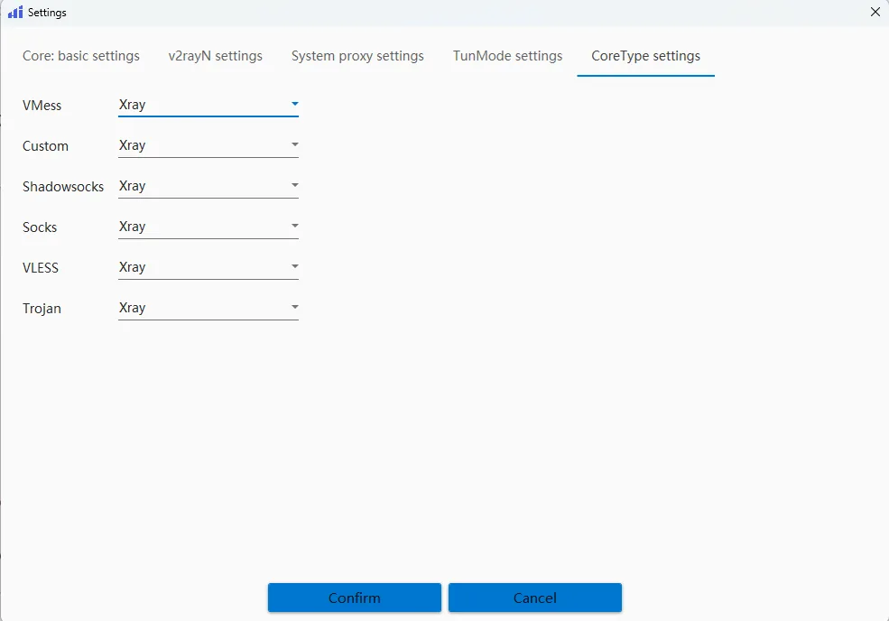

###### Routing setting
In this section, you can view the routing related to the profile imported to the program and make changes to it if needed. But it is suggested not to touch it if possible.

  

###### DNS setting
In this section, you can enter your desired DNS into the software.

  
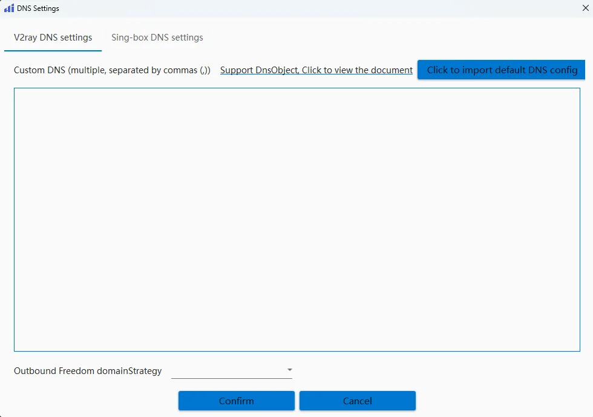

###### Reboot as administrator
With this option, you can restart the program and open it with admin access, which is required to use Tun mode.

#### 2. Reload
This button is used to reload the program core.

#### 3. Channel
By pressing this button, you will be redirected to our Telegram channel.

#### 4. Check Update
You can check program updates using this button.

#### 5. Servers
In this section, you can enter manual configurations.

#### 6. Subs group
This section is related to subscription links. By pressing this button, you can see the links added to the program and edit them.

  
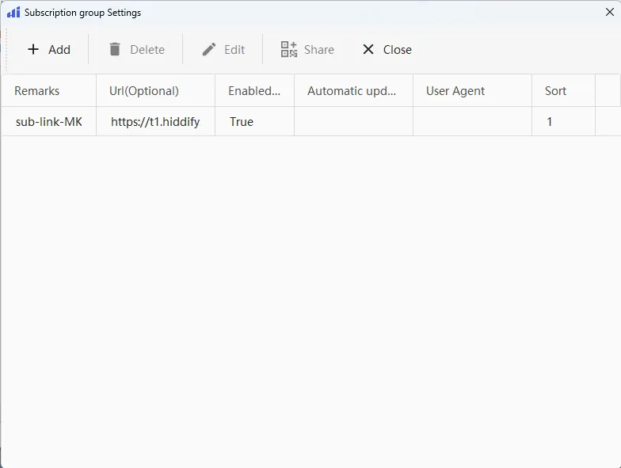

#### 7. Configs imported into the program
In this section, the configurations imported to the program can be seen.

#### 8. Connection log
In this section, the log related to connections to the filter breaker is displayed, which is very useful for troubleshooting.

#### 9. Enable Tun
This button is used to enable Tun mode or tunneling the entire system traffic.

> Note: To use this mode, the program must be run with admin access level, or in other words, `Run as Administrator`.

#### 10. Current connection specifications
In this section, the current connection specifications and its ping are displayed.

## Common problems

### Reality configs do not work

If Reality configs do not work, or show a ping of `-1`, after you add the subscription link, open the advanced settings and set `TLS` to `1.3`:

`Settings > Option Setting > v2rayN settings > Enable Security Protocol TLS v1.3`

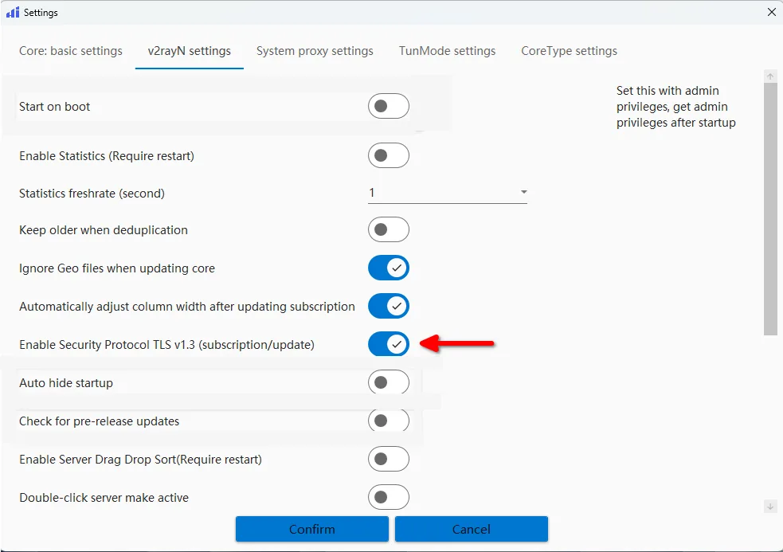

Then click `Confirm`.

### Better performance with pre-release updates

To keep the cores the program needs (Xray, sing-box) up to date and working better, go to the same place.

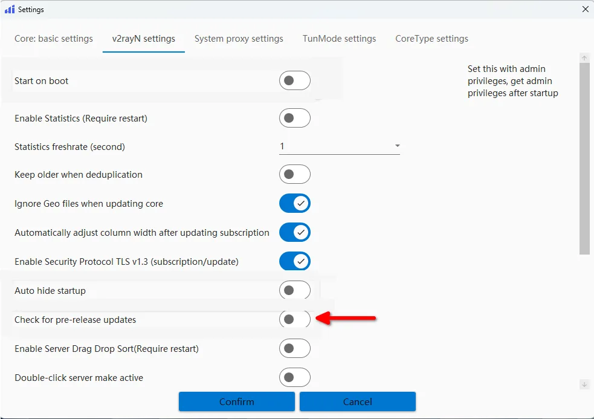

Turn on `Check for pre-release update`, then update the cores with `Check update`.

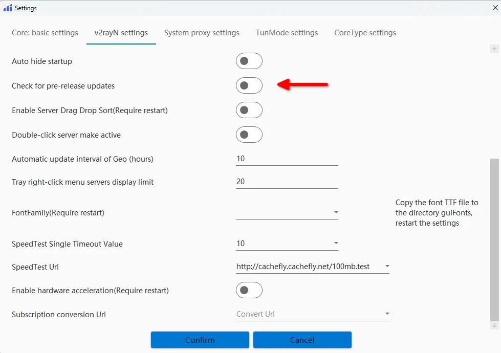

### Fix DNS leaks

- Turn on `TunMode`. It needs the sing-box core, so first download the sing-box core with the `Check update` button on the main page.

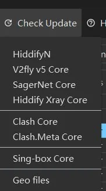

- Then go to:

`Settings > Option Setting > TunMode settings`

- Turn on `Strict Route`.
- Set `Stack` to `System`.
- Now turn on the `TunMode` button on the main page.

> Note: to turn on `TunMode`, the program must be started with `Run as administrator`.

> Note: if `TunMode` does not work for any reason, set `Stack` to `gvisor`.

### Send local sites directly, without the VPN

Even with the panel's `Lite` (green) profile, you may want the traffic of other sites to go straight to them, without the VPN. There are two ways.

#### With the System proxy settings

Go to:

`Settings > Option Setting > v2rayN settings > System proxy settings`

Type the addresses that should not go through the VPN. Separate them with `;`.

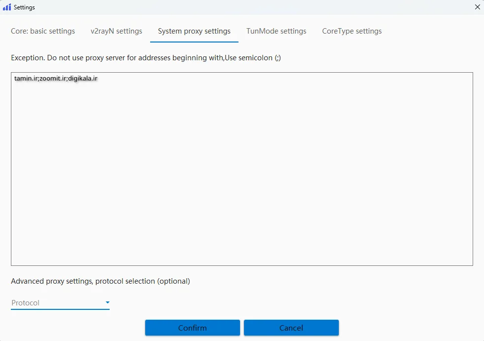

> Note: write `tamin.ir`, not `https://tamin.ir`.

#### With the Routing settings

Go to:

`Settings > Routing setting`

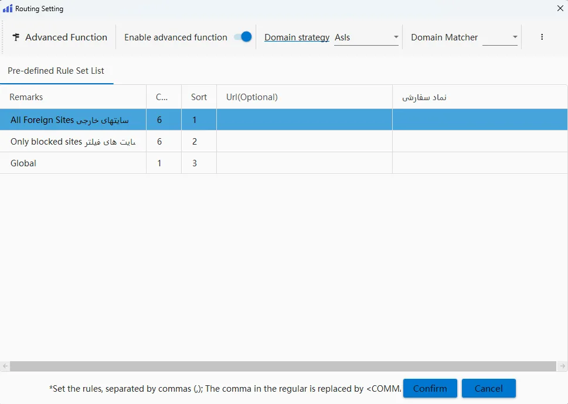

When you import the `Lite` (green) profile, the rules for local sites are already added here. To do it by hand with your own sites:

- Turn off `Enable advanced function`.
- Choose `direct domain or IP`.
- Type the domains you want. Separate several sites with `,`.
- With `block domain or ip` you can block the domains you choose.

## Related articles

- [V2rayNG](/manager/client-software-on-android/Tutorial-for-V2rayNG-app/)
- [NekoBox](/manager/client-software-on-android/Tutorial-for-Nekobox-app/)
- [sing-box](/manager/client-software-on-ios/Tutorial-for-SingBox-app/)
- [Streisand](/manager/client-software-on-ios/Tutorial-for-Streisand/)

