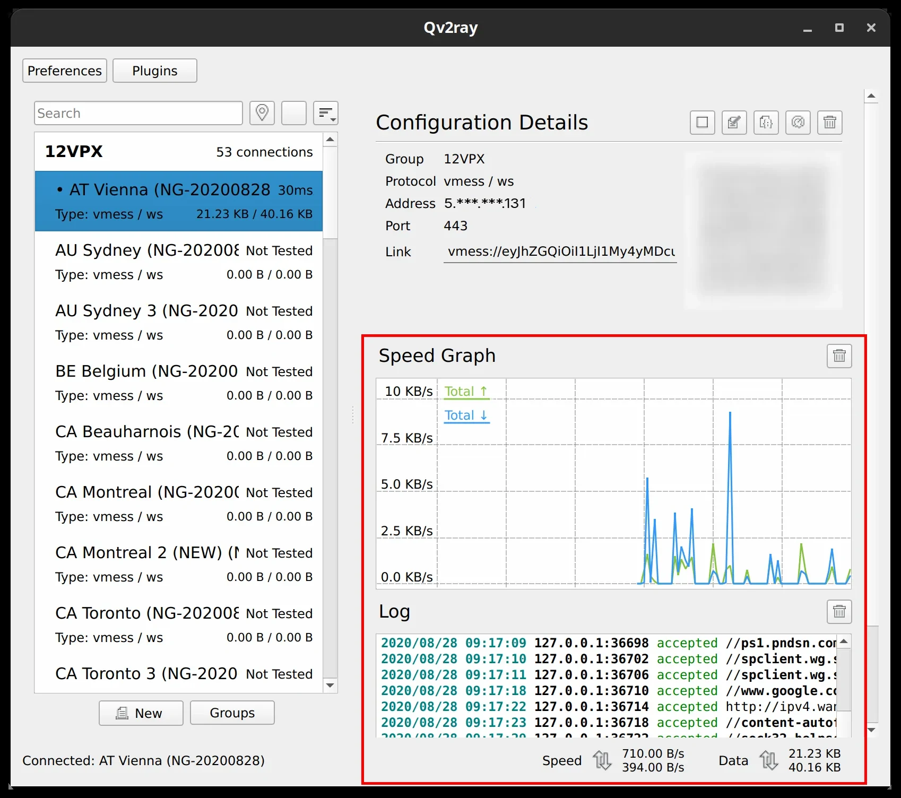

# آموزش کار با نرم‌افزار QV2ray

!!! warning "Qv2ray دیگر نگهداری نمی‌شود"
    سازندگان Qv2ray در مرداد ۱۴۰۰ (اوت ۲۰۲۱) کار روی آن را متوقف کردند؛ آخرین نسخه‌اش v2.7.0 با عنوان «The End» است. از پروتکل‌های جدیدتر مثل ریالتی، Hysteria2 و TUIC پشتیبانی نمی‌کند و وصلهٔ امنیتی هم نمی‌گیرد. به جای آن [اپ هیدیفای](/fa/app/) را پیشنهاد می‌کنیم که روی ویندوز، مک و لینوکس کار می‌کند: [نصب اپ هیدیفای](/fa/app/How-to-install-Hiddify-app/) را ببینید. این صفحه برای کسانی نگه داشته شده که هنوز از Qv2ray استفاده می‌کنند.

یکی از برنامه‌هایی که می‌توان برای اتصال به پروتکل‌های Xray روی دسکتاپ از آن استفاده نمود، برنامه QV2ray است.

## دانلود نرم‌افزار
* این برنامه را از [اینجا](https://github.com/Qv2ray/Qv2ray/releases) می‌توانید دانلود کنید.

* برای دانلود پلاگین Trojan از [اینجا](https://github.com/Qv2ray/QvPlugin-Trojan/releases) اقدام کنید.

* فایل `dll` دانلود شده پلاگین رو در مسیر نصب نرم‌افزار `QV2ray` در پوشه `Plugins` کپی کنید. از داخل نرم‌افزار در بخش `Plugins` با کلیک روی `Open Local Plugin Folder` مسیر مذکور باز می‌شود. 

* نرم‌افزار را بسته و مجددا اجرا کنید. در مسیر `Plugins` گزینه‌ای تحت عنوان `Trojan-GFW Plugins` اضافه می‌شود.

## اضافه کردن لینک سابسکریپشن
* کافیست به بخش کاربری خود در پنل بروید.
* در قسمت `همه کانفیگ‌ها`، `لینک سابسکریپشن` را کپی کنید.
* وارد بخش `Groups` در نرم‌افزار شوید.
* در تب `Subscription Setting` لینک ساب کپی شده خود را در قسمت `Subscription Address` وارد کنید.
* با زدن دکمه‌ی `Update subscription` در انتهای صفحه، کانفیگ‌ها در برنامه بارگذاری می‌شوند. 

## تست کانکشن‌ها
* پس از بارگذاری کانفیگ‌ها در مرحله قبل، در صفحه اصلی برنامه می‌توانید از آن‌ها تست اتصال بگیرید.

## آپدیت کردن لینک سابسکریپشن 
* به قسمت `Groups` بروید
* برای آپدیت خودکار مقدار مورد نظر را در قسمت `Update Interval` وارد کنید. 
* با زدن دکمه‌ی `Update subscription` در انتهای صفحه، کانفیگ‌ها مطابق با آخرین اطلاعات روی سرور به‌روزرسانی می‌شوند.

## مقاله‌های مرتبط

- [V2rayNG](/fa/manager/client-software-on-android/Tutorial-for-V2rayNG-app/)
- [NekoBox](/fa/manager/client-software-on-android/Tutorial-for-Nekobox-app/)
- [sing-box](/fa/manager/client-software-on-ios/Tutorial-for-SingBox-app/)
- [Streisand](/fa/manager/client-software-on-ios/Tutorial-for-Streisand/)

