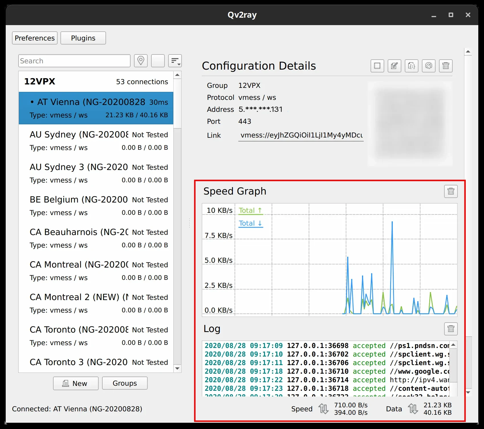

# Tutorial for QV2ray software

!!! warning "Qv2ray is no longer maintained"
    Its developers stopped Qv2ray in August 2021 (the last release is v2.7.0, "The End"). It does not support newer protocols such as Reality, Hysteria2 or TUIC, and it gets no security fixes. We recommend the [Hiddify app](/app/) instead, on Windows, macOS and Linux: see [how to install the Hiddify app](/app/How-to-install-Hiddify-app/). This page is kept for people who still use Qv2ray.

One of the programs that can be used to connect to Xray protocols on the desktop is the QV2ray program.

## Download software
- You can download this program from h[here](https://github.com/Qv2ray/Qv2ray/releases).

- Proceed [here](https://github.com/Qv2ray/QvPlugin-Trojan/releases) to download the Trojan plugin.

- Copy the downloaded `dll` file of the plugin in the installation path of the `QV2ray` software in the `Plugins` folder. From within the software, in the `Plugins` section, by clicking on `Open Local Plugin Folder`, the mentioned path will be opened.

- Close the software and run it again. In the `Plugins` path, an option called `Trojan-GFW Plugins` is added.

## Add subscription link

- Just go to your user section in the panel.
- In the `All Configurations` section, copy the `Subscription Link`.
- Enter the `Groups` section in the software.
- In the `Subscription Setting` tab, enter your copied sub link in the `Subscription Address` field.
- By clicking the `Update subscription` button at the bottom of the page, the configurations will be loaded into the program.

## Test connections

- After loading the configurations in the previous step, you can take a connection test from them on the main page of the program.

## Update the subscription link

- Go to the `Groups` section
- For automatic update, enter the desired value in the `Update Interval` section.
- By clicking the `Update subscription` button at the bottom of the page, the configurations will be updated according to the latest information on the server.

## Related articles

- [V2rayNG](/manager/client-software-on-android/Tutorial-for-V2rayNG-app/)
- [NekoBox](/manager/client-software-on-android/Tutorial-for-Nekobox-app/)
- [sing-box](/manager/client-software-on-ios/Tutorial-for-SingBox-app/)
- [Streisand](/manager/client-software-on-ios/Tutorial-for-Streisand/)

