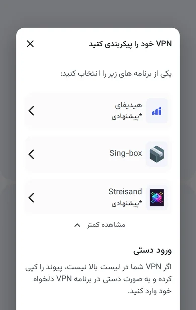
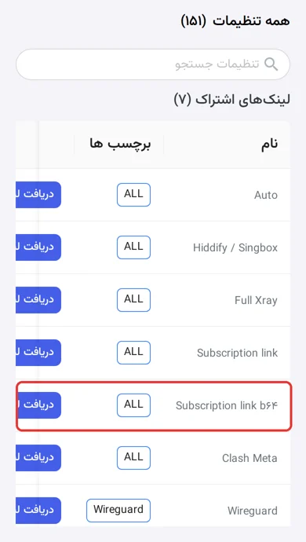
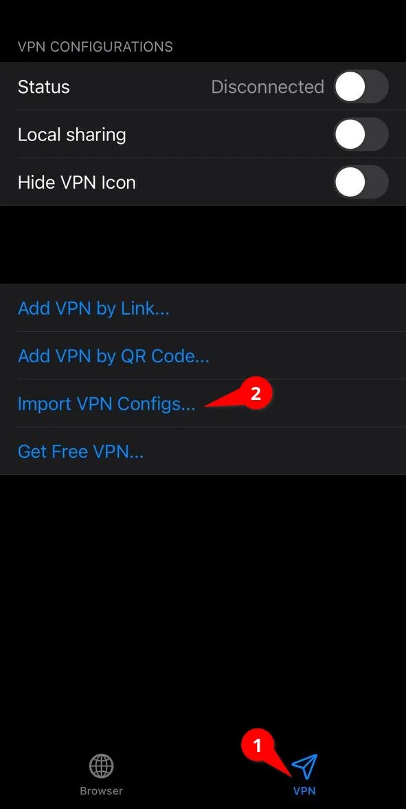
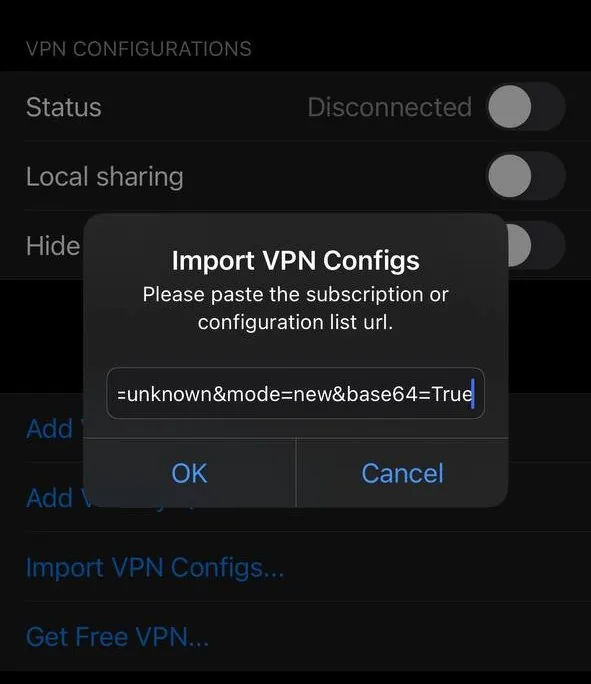
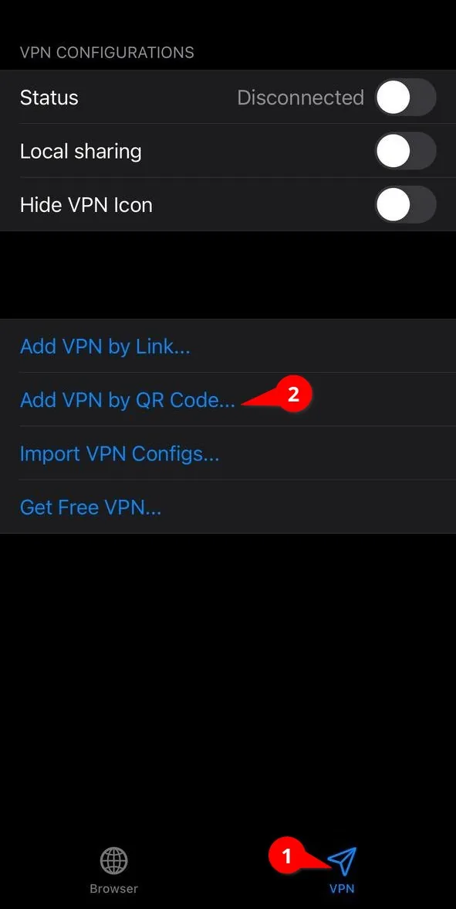
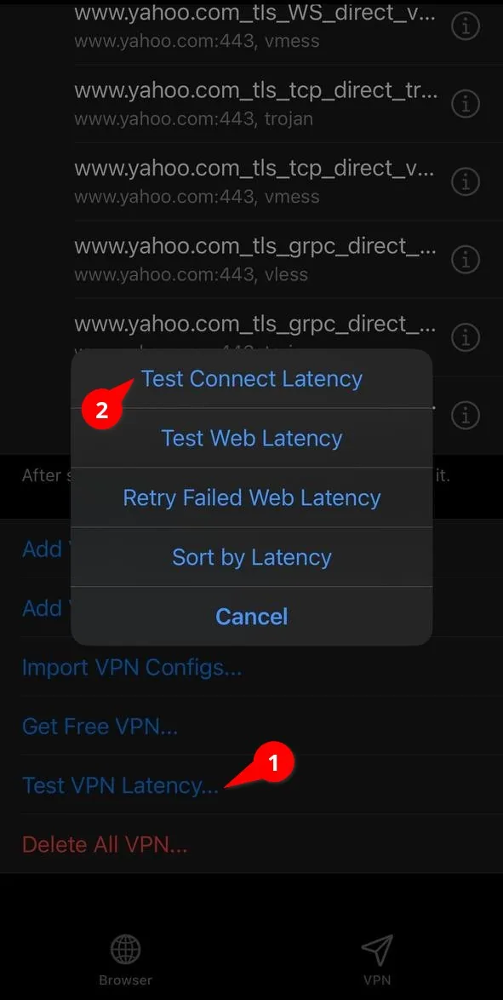
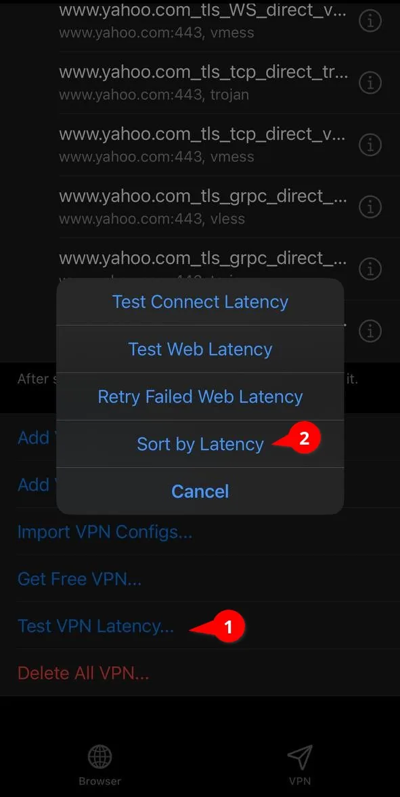
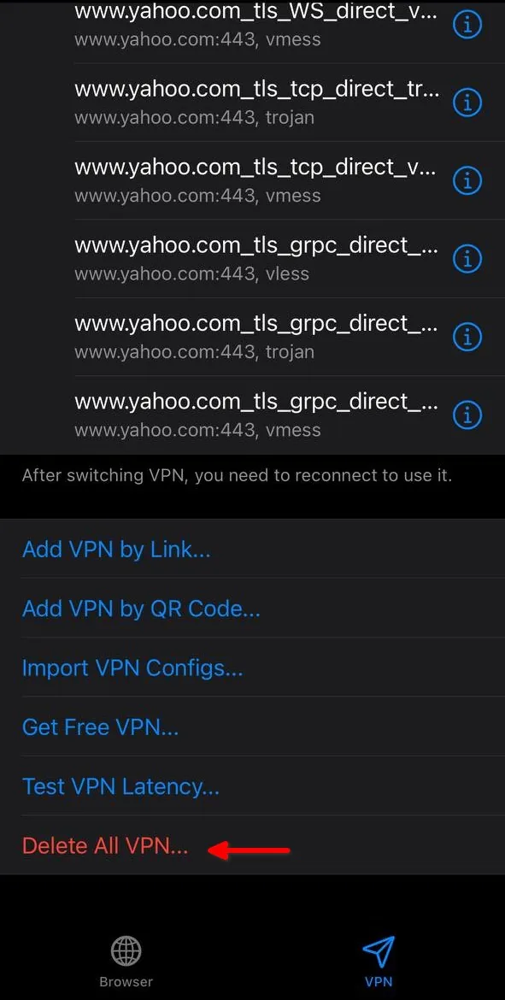
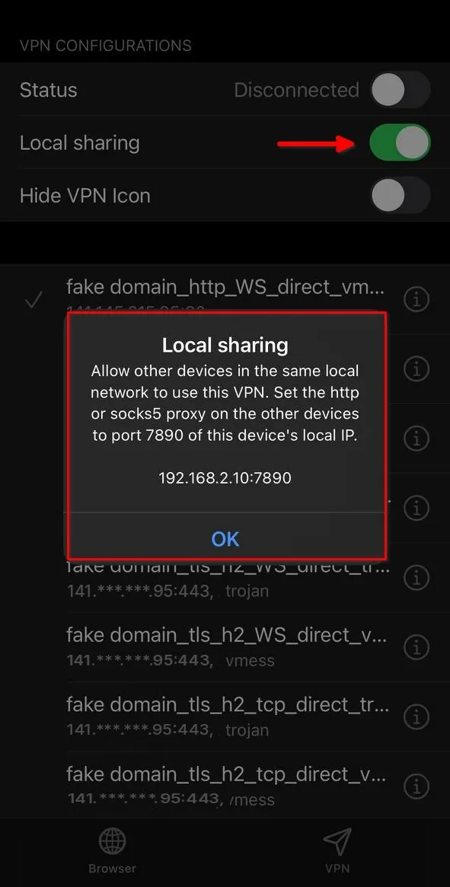

# آموزش کار با نرم‌افزار Fair VPN

در این صفحه یاد می‌گیرید چطور لینک اشتراک هیدیفای‌منیجر خود را به برنامه رایگان **Fair VPN** در آیفون و آیپد اضافه کنید، کانفیگ‌ها را تست کنید و VPN خود را با دستگاه‌های دیگر به اشتراک بگذارید.

<b>Fair VPN</b><small>v1.3.4iOS 12+رایگانآبان ۱۴۰۵</small>

<a class="hi-store" href="https://apps.apple.com/us/app/fair-vpn/id1533873488"><small>Download on the</small><b>App Store</b></a>

<a class="hi-alt" href="/fa/app/How-to-install-Hiddify-app/"><b>پیشنهاد ما: اپ هیدیفای</b><small>رایگان، ساده‌تر و با پشتیبانی از همهٔ پروتکل‌های هیدیفای‌منیجر</small>نصب اپ ←</a>

## پیش از شروع

- برنامه **Fair VPN** را از [App Store](https://apps.apple.com/us/app/fair-vpn/id1533873488) نصب کنید. این برنامه رایگان است.
- **لینک صفحه کاربری** خود را آماده داشته باشید. این همان لینکی است که مدیر سرور برایتان فرستاده و صفحه شخصی هیدیفای‌منیجر شما را باز می‌کند.

**لینک اشتراک** (سابسکریپشن) یک لینک است که همه تنظیمات اتصال شما را در خود دارد. **کانفیگ** یعنی تنظیمات یک اتصال به سرور.

## دریافت لینک اشتراک

در صفحهٔ کاربری، دکمهٔ گرد بزرگ را بزنید. در پایین پنجرهٔ باز شده، زیر **ورود دستی**، دکمهٔ **کپی لینک** لینک اشتراک را کپی می‌کند. این برنامه در فهرست برنامه‌های صفحهٔ کاربری نیست، برای همین از این دکمه استفاده کنید.

Fair VPN در فهرست برنامه‌های صفحه کاربری هیدیفای‌منیجر نیست؛ بنابراین لینک را دستی اضافه می‌کنید.

1. لینک صفحه کاربری خود را باز کنید.
2. منو را باز کنید و «همه تنظیمات» (**All Configs**) را بزنید.
3. در بخش «لینک‌های اشتراک»، ردیف **Subscription link b64** را پیدا کنید و «دریافت لینک» را بزنید. پنجره کوچکی با یک QR code و دکمه «کپی لینک» باز می‌شود.

!!! note "نکته"
    تصویرهای صفحه کاربری مربوط به نسخه قدیمی‌تر پنل هستند. ظاهر صفحه فعلی فرق دارد، اما لینک همان است.

حالا می‌توانید لینک را کپی کنید یا QR code آن را اسکن کنید.

## روش ۱: کپی کردن لینک

1. «کپی لینک» را بزنید.

    

2. برنامه Fair VPN را باز کنید. در تب `VPN` روی `Import VPN Configs` بزنید.

    

3. لینک را بچسبانید و `OK` را بزنید.

    

بعد از چند ثانیه کانفیگ‌ها به برنامه اضافه می‌شوند.

## روش ۲: اسکن QR code

اگر صفحه کاربری روی صفحه دیگری (مثلاً کامپیوتر) باز است، از این روش استفاده کنید.

1. در Fair VPN، تب `VPN` را باز کنید و از منوی پایین `Add VPN by QR Code` را بزنید.

    

2. دوربین گوشی را روی QR code صفحه کاربری بگیرید. کانفیگ‌ها مثل روش ۱ اضافه می‌شوند.

    

## تست کانفیگ‌ها

1. روی `Test VPN Latency` بزنید.
2. روی `Test Web Latency` بزنید.

برنامه از طریق هر کانفیگ یک تست واقعی انجام می‌دهد و نتیجه را کنار آن نشان می‌دهد. **Latency** (تأخیر) مدت زمان رسیدن پاسخ است؛ هرچه کمتر باشد بهتر است.

## مرتب‌سازی کانفیگ‌ها بر اساس نتیجه تست

1. روی `Test VPN Latency` بزنید.
2. `Sort by Latency` را بزنید.

کانفیگ‌ها بر اساس نتیجه تست مرتب می‌شوند و بهترین‌ها بالا قرار می‌گیرند.

## به‌روزرسانی لینک اشتراک

Fair VPN نمی‌تواند لینک اشتراک را خودش به‌روز کند. برای گرفتن آخرین کانفیگ‌ها:

1. `Delete All VPN` را بزنید تا همه کانفیگ‌ها حذف شوند.
2. لینک اشتراک را طبق مراحل بالا دوباره اضافه کنید.

!!! note "اگر مدیر سرور از Auto CDN استفاده می‌کند"
    برای گرفتن IP تمیز جدید، همه کانفیگ‌ها را با `Delete All VPN` حذف کنید. سپس VPN را خاموش کنید، صفحه کاربری را دوباره بارگذاری کنید و لینک اشتراک را دوباره اضافه کنید.

## اشتراک‌گذاری VPN با دستگاه‌های دیگر

می‌توانید VPN گوشی خود را با دستگاه دیگری که به همان Wi-Fi وصل است به اشتراک بگذارید؛ مثلاً دستگاهی که نمی‌توان روی آن برنامه VPN نصب کرد.

1. در Fair VPN، گزینه `Local Sharing` را روشن کنید. برنامه یک آدرس IP و یک پورت نشان می‌دهد.

    

2. در دستگاه دوم، **تنظیمات پروکسی** شبکه را باز کنید.
3. آدرس IP و پورتی را که Fair VPN نشان داده وارد و ذخیره کنید.

اکنون دستگاه دوم از اتصال VPN گوشی شما استفاده می‌کند.

## مقاله‌های مرتبط

- [sing-box](/fa/manager/client-software-on-ios/Tutorial-for-SingBox-app/)
- [Streisand](/fa/manager/client-software-on-ios/Tutorial-for-Streisand/)
- [V2Box](/fa/manager/client-software-on-ios/Tutorial-for-V2Box-app/)
- [FoXray](/fa/manager/client-software-on-ios/Tutorial-for-FoXray-app/)

