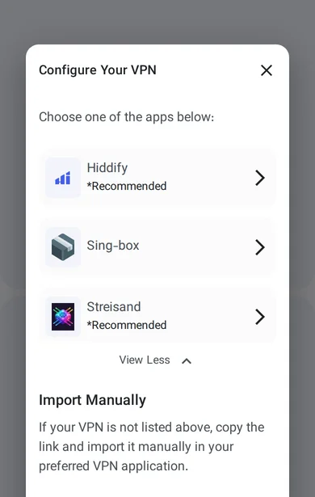
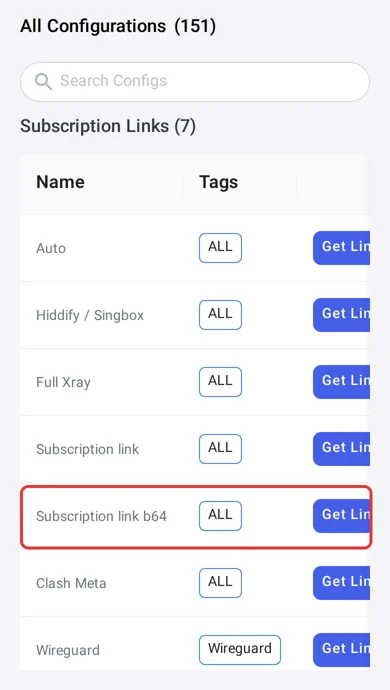
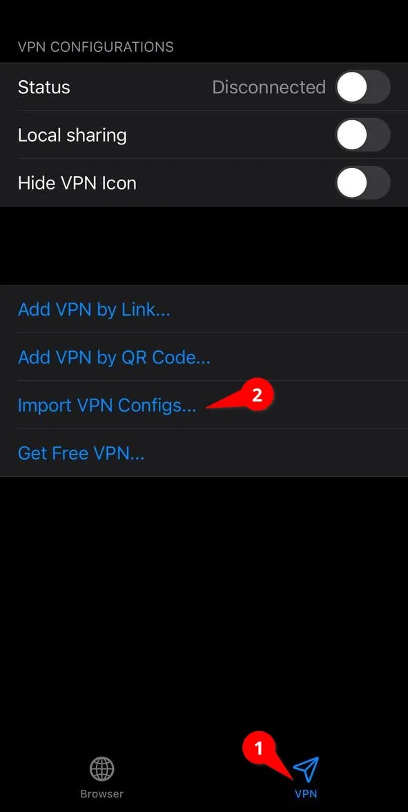
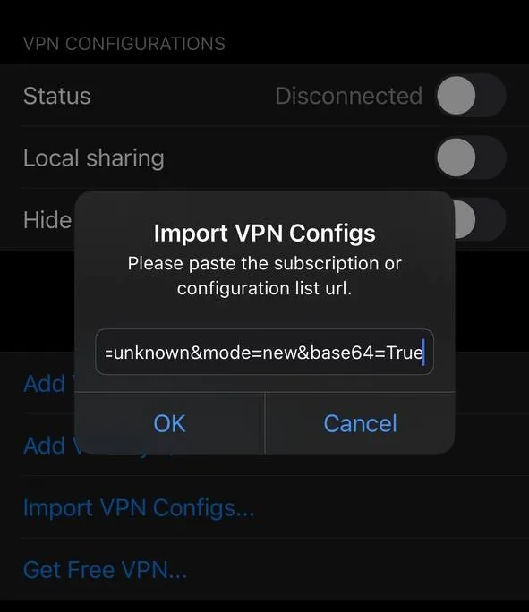
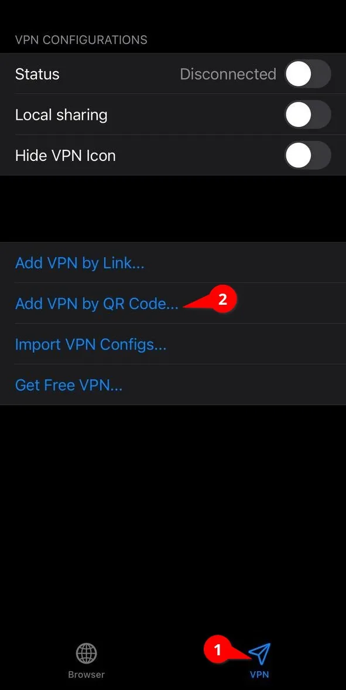
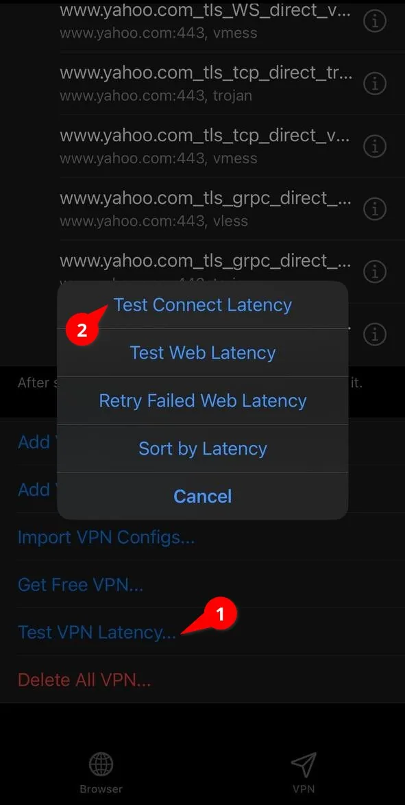
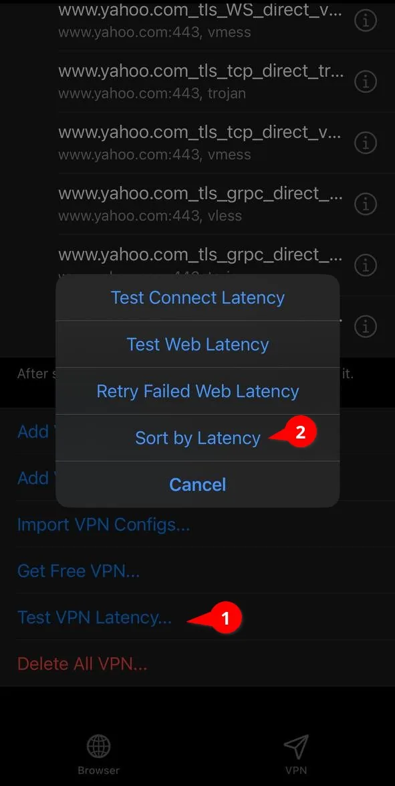
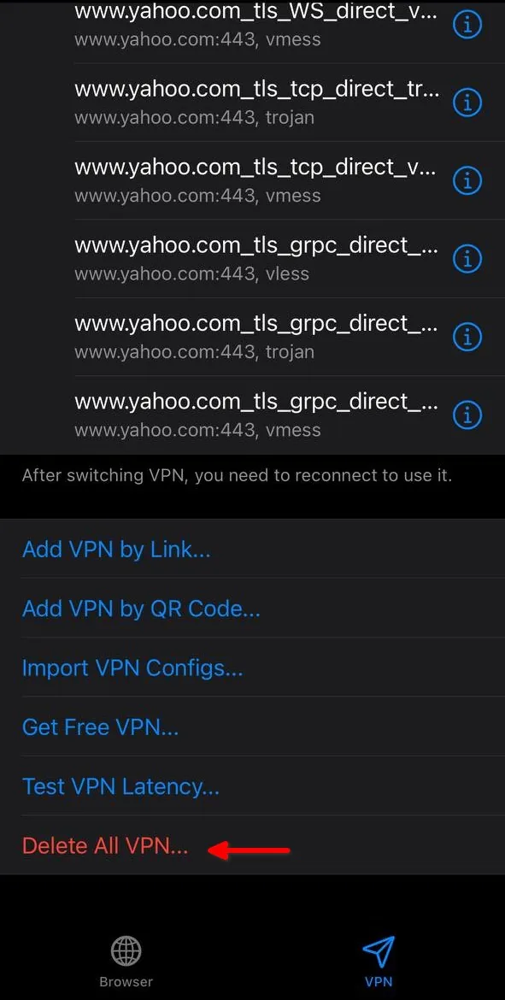
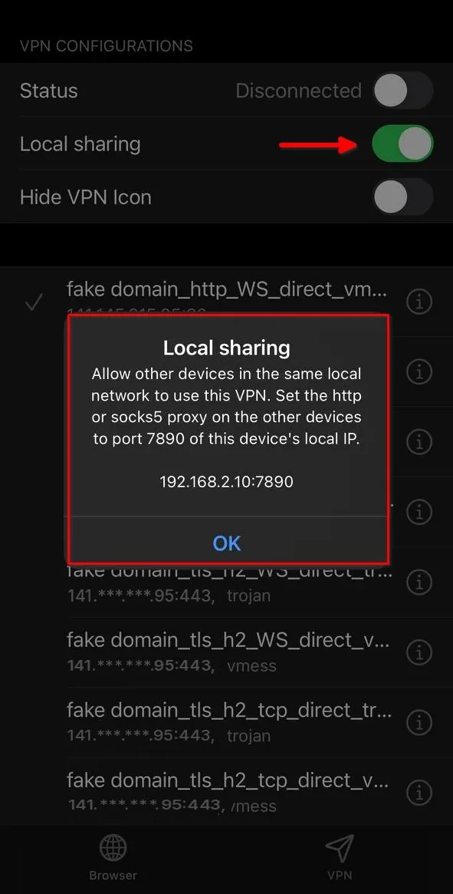

# Tutorial for Fair VPN app

This page shows you how to add your HiddifyManager subscription to the free **Fair VPN** app on iPhone and iPad, test the connections, and share your VPN with other devices.

<b>Fair VPN</b><small>v1.3.4iOS 12+FreeNov 2026</small>

<a class="hi-store" href="https://apps.apple.com/us/app/fair-vpn/id1533873488"><small>Download on the</small><b>App Store</b></a>

<a class="hi-alt" href="/app/How-to-install-Hiddify-app/"><b>Our suggestion: the Hiddify app</b><small>Free, simpler, and supports every Hiddify Manager protocol</small>Install →</a>

## Before you start

- Install **Fair VPN** from the [App Store](https://apps.apple.com/us/app/fair-vpn/id1533873488). It is free.
- Have your **user page link** ready. This is the link your server admin sent you. It opens your personal HiddifyManager page.

A **subscription link** is one link that holds all your connection settings (configs). A **config** is the settings for one connection to the server.

## Get your subscription link

On the user page, tap the big round button. At the bottom of the window, under **Import Manually**, **Copy Link** copies your subscription link. This app is not in the user page’s app list, so use this button.

Fair VPN is not in the app list on the HiddifyManager user page, so you add the link by hand.

1. Open your user page link.
2. Open the menu and tap **All Configs**.
3. In the **Subscription Links** section, find **Subscription link b64** and tap **Get Link**. A small window opens with a QR code and a **Copy Link** button.

!!! note
    The screenshots of the user page come from an older panel version. The current page looks different, but the link is the same.

Now you can either copy the link or scan its QR code.

## Option 1: Copy the link

1. Tap **Copy Link**.

    

2. Open Fair VPN. In the **VPN** tab, tap **Import VPN Configs**.

    

3. Paste the link and tap **OK**.

    

After a few seconds, your configs appear in the app.

## Option 2: Scan the QR code

Use this if the user page is open on another screen, such as a computer.

1. In Fair VPN, open the **VPN** tab and tap **Add VPN by QR Code** in the bottom menu.

    

2. Point your phone's camera at the QR code on the user page. The configs are added, just as with option 1.

    

## Test the connections

1. Tap **Test VPN Latency**.
2. Tap **Test Web Latency**.

The app makes a real test through each config and shows the result next to it. **Latency** is how long a reply takes; lower is better.

## Sort configs by test result

1. Tap **Test VPN Latency**.
2. Tap **Sort by Latency**.

The configs are now sorted by their test result, best first.

## Update your subscription

Fair VPN cannot refresh a subscription by itself. To get the latest configs:

1. Tap **Delete All VPN** to remove all configs.
2. Add the subscription link again, as shown above.

!!! note "If your admin uses Auto CDN"
    To get a new clean IP, delete all configs with **Delete All VPN**. Then turn the VPN off, reload your user page, and add the subscription link again.

## Share your VPN with other devices

You can share your phone's VPN with another device on the same Wi-Fi network, for example a device that can't install a VPN app.

1. In Fair VPN, turn on **Local Sharing**. The app shows an IP address and a port.

    

2. On the other device, open its network **proxy settings**.
3. Enter the IP address and port shown by Fair VPN, and save.

The other device now uses your phone's VPN connection.

## Related articles

- [sing-box](/manager/client-software-on-ios/Tutorial-for-SingBox-app/)
- [Streisand](/manager/client-software-on-ios/Tutorial-for-Streisand/)
- [V2Box](/manager/client-software-on-ios/Tutorial-for-V2Box-app/)
- [FoXray](/manager/client-software-on-ios/Tutorial-for-FoXray-app/)

